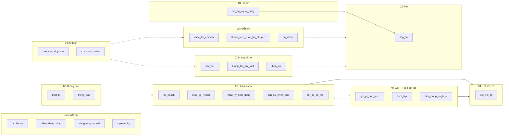

# Sơ đồ tổng quan database V1

Nguồn: `Tài liệu dự án/GymBase_V1_Thiet_ke_Database_21_bang.docx` (21 bảng nghiệp vụ) cộng 4 bảng nền
của Base. Tài liệu này là bản vẽ đề xuất, **chưa có migration nào cho 21 bảng nghiệp vụ**.

## 1. Các nhóm bảng

Mũi tên cho biết nhóm nào tham chiếu tới nhóm nào. Mọi nhóm đều tham chiếu `tai_khoan` nên không vẽ
mũi tên đó để sơ đồ đỡ rối.

Đường nét đứt là liên kết đa hình (không có khóa ngoại thật), xem [10-lien-ket-da-hinh.md](10-lien-ket-da-hinh.md).
`Coaching` và `Packages` tham chiếu lẫn nhau: `nhat_ky_hoat_dong` trỏ tới `buoi_tap`, còn `buoi_tap` trỏ tới
`muc_ke_hoach`.

## 2. Quan hệ giữa các bảng

Chỉ vẽ khóa ngoại thật. Cột chi tiết nằm ở các sơ đồ con. `tai_khoan` là bảng tài khoản của Base, hiện
đang tên `nguoi_dung` trong code.

```mermaid
erDiagram
    tai_khoan ||--o{ phien_dang_nhap : "đăng nhập trên"
    tai_khoan ||--o{ dang_nhap_ngoai : "liên kết Google"
    tai_khoan ||--o| ho_so_nguoi_dung : "có hồ sơ"
    tai_khoan ||--o{ tep_tin : "tải lên"
    tep_tin |o--o{ ho_so_nguoi_dung : "ảnh đại diện"
    tai_khoan ||--o{ bai_viet : "tác giả"
    bai_viet ||--o{ tuong_tac_bai_viet : "có"
    tai_khoan ||--o{ tuong_tac_bai_viet : "thực hiện"
    tuong_tac_bai_viet |o--o{ tuong_tac_bai_viet : "trả lời"
    tai_khoan ||--o{ theo_doi : "người theo dõi"
    tai_khoan ||--o{ theo_doi : "được theo dõi"
    tai_khoan ||--o{ ket_noi_pt : "pt"
    tai_khoan ||--o{ ket_noi_pt : "học viên"
    tai_khoan ||--o{ ket_noi_pt : "người khởi tạo"
    cuoc_tro_chuyen ||--o{ thanh_vien_cuoc_tro_chuyen : "gồm"
    tai_khoan ||--o{ thanh_vien_cuoc_tro_chuyen : "tham gia"
    cuoc_tro_chuyen ||--o{ tin_nhan : "chứa"
    tai_khoan ||--o{ tin_nhan : "gửi"
    tin_nhan |o--o{ tin_nhan : "trả lời"
    ket_noi_pt ||--o{ ke_hoach : "áp dụng"
    tai_khoan ||--o{ ke_hoach : "người tạo"
    ke_hoach ||--o{ muc_ke_hoach : "gồm"
    ket_noi_pt |o--o{ nhat_ky_hoat_dong : "phạm vi"
    muc_ke_hoach |o--o{ nhat_ky_hoat_dong : "căn cứ"
    buoi_tap |o--o{ nhat_ky_hoat_dong : "liên kết"
    tai_khoan ||--o{ nhat_ky_hoat_dong : "học viên"
    tai_khoan |o--o{ nhat_ky_hoat_dong : "người đánh giá"
    tai_khoan ||--o{ lich_su_chinh_sua : "người thực hiện"
    tai_khoan ||--o{ chi_so_co_the : "học viên"
    tai_khoan ||--o{ chi_so_co_the : "người nhập"
    ket_noi_pt |o--o{ chi_so_co_the : "chia sẻ"
    ket_noi_pt ||--o{ goi_pt_hoc_vien : "sở hữu"
    tai_khoan ||--o{ goi_pt_hoc_vien : "người tạo"
    ket_noi_pt |o--o{ buoi_tap : "thuộc"
    goi_pt_hoc_vien |o--o{ buoi_tap : "dự kiến trừ"
    muc_ke_hoach |o--o{ buoi_tap : "lịch gốc"
    tai_khoan ||--o{ buoi_tap : "học viên"
    tai_khoan |o--o{ buoi_tap : "pt phụ trách"
    tai_khoan |o--o{ buoi_tap : "người xác nhận"
    goi_pt_hoc_vien ||--o{ bien_dong_so_buoi : "biến động"
    buoi_tap |o--o{ bien_dong_so_buoi : "phát sinh"
    tai_khoan ||--o{ bien_dong_so_buoi : "người tạo"
    tai_khoan ||--o{ thiet_bi : "dùng"
    tai_khoan ||--o{ thong_bao : "nhận"
    tai_khoan ||--o{ bao_cao_vi_pham : "báo cáo"
    tai_khoan |o--o{ bao_cao_vi_pham : "xử lý"
    tai_khoan ||--o{ chan_tai_khoan : "chặn"
    tai_khoan ||--o{ chan_tai_khoan : "bị chặn"
    system_log {
        guid Id PK
    }
```

`system_log` đứng riêng vì cột `nguoi_dung` của nó chỉ là chuỗi tên đăng nhập, không phải khóa ngoại.

## 3. Cách đọc

| Ký hiệu | Ý nghĩa |
| --- | --- |
| `\|\|--o{` | Một bên bắt buộc có, bên kia có 0 hoặc nhiều |
| `\|o--o{` | Cột khóa ngoại cho phép NULL |
| `\|\|--o\|` | Quan hệ 1–1 |
| `PK`, `FK`, `UK` | Khóa chính, khóa ngoại, unique |

Các sơ đồ con: [README.md](README.md).
