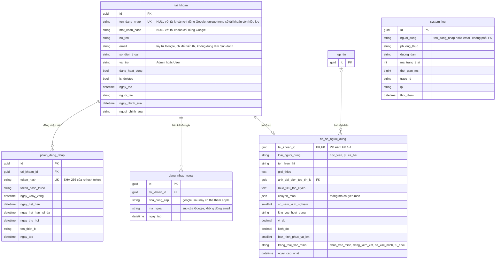
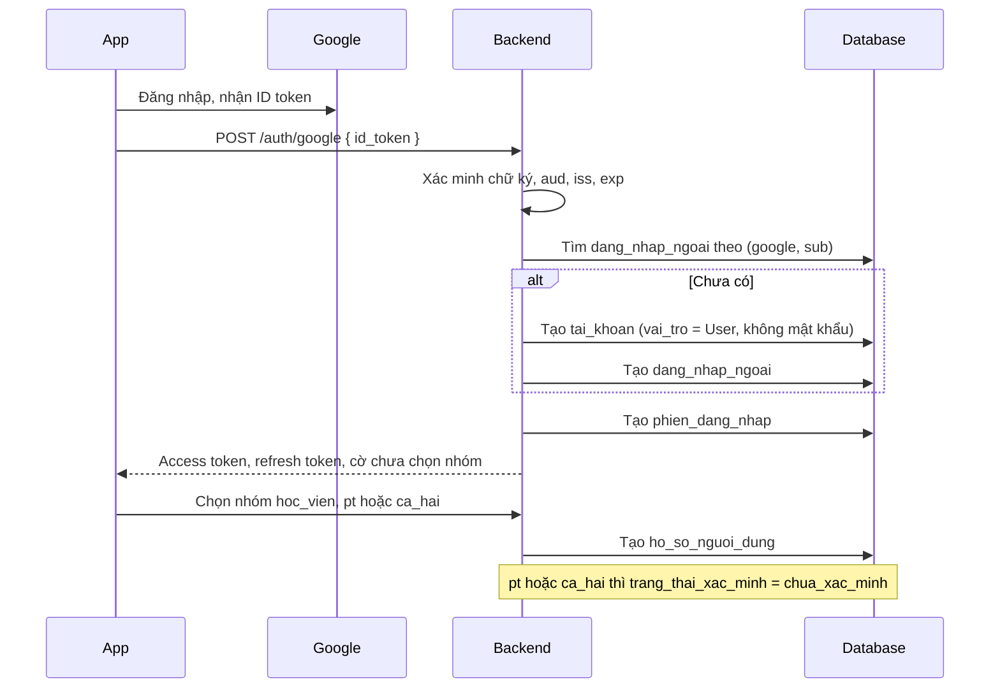
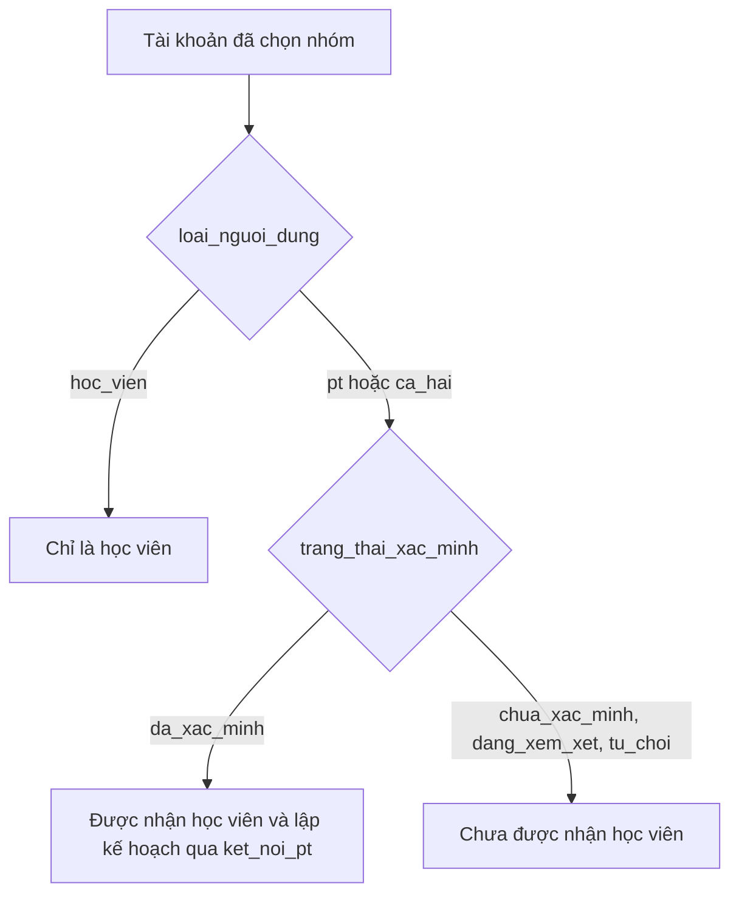

# 01. Tài khoản và hồ sơ

Gồm 4 bảng nền (`tai_khoan`, `phien_dang_nhap`, `dang_nhap_ngoai`, `system_log`) và hồ sơ người dùng.
Hỗ trợ **hai cách đăng nhập**: tên đăng nhập kèm mật khẩu, và Google.

> **Trạng thái:** trong code, bảng tài khoản hiện vẫn tên `nguoi_dung` và chưa có `dang_nhap_ngoai`. Sơ đồ này vẽ theo
> thiết kế đã chốt, sẽ khớp code sau bước đổi tên và migration `InitialBase`.

## Đăng ký bằng Google và chọn nhóm

Người lạ tự đăng ký được. Sau khi đăng nhập lần đầu, tài khoản chưa có `ho_so_nguoi_dung`, và app đưa người dùng
tới bước chọn nhóm.

## Ai được làm PT

`vai_tro` chỉ là vai trò hệ thống. Quyền làm PT dựa vào hồ sơ, không dựa vào `vai_tro`.

## Ghi chú

- `vai_tro` chỉ có `Admin` hoặc `User`. `ca_hai` (vừa là PT vừa là học viên) không còn vướng với cột `vai_tro`.
- `dang_nhap_ngoai` có hai unique: `(nha_cung_cap, ma_ngoai)` để một tài khoản Google không gắn vào hai tài khoản
  GymBase, và `(tai_khoan_id, nha_cung_cap)` để mỗi tài khoản chỉ liên kết một Google.
- `ten_dang_nhap` cho phép NULL. MySQL không có partial unique, nên dùng cột sinh tự động
  `IF(is_deleted = 0, ten_dang_nhap, NULL)` kèm unique index, cùng cách với cột `tai_khoan_hieu_luc` hiện tại.
- Cột `nguoi_tao` và `nguoi_chinh_sua` ghi `ten_dang_nhap` nếu có, không thì ghi `email`.
- `ho_so_nguoi_dung` có khóa chính là `tai_khoan_id`, nên không kế thừa `BaseEntity` và không dùng CRUD chung.
- Chưa chốt: người dùng có đổi nhóm sau khi đã chọn được không. Đề xuất: chọn một lần, đổi từ học viên sang PT
  được nhưng phải qua xác minh lại.
- Index đề xuất: `ho_so_nguoi_dung(loai_nguoi_dung, trang_thai_xac_minh)`.
- `phien_dang_nhap` và `system_log` được mô tả trong [logging.md](../../docs/api/logging.md) và
  [xac-thuc.md](../../docs/api/xac-thuc.md).
