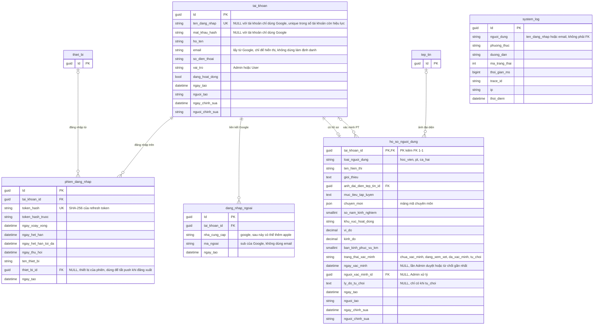
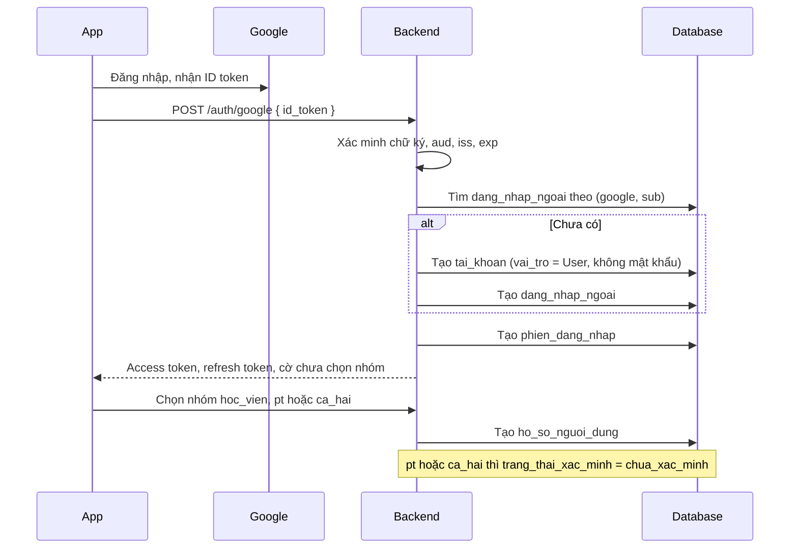
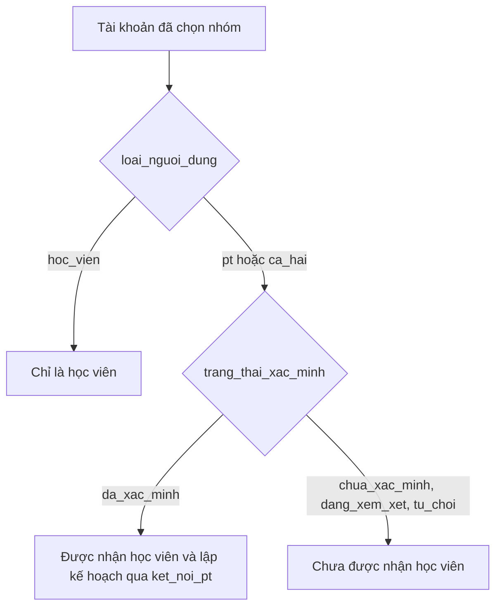

# 01. Tài khoản và hồ sơ

Gồm 4 bảng nền (`tai_khoan`, `phien_dang_nhap`, `dang_nhap_ngoai`, `system_log`) và hồ sơ người dùng.
Hỗ trợ **hai cách đăng nhập**: tên đăng nhập kèm mật khẩu, và Google.

> **Trạng thái:** entity và cấu hình EF đã đổi sang `tai_khoan` (chưa commit), nhưng các migration hiện có vẫn tạo bảng
> `nguoi_dung` và chưa có `dang_nhap_ngoai`. Sơ đồ này vẽ theo thiết kế, sẽ khớp code sau khi tạo lại migration
> `InitialBase`. Cột `phien_dang_nhap.thiet_bi_id` thêm ở migration `AddBizTables`, cùng lúc tạo `thiet_bi`.

## Đăng ký bằng Google và chọn nhóm

Người lạ tự đăng ký được. Sau khi đăng nhập lần đầu, tài khoản chưa có `ho_so_nguoi_dung`, và app đưa người dùng
tới bước chọn nhóm.

## Ai được làm PT

`vai_tro` chỉ là vai trò hệ thống. Quyền làm PT dựa vào hồ sơ, không dựa vào `vai_tro`.

## Ghi chú

- `vai_tro` chỉ có `Admin` hoặc `User`. `ca_hai` (vừa là PT vừa là học viên) không còn vướng với cột `vai_tro`.
- `dang_nhap_ngoai` có hai unique: `(nha_cung_cap, ma_ngoai)` để một tài khoản Google không gắn vào hai tài khoản
  GymBase, và `(tai_khoan_id, nha_cung_cap)` để mỗi tài khoản chỉ liên kết một Google.
- `ten_dang_nhap` cho phép NULL (tài khoản chỉ dùng Google) và là unique index thường; MySQL cho phép nhiều NULL trong unique index.
- Cột `nguoi_tao` và `nguoi_chinh_sua` ghi `ten_dang_nhap` nếu có, không thì ghi `email`.
- `ho_so_nguoi_dung` có khóa chính là `tai_khoan_id`, nên không kế thừa `BaseEntity` và không dùng CRUD chung. Bốn cột
  audit (`ngay_tao`, `nguoi_tao`, `ngay_chinh_sua`, `nguoi_chinh_sua`) giống `BaseAuditableEntity` nhưng phải khai báo và ghi
  tay. Cột `ngay_cap_nhat` của tài liệu thiết kế được thay bằng `ngay_chinh_sua`.
- Chưa chốt: người dùng có đổi nhóm sau khi đã chọn được không. Đề xuất: chọn một lần, đổi từ học viên sang PT
  được nhưng phải qua xác minh lại.
- `ngay_xac_minh`, `nguoi_xac_minh_id`, `ly_do_tu_choi` là **đề xuất thêm so với tài liệu thiết kế**: không có chúng thì
  không biết ai duyệt PT, khi nào, vì sao từ chối. Cột `ly_do_tu_choi` chỉ có giá trị khi `tu_choi`.
- Chưa chốt: V1 xác minh PT bằng gì (chứng chỉ, ảnh giấy tờ). Nếu có file thì gắn qua `tep_tin` với
  `loai_doi_tuong = ho_so_nguoi_dung` và `muc_dich` khác ảnh đại diện, xem [02-tep-tin.md](02-tep-tin.md).
- `phien_dang_nhap.thiet_bi_id` (đề xuất, cho phép NULL, `ON DELETE SET NULL`): khi đăng xuất hoặc thu hồi phiên, tắt
  `dang_hoat_dong` của `thiet_bi` tương ứng. Phiên đăng nhập từ web không có thiết bị nên để NULL.
- **Đã chốt 11/11:** người lạ tự đăng ký bằng Google ngay V1. [xac-thuc.md](../../docs/api/xac-thuc.md) mục 8 đã sửa theo.
- Index đề xuất: `ho_so_nguoi_dung(loai_nguoi_dung, trang_thai_xac_minh)`.
- `phien_dang_nhap` và `system_log` được mô tả trong [logging.md](../../docs/api/logging.md) và
  [xac-thuc.md](../../docs/api/xac-thuc.md).
