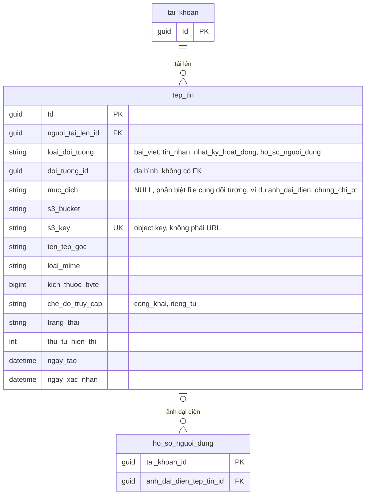
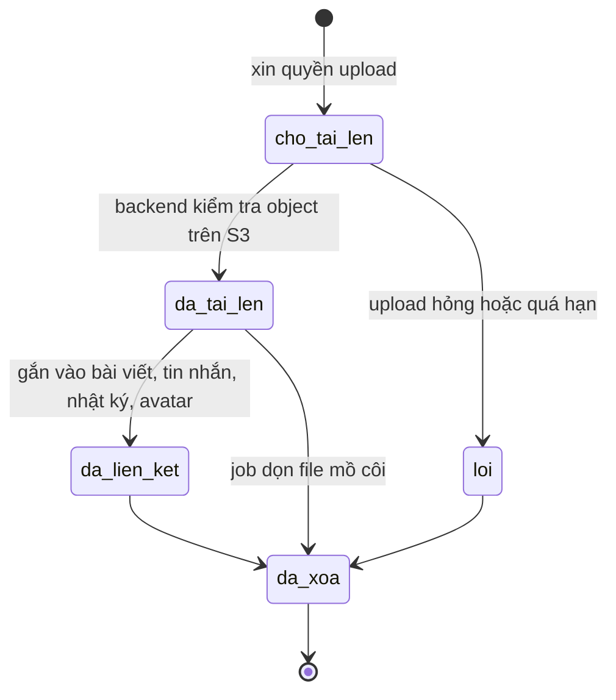
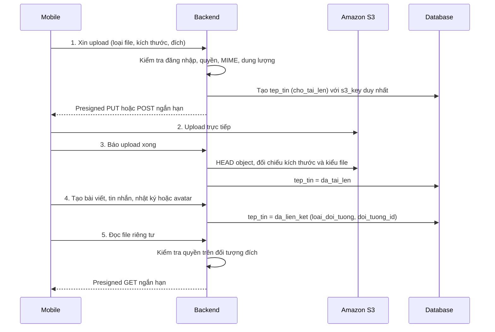

# 02. File (Amazon S3)

Một bảng `tep_tin` lưu metadata cho mọi file. Database không chứa binary, chỉ giữ khóa S3.

## Vòng đời của file

## Luồng upload

## Ghi chú

- `(loai_doi_tuong, doi_tuong_id)` không có khóa ngoại, service phải kiểm tra loại đích, chủ sở hữu và trạng thái.
- Index đề xuất: `UNIQUE(s3_key)`, `(loai_doi_tuong, doi_tuong_id)`, `(nguoi_tai_len_id, ngay_tao DESC)`.
- `s3_key` cần collation phân biệt hoa thường trên MySQL, vì S3 phân biệt còn collation mặc định thì không.
- Job nền dọn file `cho_tai_len` quá hạn và file mồ côi.
- `muc_dich` là **đề xuất thêm so với tài liệu thiết kế**. Hồ sơ có thể có nhiều loại file (ảnh đại diện, chứng chỉ PT) cùng
  gắn vào một `doi_tuong_id`, cặp `(loai_doi_tuong, doi_tuong_id)` không đủ để phân biệt. Danh sách giá trị chưa chốt.
- Ảnh đại diện có hai liên kết: FK `ho_so_nguoi_dung.anh_dai_dien_tep_tin_id` để đọc nhanh, và
  `loai_doi_tuong = ho_so_nguoi_dung`, `doi_tuong_id = tai_khoan_id`, `muc_dich = anh_dai_dien` để job dọn file nhận ra file
  đang được dùng. Service cập nhật cả hai cùng lúc.
- Có thể thêm sau (cột cho phép NULL, không cần làm ngay): `thoi_luong_giay`, `chieu_rong`, `chieu_cao` và file thu nhỏ cho
  video trên feed. Tài liệu coi xử lý video là cấu hình của Media module.
