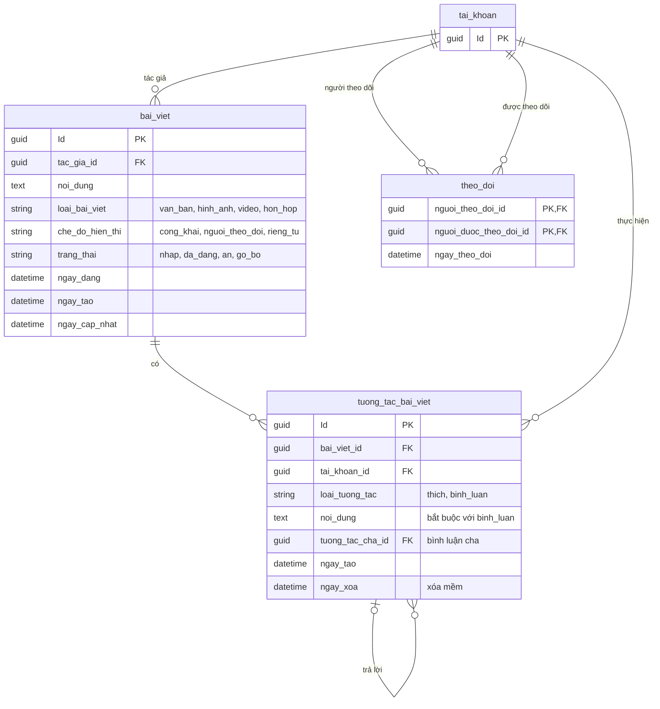

# 03. Mạng xã hội

Bài viết, thích và bình luận, theo dõi.

## Ghi chú

- Ảnh và video của bài viết gắn qua `tep_tin` (`loai_doi_tuong = bai_viet`), không có bảng riêng.
- `tuong_tac_bai_viet`: mỗi người chỉ thích một bài một lần. MySQL không có partial unique, nên dùng cột sinh tự động
  `IF(loai_tuong_tac = 'thich' AND ngay_xoa IS NULL, CONCAT(bai_viet_id, '|', tai_khoan_id), NULL)` kèm unique index.
- `tuong_tac_cha_id` chỉ được trỏ tới bình luận cùng bài viết, không trỏ tới lượt thích. Service kiểm tra.
- `theo_doi` có khóa chính kép và không được tự theo dõi (`CHECK nguoi_theo_doi_id <> nguoi_duoc_theo_doi_id`).
- Index đề xuất: `bai_viet(trang_thai, ngay_dang DESC)`, `bai_viet(tac_gia_id, ngay_dang DESC)`,
  `tuong_tac_bai_viet(bai_viet_id, loai_tuong_tac, ngay_tao DESC)`, `theo_doi(nguoi_duoc_theo_doi_id, ngay_theo_doi DESC)`.
