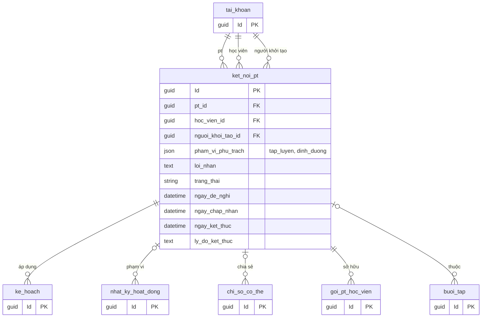
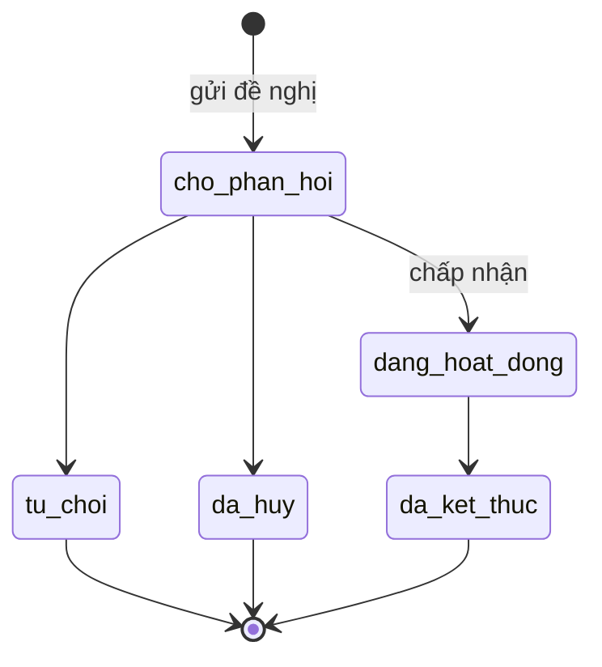

# 04. Kết nối PT

`ket_noi_pt` gộp yêu cầu thuê PT và quan hệ huấn luyện. Mỗi lần hợp tác là một dòng, nên giữ được lịch sử.
Bảng này là gốc phân quyền: PT chỉ quản lý dữ liệu thuộc kết nối `dang_hoat_dong` của mình.

## Vòng đời

Chỉ kết nối `dang_hoat_dong` mới cho PT lập hoặc cập nhật kế hoạch mới. Sau khi kết thúc vẫn xem được lịch sử theo
chính sách sau, và cặp PT với học viên có thể nối lại bằng một dòng mới.

## Ghi chú

- `pt_id` khác `hoc_vien_id` (`CHECK`).
- Mỗi cặp PT với học viên chỉ có tối đa một kết nối đang `cho_phan_hoi` hoặc `dang_hoat_dong`. Trên MySQL dùng cột sinh tự động
  `IF(trang_thai IN ('cho_phan_hoi','dang_hoat_dong'), CONCAT(pt_id, '|', hoc_vien_id), NULL)` kèm unique index.
- Index đề xuất: `(pt_id, trang_thai)`, `(hoc_vien_id, trang_thai)`.
