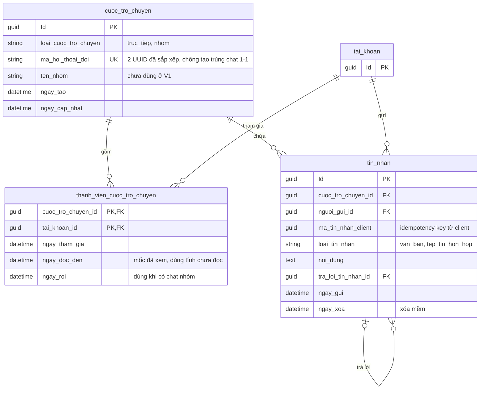

# 05. Nhắn tin

Chat 1–1 ở V1, giữ chỗ cho chat nhóm. Chat không cần có kết nối PT, nên hai người nhắn được trước khi thuê.

## Ghi chú

- File đính kèm tin nhắn gắn qua `tep_tin` (`loai_doi_tuong = tin_nhan`).
- `UNIQUE(nguoi_gui_id, ma_tin_nhan_client)` chống tin nhắn trùng khi mạng di động gửi lại.
- `ma_hoi_thoai_doi` có thể NULL (chat nhóm). MySQL cho phép nhiều NULL trong unique index nên không cần cột phụ.
- Người gửi phải là thành viên của cuộc trò chuyện và không bị chặn (`chan_tai_khoan`), do service kiểm tra.
- `thanh_vien_cuoc_tro_chuyen` có khóa chính kép. Index đề xuất: `(tai_khoan_id, ngay_tham_gia DESC)`,
  `tin_nhan(cuoc_tro_chuyen_id, ngay_gui DESC)`.
