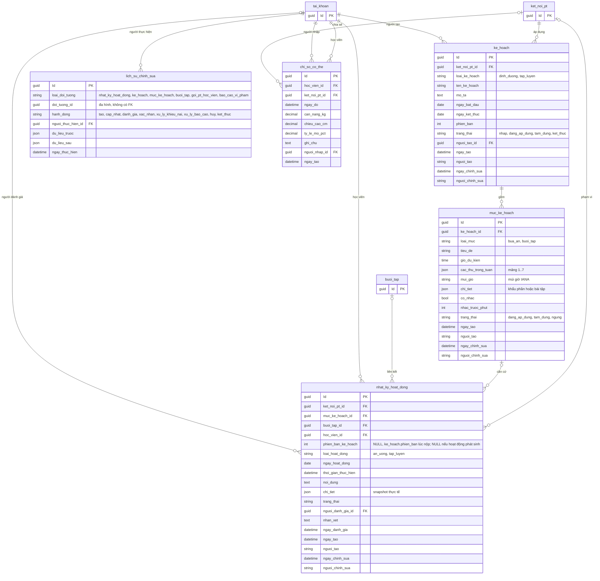
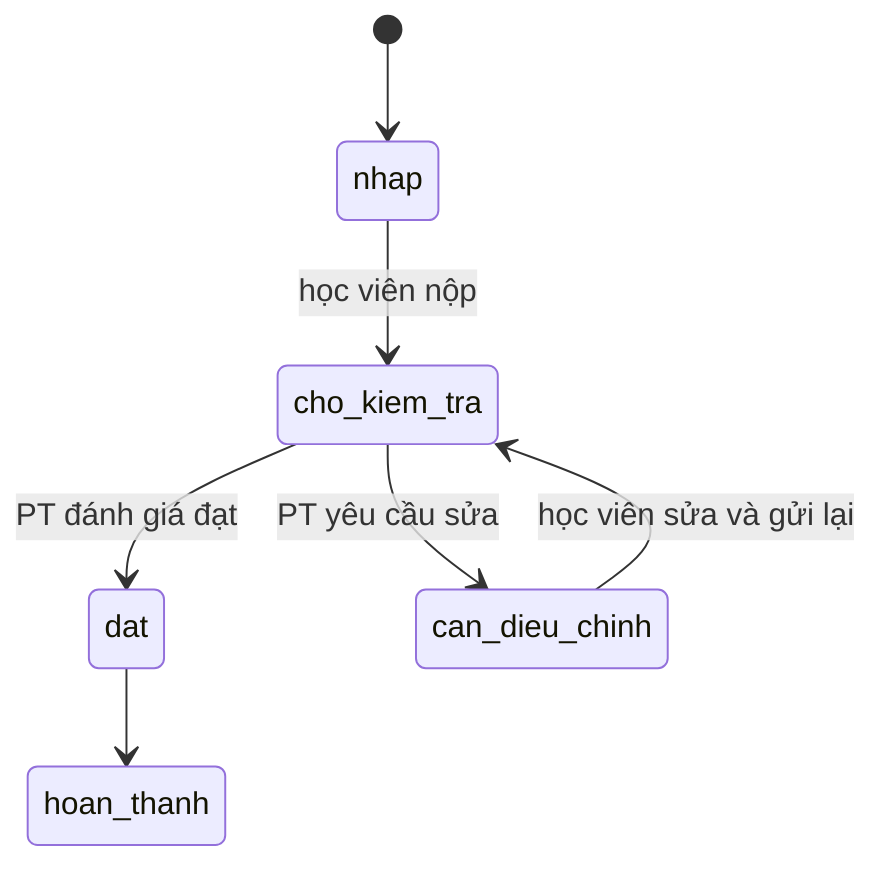
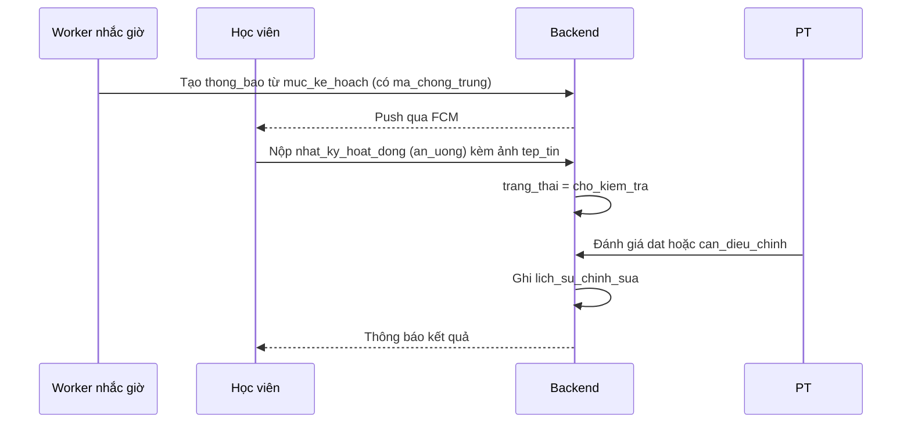

# 06. Huấn luyện và sức khỏe

Kế hoạch ăn hoặc tập, lịch lặp, nhật ký học viên nộp, lịch sử chỉnh sửa và chỉ số cơ thể.

## Vòng đời nhật ký

Tài liệu chưa mô tả khi nào nhật ký chuyển từ `dat` sang `hoan_thanh`, cần chốt trước khi viết nghiệp vụ.
Mỗi lần sửa hoặc đánh giá lại đều ghi vào `lich_su_chinh_sua`.

## Luồng báo cáo bữa ăn

## Ghi chú

- Ảnh bữa ăn gắn qua `tep_tin` (`loai_doi_tuong = nhat_ky_hoat_dong`), không có bảng `anh_bua_an`.
- `ke_hoach.phien_ban` tăng khi sửa nội dung đã áp dụng. Nhật ký lưu snapshot nên kế hoạch đổi không làm thay đổi nhật ký cũ.
- `nhat_ky_hoat_dong.phien_ban_ke_hoach` là **đề xuất thêm so với tài liệu thiết kế**. `muc_ke_hoach` được sửa tại chỗ, còn
  `chi_tiet` của nhật ký chỉ lưu phần thực tế, nên không có cách biết nhật ký cũ làm theo phiên bản kế hoạch nào. Cách
  khác: không thêm cột, mà quy định JSON `chi_tiet` có thêm khối kế hoạch lúc nộp. Cần chọn một cách.
- `lich_su_chinh_sua`: tài liệu để danh sách `loai_doi_tuong` và `hanh_dong` mở ("..."). Đề xuất danh sách đầy đủ ở sơ đồ,
  thêm `muc_ke_hoach` (sửa lịch làm tăng `phien_ban`), `goi_pt_hoc_vien` (đổi trạng thái gói) và `bao_cao_vi_pham` (tài liệu
  yêu cầu ghi lịch sử quyết định của quản trị). Khai báo ở một chỗ và dùng chung cho enum, `CHECK` và validator.
- `ke_hoach`, `muc_ke_hoach`, `nhat_ky_hoat_dong` kế thừa `BaseAuditableEntity`: bốn cột audit thay cho `ngay_cap_nhat` của tài
  liệu thiết kế, xem [README.md](README.md#quy-ước-chung-khi-làm-migration). `nguoi_tao` là chuỗi tên đăng nhập, còn
  `ke_hoach.nguoi_tao_id` vẫn giữ làm khóa ngoại nghiệp vụ.
- `lich_su_chinh_sua` và `chi_so_co_the` là bản ghi chỉ thêm, không sửa, nên chỉ kế thừa `BaseEntity` và giữ cột thời gian riêng.
- Có thể thêm sau: khóa chống gửi trùng cho `nhat_ky_hoat_dong` khi mạng di động gửi lại (như `tin_nhan.ma_tin_nhan_client`).
- `loai_muc` của mục phải khớp `loai_ke_hoach` của kế hoạch cha. Service kiểm tra, JSON `chi_tiet` kiểm tra theo schema của từng loại.
- `chi_so_co_the` không chia sẻ mặc định cho mọi PT của học viên, chỉ chia sẻ khi gắn `ket_noi_pt_id`.
- Index đề xuất: `ke_hoach(ket_noi_pt_id, loai_ke_hoach, trang_thai)`, `muc_ke_hoach(ke_hoach_id, trang_thai)`,
  `nhat_ky_hoat_dong(hoc_vien_id, ngay_hoat_dong DESC)`, `nhat_ky_hoat_dong(ket_noi_pt_id, trang_thai)`,
  `lich_su_chinh_sua(loai_doi_tuong, doi_tuong_id, ngay_thuc_hien DESC)`, `chi_so_co_the(hoc_vien_id, ngay_do DESC)`.
