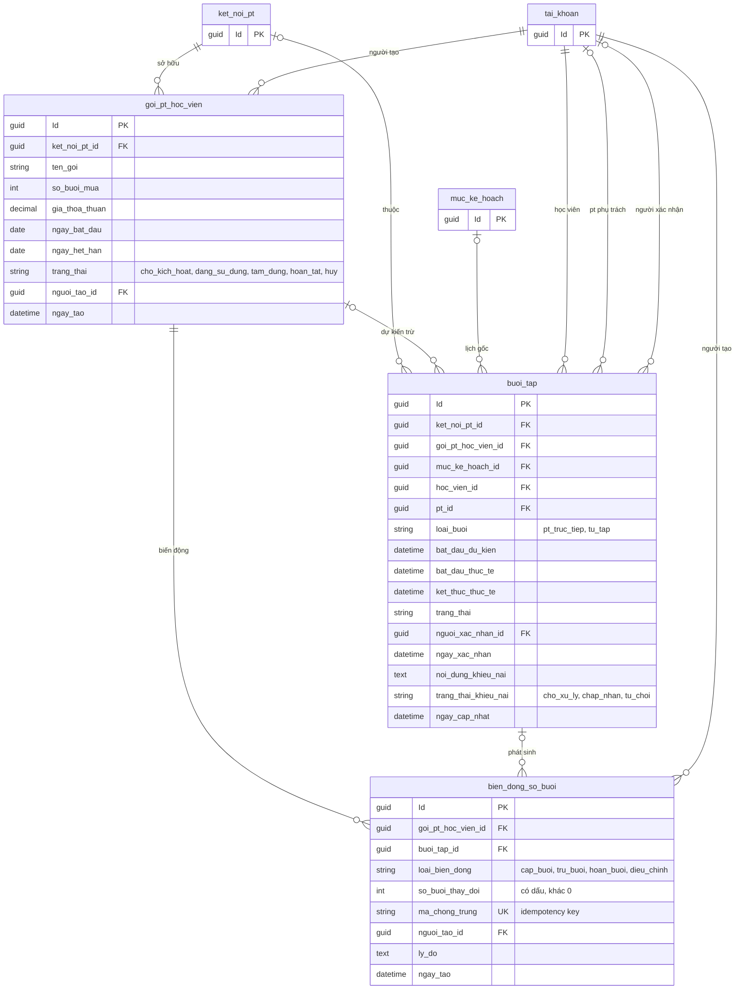
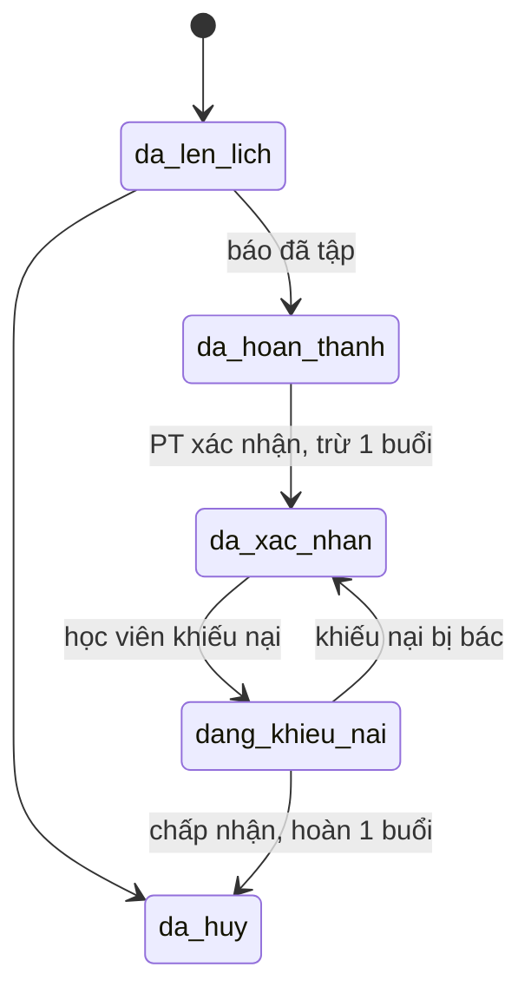
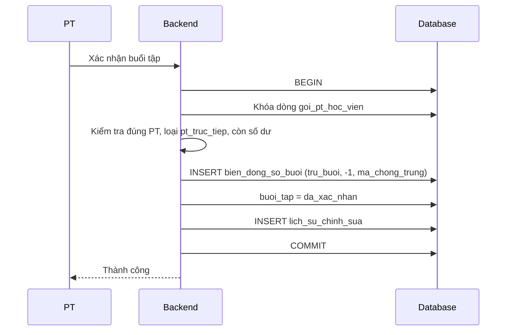

# 07. Gói PT và buổi tập

Gói buổi giữa một PT với học viên, từng buổi tập, và sổ cái biến động số buổi. Số buổi còn lại **không lưu**,
luôn tính bằng `SUM(bien_dong_so_buoi.so_buoi_thay_doi)` của gói.

## Vòng đời buổi tập

Tài liệu mô tả kết quả xử lý khiếu nại ở `trang_thai_khieu_nai` (`chap_nhan`, `tu_choi`) nhưng không nói
`trang_thai` của buổi sau đó là gì. Hai mũi tên cuối ở trên là gợi ý, **cần chốt** trước khi viết nghiệp vụ.

## Xác nhận buổi và trừ gói

Ví dụ số dư: mua 12 buổi (+12), PT xác nhận 3 buổi (−1 × 3) thì còn 9. Một khiếu nại được chấp nhận hoàn 1 buổi (+1) thì còn 10.

## Ghi chú

- `buoi_tap` loại `tu_tap` không bao giờ bị trừ gói.
- Sổ cái không được `UPDATE` hay `DELETE`, điều chỉnh bằng giao dịch bù. Trên MySQL chặn bằng trigger.
- Chặn hai lần trừ cho một buổi: cột sinh tự động `IF(loai_bien_dong = 'tru_buoi', buoi_tap_id, NULL)` kèm unique index.
- Chỉ một khiếu nại đang xử lý cho mỗi buổi (khiếu nại nằm ngay trong `buoi_tap`). Muốn nhiều vòng khiếu nại thì sau này tách bảng `phieu_khieu_nai`.
- Index đề xuất: `goi_pt_hoc_vien(ket_noi_pt_id, trang_thai)`, `buoi_tap(hoc_vien_id, bat_dau_du_kien DESC)`,
  `buoi_tap(pt_id, trang_thai)`, `buoi_tap(goi_pt_hoc_vien_id, trang_thai)`.
