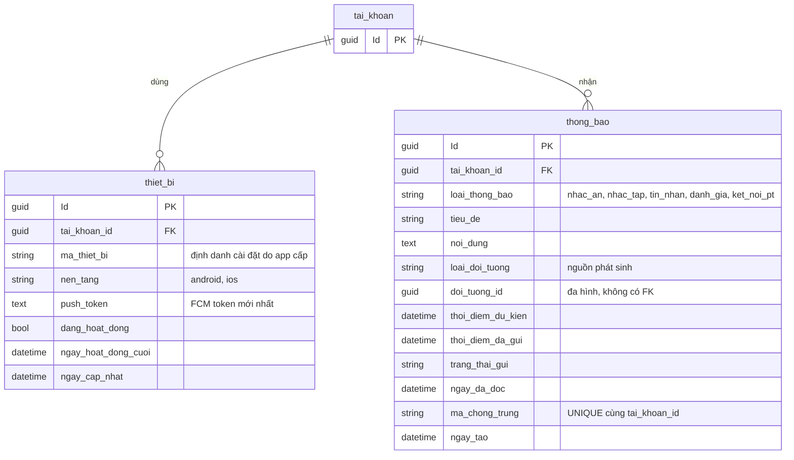
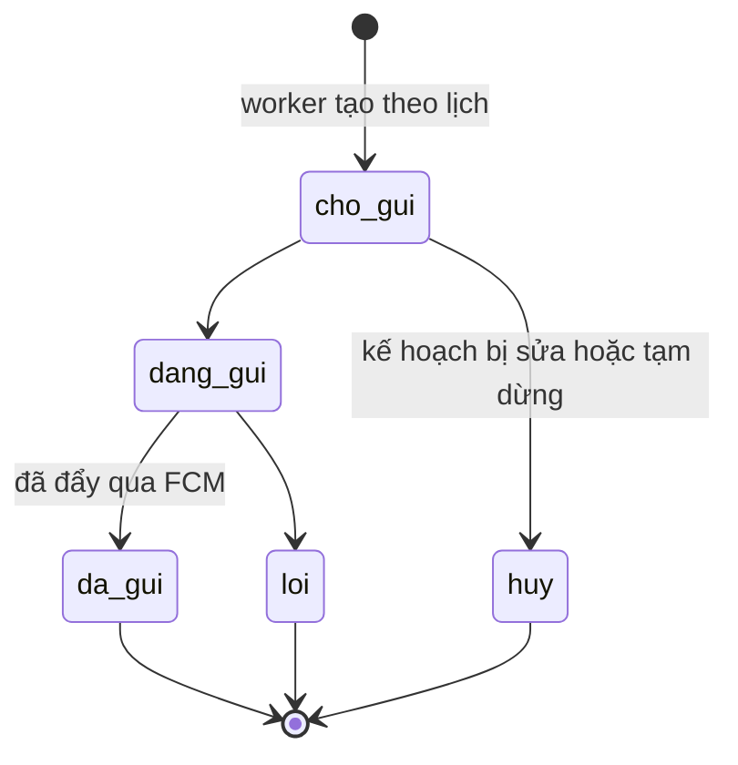
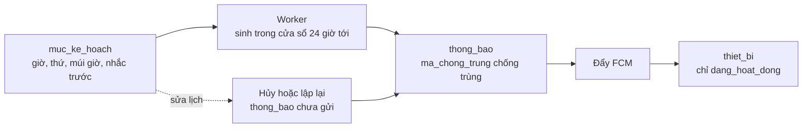

# 08. Thiết bị và thông báo

`thiet_bi` giữ push token theo từng điện thoại. `thong_bao` vừa là hộp thông báo vừa là hàng đợi nhắc giờ, nên không
cần bảng lịch nhắc riêng.

## Trạng thái gửi

`da_gui` chỉ cho biết hệ thống đã gửi yêu cầu tới dịch vụ push, không chứng minh thiết bị đã nhận hay người dùng đã đọc.
Việc người dùng đã đọc nằm ở `ngay_da_doc`.

## Luồng nhắc giờ

## Ghi chú

- `UNIQUE(tai_khoan_id, ma_thiet_bi)`; khi đăng xuất thì tắt `dang_hoat_dong` của thiết bị đó.
- `UNIQUE(tai_khoan_id, ma_chong_trung)` giúp worker và retry không tạo thông báo trùng.
- Index đề xuất: `thong_bao(trang_thai_gui, thoi_diem_du_kien)`, `thong_bao(tai_khoan_id, ngay_tao DESC)`,
  `thiet_bi(tai_khoan_id, dang_hoat_dong)`.
- `thiet_bi` chưa liên kết với `phien_dang_nhap`. Khi cần vô hiệu push theo phiên đăng nhập, phải quyết định cách nối hai bảng.
