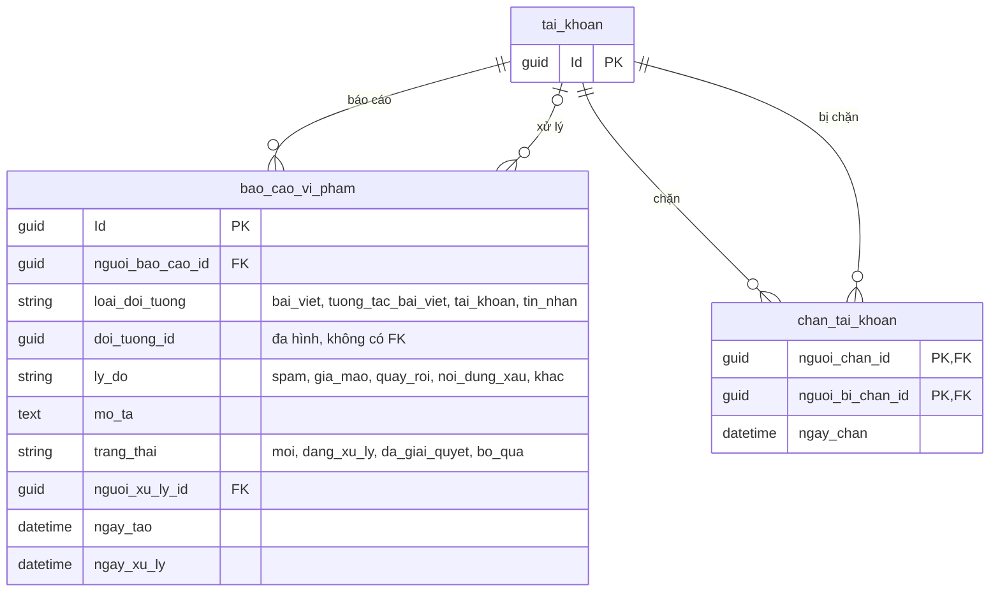

# 09. An toàn và quản trị

Báo cáo vi phạm và chặn tài khoản.

## Ghi chú

- `chan_tai_khoan` có khóa chính kép, không được tự chặn (`CHECK nguoi_chan_id <> nguoi_bi_chan_id`).
- Chặn ảnh hưởng nhắn tin, theo dõi và bình luận theo chính sách của ứng dụng, không tự xóa dữ liệu cũ.
- Quản trị viên xử lý báo cáo phải được kiểm tra quyền, và các quyết định nhạy cảm cần ghi lịch sử.
- Index đề xuất: `bao_cao_vi_pham(trang_thai, ngay_tao)`, `bao_cao_vi_pham(loai_doi_tuong, doi_tuong_id)`,
  `chan_tai_khoan(nguoi_bi_chan_id)`.
