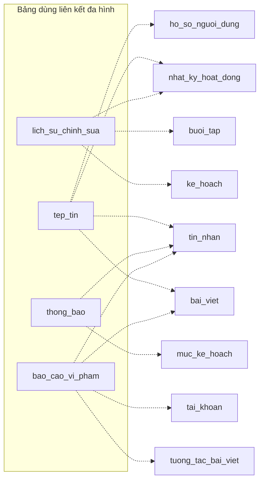

# 10. Liên kết đa hình

Bốn bảng trỏ tới bảng khác bằng cặp `(loai_doi_tuong, doi_tuong_id)`. Cặp này **không có khóa ngoại** trong database,
nên service phải kiểm tra loại đích hợp lệ, chủ sở hữu và quyền. Cần job nền kiểm tra dữ liệu mồ côi.

| Bảng nguồn | Các giá trị `loai_doi_tuong` theo tài liệu |
| --- | --- |
| `tep_tin` | `bai_viet`, `tin_nhan`, `nhat_ky_hoat_dong`, `ho_so_nguoi_dung` |
| `lich_su_chinh_sua` | `nhat_ky_hoat_dong`, `ke_hoach`, `buoi_tap` (danh sách có dấu "…", còn mở) |
| `thong_bao` | `muc_ke_hoach`, `tin_nhan` (còn mở, ví dụ trong tài liệu) |
| `bao_cao_vi_pham` | `bai_viet`, `tuong_tac_bai_viet`, `tai_khoan`, `tin_nhan` |

## Quy ước đề xuất

- Mỗi bảng có một danh sách `loai_doi_tuong` hợp lệ khai báo ở một chỗ (enum kèm `CHECK`), không để chuỗi tự do.
- Mỗi loại có một hàm kiểm tra: đối tượng còn tồn tại, người thao tác có quyền trên đối tượng đó.
- Job dọn dữ liệu mồ côi chạy định kỳ cho cả bốn bảng.
- Nếu sau này có yêu cầu truy vết nghiêm ngặt hơn, có thể thêm bảng liên kết riêng cho từng module mà không đổi cấu trúc khóa S3.
