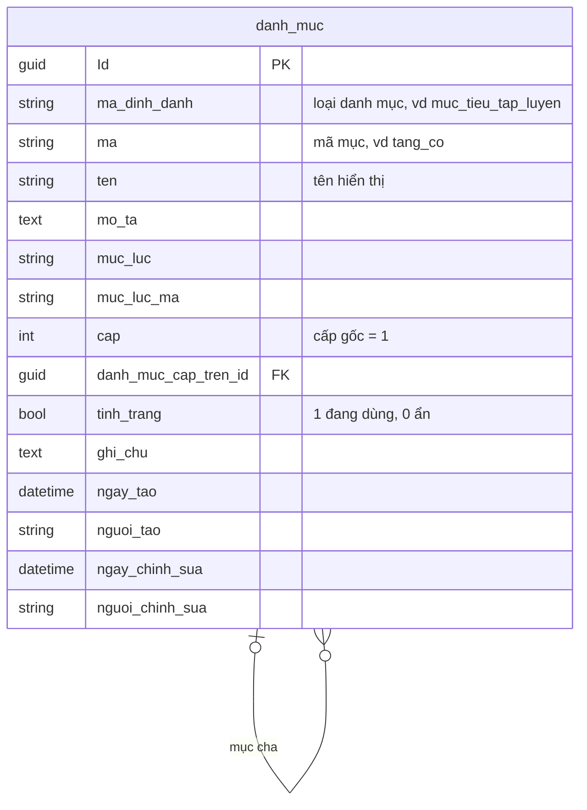

# 11. Danh mục

Bảng `danh_muc` là dữ liệu tham chiếu dùng chung cho dropdown của app và cho việc kiểm tra mã khi lưu hồ sơ. Khác với
các bảng nghiệp vụ, bảng này **không có khóa ngoại tới bảng khác** (chỉ tự tham chiếu để dựng cây), nên đứng riêng
trong sơ đồ tổng quan.

Đã triển khai bằng migration `ThemBangDanhMuc` (kèm dữ liệu tham chiếu). Chi tiết API và cách sửa dữ liệu:
[docs/api/danh-muc.md](../../docs/api/danh-muc.md).



## 1. Khóa và ràng buộc

| Ràng buộc | Cột | Ghi chú |
| --- | --- | --- |
| PK | `Id` | UUIDv7, lưu `varchar(36)` |
| Unique | `(ma_dinh_danh, ma)` | Một mã dùng được ở nhiều loại |
| Index | `muc_luc_ma` | Lọc cây con theo đường dẫn mã |
| Index | `danh_muc_cap_tren_id` | Lấy mục con của một mục |
| FK | `danh_muc_cap_tren_id → danh_muc.Id` | `RESTRICT`: còn mục con thì không xóa mục cha |

## 2. Quy ước dữ liệu

- `ma_dinh_danh` là namespace, không phải khóa ngoại: thêm loại mới chỉ cần thêm dòng, không sửa schema.
- `ma` viết snake_case không dấu, không đổi sau khi đã có hồ sơ tham chiếu; đổi tên hiển thị thì sửa `ten`.
- `tinh_trang = 0` để ẩn mục khỏi dropdown mà không phá dữ liệu cũ.
- Đợt này danh mục **phẳng**: `cap = 1`, `danh_muc_cap_tren_id = NULL`, `muc_luc = ma`,
  `muc_luc_ma = '<ma_dinh_danh>/<ma>'`. Cây nhiều cấp (khu vực → quận/huyện) chưa chốt định dạng đường dẫn; xem
  `// TODO(DANH-MUC)` trong entity.
- API đã đọc được mục con theo `ma_cap_tren` (xem [docs/api/danh-muc.md](../../docs/api/danh-muc.md)); dữ liệu cấp 2
  chưa được nạp.

## 3. Truy vấn thường dùng

```sql
-- Mọi mục đang dùng của một loại
SELECT ma, ten FROM danh_muc
WHERE ma_dinh_danh = 'khu_vuc' AND tinh_trang = 1
ORDER BY ten;

-- Ẩn một mục mà không xóa
UPDATE danh_muc SET tinh_trang = 0
WHERE ma_dinh_danh = 'khu_vuc' AND ma = 'hue';
```

Thứ tự hiển thị hiện sắp theo `ten`; bảng chưa có cột thứ tự tự chọn (kéo-thả) — thêm cột khi cần.
