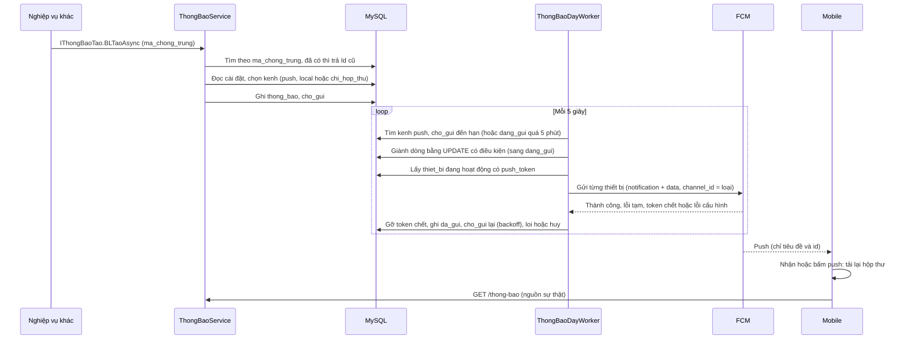
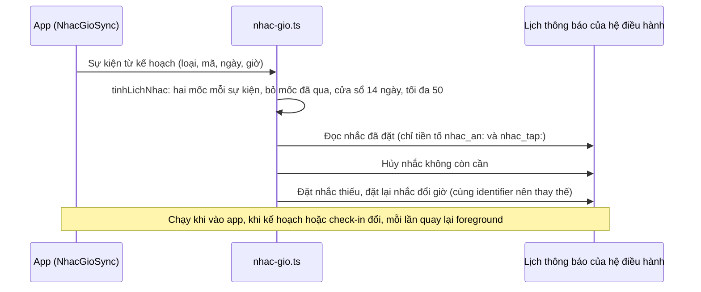
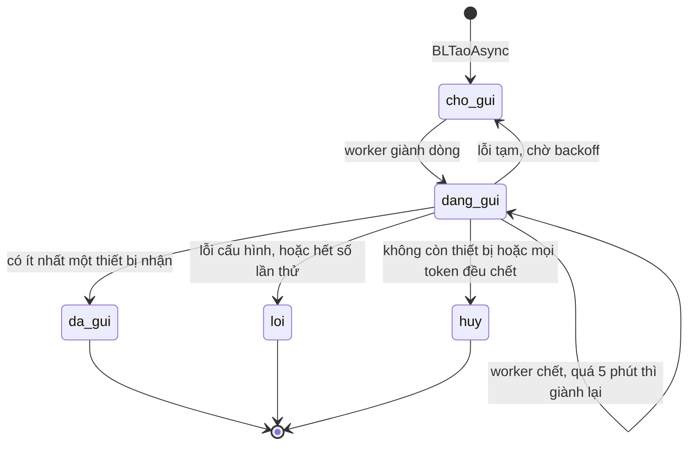

# Thông báo: thiết kế chi tiết

> **Ngày viết:** 25/11/2026 · **Trạng thái:** đã triển khai (hộp thư, đăng ký thiết bị, worker đẩy push, `FcmPushSender`, nhắc ăn và nhắc tập đặt lịch trên máy, màn thông báo và chuông ở header); chưa làm: thử `FcmPushSender` với Firebase thật, cài đặt bật/tắt từng loại (có bảng, chưa có API), push dự phòng khi lịch local không phủ được, đồng bộ nhắc theo lộ trình thật (đang dùng kế hoạch mẫu), nút bấm push mở đúng màn khi app đã tắt hẳn, iOS, transaction chung với nghiệp vụ sinh thông báo, dọn dòng `thong_bao` cũ · **Đối chiếu code:** 19d49ec

Quyết định và lý do: [ADR-2](../adr/0002-thong-bao-day-bang-fcm-truc-tiep-outbox.md). Tài liệu này mô tả cách làm. Cách thiết lập Firebase,
chạy thử và xử lý sự cố: [thong-bao-fcm.md](../onboarding/thong-bao-fcm.md). Bảng `thong_bao`, `thiet_bi`:
[database/diagrams/08-thong-bao.md](../../database/diagrams/08-thong-bao.md) (sơ đồ này còn là bản thiết kế cũ, chưa có cột `kenh`, `so_lan_thu`,
`thoi_diem_thu_lai`, `thoi_diem_nhan`, `mui_gio` và bảng `cai_dat_thong_bao`; xem mục 2 và 9).

## 1. Thành phần

Hai đường tới người dùng, cùng nằm trên một hộp thư:

```text
Nghiệp vụ khác ──IThongBaoTao──▶ thong_bao (MySQL) ◀── App: GET /thong-bao (nguồn sự thật)
                                     │
                       kenh = push   │   kenh = local, chi_hop_thu
                                     ▼                │
                          ThongBaoDayWorker           └─▶ chỉ nằm trong hộp thư
                                     │
                                IPushSender ──▶ FCM ──▶ Android (iOS: chưa làm)

App tự đặt lịch trên máy (nhắc ăn, nhắc tập): kế hoạch ──▶ dongBoNhacGioAsync ──▶ lịch hệ thống, không qua server
```

| Thành phần | Việc |
| --- | --- |
| `ThongBaoController`, `ThietBiController` (mob) | Các endpoint mục 3; chỉ gọi BL |
| `ThongBaoService` (`GymBase.BLThongBao`, cài `IThongBaoTao`) | Tạo dòng hộp thư (chống trùng, chọn kênh), đọc hộp thư, đánh dấu đã đọc |
| `IThongBaoTao` (`ModuleContracts/ThongBao`) | Hợp đồng để nhóm khác tạo thông báo mà không tham chiếu `BLThongBao` |
| `ThietBiService` | Đăng ký thiết bị và push token (upsert), gỡ khi đăng xuất, múi giờ |
| `ThongBaoDayWorker` + `ThongBaoDayService` | Quét dòng kênh `push` đến hạn, giành dòng, gửi, ghi kết quả, retry |
| `IPushSender` | Seam gửi push: `LogPushSender` (mặc định) hoặc `FcmPushSender` (FCM HTTP v1) |
| `IFcmAccessTokenProvider` / `GoogleFcmAccessTokenProvider` | Lấy access token OAuth từ file service account |
| `ThongBaoPolicy` | Ưu tiên, TTL và kênh mặc định theo loại thông báo |
| `ThongBaoSync` (mobile) | Tạo kênh, xin quyền, đăng ký thiết bị, tải lại hộp thư khi có sự kiện |
| `NhacGioSync` + `nhac-gio.ts` (mobile) | Tính và đồng bộ lịch nhắc ăn, nhắc tập trên máy |
| `thong-bao-screen`, chuông ở header (mobile) | Hộp thư, đánh dấu đã đọc, huy hiệu chưa đọc |

### Sơ đồ tuần tự

Tạo thông báo và đẩy push:



Nhắc ăn và nhắc tập trên máy:



## 2. Trạng thái `thong_bao`

`thong_bao` là nguồn sự thật. `kenh` quyết định dòng có đi qua worker hay không; `trang_thai_gui` chỉ có nghĩa với kênh `push`.

| `kenh` | Khi nào | Worker | Hiện ở hộp thư |
| --- | --- | --- | --- |
| `push` | Loại thông báo mặc định (`tin_nhan`, `danh_gia`, `ket_noi_pt`) | Gửi qua FCM | Có |
| `local` | `nhac_an`, `nhac_tap`: app tự đặt lịch trên máy | Bỏ qua | Có, từ `thoi_diem_du_kien` |
| `chi_hop_thu` | Người dùng đã tắt loại này (bảng `cai_dat_thong_bao`) | Bỏ qua | Có, không chuông |



- Dòng kênh `local` và `chi_hop_thu` đứng yên ở `cho_gui`, worker không bao giờ nhặt (truy vấn lọc `kenh = push`).
- `da_gui` chỉ cho biết ít nhất một thiết bị được FCM nhận, không chứng minh người dùng đã thấy. Việc đã đọc nằm ở `ngay_da_doc`.
- `huy` vẫn để dòng trong hộp thư; người dùng đăng nhập lại ở máy khác thì vẫn thấy.
- Cột theo dõi gửi: `so_lan_thu`, `thoi_diem_thu_lai` (chờ tới mốc này mới thử lại), `thoi_diem_nhan` (mốc giành dòng, để biết worker chết), `thoi_diem_da_gui`.
- Index: unique `(tai_khoan_id, ma_chong_trung)`; `(kenh, trang_thai_gui, thoi_diem_du_kien)` cho worker; `(tai_khoan_id, ngay_tao desc)` cho hộp thư.

## 3. API

Tất cả dưới `/api/v1/mob`, yêu cầu đăng nhập. Route theo quy ước kebab-case; hàm BL đặt tên tiếng Việt theo việc (`BLLayHopThuAsync`,
`BLDanhDauDaDocAsync`, `BLDangKyAsync`).

### 3.1 Hộp thư: `GET /thong-bao`

Query: `chi_chua_doc`, `bo_qua`, `so_luong` (tối đa 50, kẹp trong khoảng 1 đến 50). Trả `{ "data": [...], "con_nua": true }`, mới nhất trước, **chỉ gồm dòng đã tới giờ**
(`thoi_diem_du_kien <= now`), nên nhắc hẹn giờ chưa tới thì chưa hiện. Mỗi phần tử: `id`, `loai_thong_bao`, `tieu_de`, `noi_dung`, `loai_doi_tuong`, `doi_tuong_id`,
`thoi_diem_du_kien`, đã đọc hay chưa.

Phân trang bằng `bo_qua` chứ không bằng con trỏ. Dòng mới chen vào giữa các lần tải làm lệch trang, nên app bỏ trùng theo `id` (`useHopThu`). Lý do chọn cách
này: hộp thư của một người ít dòng, lệch một dòng không hại.

### 3.2 Đếm và đánh dấu đã đọc

| Việc | Gọi | Ghi chú |
| --- | --- | --- |
| Số chưa đọc | `GET /thong-bao/so-chua-doc` → `{ "so_chua_doc": 3 }` | Cho chấm trên chuông; cùng điều kiện "đã tới giờ" |
| Đã đọc một dòng | `POST /thong-bao/{id}/da-doc` → 204 | Gọi lại giữ mốc đọc đầu tiên; dòng của người khác báo 404, không lộ là có tồn tại |
| Đã đọc tất cả | `POST /thong-bao/da-doc-tat-ca` → `{ "so_dong": n }` | Một câu `UPDATE` |

### 3.3 Đăng ký thiết bị: `PUT /thiet-bi` và `DELETE /thiet-bi/{maThietBi}`

```json
{ "ma_thiet_bi": "…", "nen_tang": "android", "push_token": "…", "mui_gio": "Asia/Ho_Chi_Minh" }
```

BL kiểm: `ma_thiet_bi` bắt buộc, tối đa 128 ký tự; `nen_tang` là `android` hoặc `ios`; `push_token` tối đa 512 ký tự (trống thì lưu null); `mui_gio` đúng dạng tên IANA, tối đa 64 ký tự.

Đăng ký là **upsert theo `(tai_khoan_id, ma_thiet_bi)`** và luôn đặt `dang_hoat_dong = true`. Hai tình huống đua nhau ở unique index, mỗi bên được thử lại một lần:

- Hai request cùng chuyển một token: `push_token` unique, nên trước khi ghi phải gỡ token khỏi dòng đang giữ nó (`DLReleasePushTokenAsync`). Người đăng xuất rồi người khác đăng nhập cùng
  máy nhờ đó không nhận thông báo của người trước.
- Hai request cùng đăng ký một thiết bị mới (app đồng bộ nhiều lần cùng lúc): bên thua cập nhật lên dòng bên thắng.

`DELETE` gỡ token của thiết bị (không xóa dòng); không có thiết bị thì coi như xong. App gọi trước khi đăng xuất.

### 3.4 Thử nghiệm: `POST /thong-bao/thu-nghiem` (chỉ Development)

Tạo thông báo cho chính người gọi để thử hộp thư và push. `tre_giay` từ 0 đến 300 hẹn giờ gửi, để kịp tắt app rồi xem push tới khi app đã đóng. Môi trường khác trả 404.
`TODO(THONGBAO)`: bỏ endpoint này khi tin nhắn thật đã gọi `IThongBaoTao`.

### 3.5 Tạo thông báo từ nhóm khác

```csharp
await thongBaoTao.BLTaoAsync(new TaoThongBaoRequest(
    TaiKhoanId: nguoiNhan, LoaiThongBao: "tin_nhan", TieuDe: "Bạn có tin nhắn mới", NoiDung: null,
    LoaiDoiTuong: "tin_nhan", DoiTuongId: tinNhanId, MaChongTrung: $"tin_nhan:{tinNhanId}"));
```

BL kiểm: loại thông báo hợp lệ; `tieu_de` bắt buộc, tối đa 160 ký tự; `ma_chong_trung` bắt buộc, tối đa 160; `loai_doi_tuong` tối đa 32.
`ma_chong_trung` đã có cùng tài khoản thì trả `Id` dòng cũ (retry an toàn), kể cả khi hai request đua nhau và va unique index.
`ThoiDiemDuKien` bỏ trống là "ngay bây giờ".

**Chưa làm:** hàm ghi dòng ngay, **chưa nằm cùng transaction** với nghiệp vụ gọi nó (ADR-2, quyết định 3). Cần unit of work khi gắn vào tin nhắn thật; trước đó nghiệp vụ lỗi sau khi ghi thông báo
thì thông báo vẫn còn.

## 4. Quy tắc theo loại thông báo

Bảng này nằm ở **một nơi duy nhất** trong BL: `ThongBaoPolicy`.

| `loai_thong_bao` | Kênh mặc định | Ưu tiên push | TTL push | Android `channel_id` |
| --- | --- | --- | --- | --- |
| `nhac_tap` | `local` | cao | 10 phút | `nhac_tap` |
| `nhac_an` | `local` | cao | 10 phút | `nhac_an` |
| `tin_nhan` | `push` | cao | 1 giờ | `tin_nhan` |
| `danh_gia` | `push` | thường | 1 ngày | `danh_gia` |
| `ket_noi_pt` | `push` | thường | 1 ngày | `ket_noi_pt` |

- Thông báo có giờ giấc dùng TTL ngắn: quá giờ thì thôi, không giao muộn (ADR-2, quyết định 8). Ưu tiên cao ánh xạ sang `priority: HIGH` (Android) và `apns-priority: 10`.
- Người dùng đã tắt loại nào trong `cai_dat_thong_bao` thì dòng mới của loại đó có `kenh = chi_hop_thu` (quyết định 19). Chưa có API để người dùng đổi cài đặt, nên hiện bảng luôn rỗng và mọi loại theo kênh mặc định.
- Loại thông báo là enum `LoaiThongBao`; thêm loại mới phải sửa cùng lúc: enum, `ThongBaoPolicy`, `KENH_ANDROID` ở mobile (kênh Android cùng tên loại).

## 5. Gửi qua FCM

`FcmPushSender` gọi FCM HTTP v1 trực tiếp (`https://fcm.googleapis.com/v1/projects/{id}/messages:send`, timeout 15 giây), không dùng Expo Push Service (quyết định 2).

**Tin gửi đi** gồm: `notification` chỉ có `title`, kèm `data` (`thong_bao_id`, `loai_thong_bao`, `loai_doi_tuong`, `doi_tuong_id`); phần `android` có `priority`, `ttl`, `channel_id` bằng loại thông báo,
`visibility: PUBLIC`; phần `apns` có `apns-priority`, `apns-expiration`. Nội dung chi tiết không đi qua push: màn hình khóa và máy chủ Google, Apple đều thấy payload, mà dữ liệu sức khỏe là nhạy cảm (quyết định 7).

**Phân loại kết quả** thành bốn nhóm để worker quyết định:

| Kết quả FCM | Nhóm | Worker làm |
| --- | --- | --- |
| 2xx | thành công | `da_gui` nếu ít nhất một thiết bị nhận |
| `UNREGISTERED`, `NOT_FOUND`, `INVALID_ARGUMENT` mà thông điệp nói về registration token | token chết | Xóa `push_token` của thiết bị đó, không thử lại |
| `UNAVAILABLE`, `INTERNAL`, `QUOTA_EXCEEDED`, `RESOURCE_EXHAUSTED`, 5xx, 429; mất mạng; hết thời gian chờ; không lấy được access token vì mạng | lỗi tạm | Thử lại với backoff |
| `INVALID_ARGUMENT` còn lại, `SENDER_ID_MISMATCH`, `THIRD_PARTY_AUTH_ERROR`, `PERMISSION_DENIED`, `UNAUTHENTICATED`, 401, 403, access token lỗi vì khóa sai | lỗi cấu hình | `loi` ngay, ghi log mức lỗi |

Sender không ném lỗi của FCM ra ngoài; lỗi bất ngờ mà sender vẫn ném thì `ThongBaoDayService` coi là lỗi tạm để dòng không mất. Token được che (`***`) trong mô tả lỗi ghi log.

### Cấu hình `ThongBao` (appsettings)

| Khóa | Mặc định | Ý nghĩa |
| --- | --- | --- |
| `PushProvider` | `LOG` | `LOG` chỉ ghi log; `FCM` gửi thật. Giá trị khác, hoặc `FCM` mà thiếu file service account, làm API dừng ngay lúc khởi động |
| `Fcm:CredentialsPath` | rỗng | Đường dẫn file JSON service account (bắt buộc khi `FCM`) |
| `Fcm:ProjectId` | rỗng | Bỏ trống thì đọc `project_id` trong file service account |
| `IntervalSeconds` | 5 | Giây giữa hai lượt quét |
| `BatchSize` | 50 | Số dòng mỗi lượt |
| `MaxAttempts` | 5 | Số lần gặp lỗi tạm tối đa |
| `BackoffSeconds`, `MaxBackoffSeconds` | 30, 600 | Chờ lần đầu, gấp đôi mỗi lần, có mức trần |
| `ReclaimMinutes` | 5 | `dang_gui` quá số phút này coi như worker đã chết |

Khóa service account là bí mật: để ngoài repo, nạp bằng user-secrets hoặc biến môi trường. Các bước thiết lập Firebase: [thong-bao-fcm.md](../onboarding/thong-bao-fcm.md).
`apps/mobile/google-services.json` không commit (repo công khai, đã có trong `.gitignore`); mỗi người build Android tự đặt file.

## 6. Xử lý nền

Hàng đợi là chính bảng `thong_bao` (outbox), không có bảng hay broker riêng.

1. `ThongBaoDayWorker` (`BackgroundService` trong API) quét mỗi `IntervalSeconds`; còn việc thì làm tiếp ngay, hết việc mới chờ lượt sau. Mỗi lượt dùng một scope DI riêng. Lỗi cả lượt chỉ ghi log, lượt sau thử lại.
2. Tìm dòng: `kenh = push` và (`cho_gui`, đến hạn `thoi_diem_du_kien`, qua `thoi_diem_thu_lai`) hoặc (`dang_gui` mà `thoi_diem_nhan` quá `ReclaimMinutes`), sắp theo `thoi_diem_du_kien`, tối đa `BatchSize`.
3. **Giành dòng** bằng `UPDATE` có điều kiện (`DLTryClaimAsync`: khớp cả `trang_thai_gui` lẫn `thoi_diem_nhan` đã thấy, đặt `dang_gui` và `thoi_diem_nhan = now`), nên nhiều instance API không gửi trùng; ai không giành được thì bỏ qua.
4. Gửi tới **mọi** thiết bị `dang_hoat_dong` có `push_token` của tài khoản (quyết định 6), rồi tổng hợp bằng thứ tự ưu tiên: có thiết bị thành công → `da_gui`; không thì lỗi cấu hình → `loi`; không thì lỗi tạm → tăng `so_lan_thu`, đạt `MaxAttempts` thì `loi`, chưa thì `cho_gui` với `thoi_diem_thu_lai`; còn lại → `huy`.
5. Backoff lần lỗi thứ n: `BackoffSeconds × 2^(n-1)`, không quá `MaxBackoffSeconds` (mặc định 30 giây, 60, 120, 240; tối đa 5 lần).
6. Mỗi lượt ghi một dòng log tổng kết (`dong`, `da_gui`, `thu_lai`, `loi`, `huy`, `tin_thanh_cong`, `token_chet`).

Giao **ít nhất một lần**: worker chết sau khi gửi mà trước khi ghi `da_gui` thì dòng bị giành lại và gửi lại. App bỏ trùng theo `thong_bao.Id` (quyết định 4), và vì push chỉ là cái chuông nên một chuông thừa không gây hại.

**Chưa làm:** dọn dòng `thong_bao` cũ và chính sách giữ bao lâu; cảnh báo khi tỷ lệ lỗi tăng đột biến (hiện chỉ có log, quyết định 10).

## 7. Mobile

### 7.1 Đồng bộ chung: `ThongBaoSync`

Mount trong nhóm đã đăng nhập, không vẽ gì, đăng xuất thì tự gỡ. Việc làm:

- Vào app: tạo kênh Android (mỗi loại một kênh cùng id, `lockscreenVisibility: PUBLIC`), cài cách hiện thông báo khi app đang mở, xin quyền (không hỏi lại nếu đã có, hoặc người dùng đã từ chối hẳn), đăng ký thiết bị.
- Quay lại foreground, token đổi: đăng ký lại thiết bị. Các lần đồng bộ đến chồng nhau được gộp (`gopLanGoi`) để không bắn nhiều request cùng lúc.
- Nhận push, quay lại foreground, bấm push: tải lại hộp thư (invalidate cache). Bấm push thì mở màn tương ứng.
- Đăng ký thiết bị lấy token bằng `getDevicePushTokenAsync` (token FCM trên Android). Chưa có quyền hoặc không lấy được token thì vẫn đăng ký thiết bị, chỉ không có `push_token`.
- Đăng xuất (`session.tsx`): hủy mọi nhắc local, gỡ token của thiết bị trên server, xóa cache ảnh; lỗi từng bước bị bỏ qua để đăng xuất vẫn xong.

**Chưa làm:** bấm push khi app đã tắt hẳn chưa mở màn tương ứng (cần `useLastNotificationResponse`); `duongDanCuaThongBao` tạm mở màn lộ trình cho mọi loại, cần rẽ theo `loai_doi_tuong` khi có màn tin nhắn, kết nối PT, đánh giá. Cả hai là `TODO(THONGBAO)`.

### 7.2 Nhắc ăn và nhắc tập trên máy

Hai loại này không đi qua server: app tự đặt lịch nên chạy không cần mạng, không phụ thuộc FCM hay APNs (quyết định 12).

1. **Hai mốc cố định** mỗi sự kiện: 15 phút trước và đúng lúc. Mốc đã qua thì bỏ. Người dùng không chỉnh được.
2. **Cửa sổ ngắn:** chỉ nhắc trong 14 ngày tới và tối đa 50 nhắc gần nhất, vì iOS giới hạn khoảng 64 lịch đang chờ và mỗi sự kiện tốn hai. Mỗi lần đồng bộ nạp lại cửa sổ.
3. **Đồng bộ idempotent** (`dongBoNhacGioAsync`): tính lại toàn bộ nhắc cần có (`tinhLichNhac`), rồi hủy nhắc thừa, đặt nhắc thiếu, đặt lại nhắc đổi giờ. Identifier cố định
   `{loai}:{maSuKien}:{yyyy-MM-dd}:{truoc15|dung_luc}` nên đặt lại là thay thế, không nhân đôi; nhắc đã đúng giờ thì giữ nguyên (so mốc lưu trong `data.luc`). Chỉ chạm vào nhắc có tiền tố `nhac_an:` hoặc `nhac_tap:`; lỗi một nhắc được đếm và bỏ qua để các nhắc khác vẫn được đặt.
4. **Khi nào chạy:** vào app, khi kế hoạch hoặc check-in đổi (việc hôm nay đã check thì bỏ nhắc), mỗi lần quay lại foreground (cũng là lúc quyền thông báo vừa đổi, hoặc sang ngày mới). Các lần gọi chồng nhau được gộp.
5. **Nội dung trung tính** ("Sắp đến giờ tập", "Đến giờ ăn", "Mở GymBase để xem chi tiết."): nhắc hiện trên màn hình khóa nên không ghi giờ, bài tập hay món ăn. Mỗi nhắc đi qua kênh Android cùng tên loại.
6. **Múi giờ** là múi giờ của máy: giờ trong kế hoạch được hiểu theo giờ địa phương. Server nhận `mui_gio` lúc đăng ký thiết bị, để dành cho khi cần quy đổi sang UTC (quyết định 18); hiện chưa dùng.

Phần tính và đồng bộ (`shared/notifications/nhac-gio.ts`) không phụ thuộc lộ trình; phần đổi kế hoạch thành sự kiện nằm ở `features/lo-trinh/utils/nhac-gio.ts`; `NhacGioSync` nối hai phần.

**Đang dùng dữ liệu mẫu:** lộ trình chưa có API nên `NhacGioSync` đọc kế hoạch mẫu (`taoKeHoachMau`, `TODO(ROUTE)`). Khi có API chỉ cần đổi nguồn kế hoạch. Quyết định 14 muốn có số phiên bản lộ trình để chỉ tính lại khi đổi;
hiện đồng bộ luôn tính lại (rẻ, vì idempotent).

**Công cụ thử và chẩn đoán** (đều `TODO(THONGBAO)`, bỏ khi thử xong trên máy thật): `datNhacThuAsync` đặt một nhắc tập sau n giây (tiền tố `nhac_thu:` nên đồng bộ không dọn);
`chanDoanNhacGioAsync` báo quyền thông báo, quyền báo thức chính xác, số nhắc đang chờ; `xinBaoThucChinhXacAsync` mở cài đặt hệ thống để cấp quyền báo thức chính xác (Android 12 trở lên, từ Android 14 mặc định bị từ chối).

### 7.3 Hộp thư và chuông

`useHopThu` (tải theo trang 20 dòng, bỏ trùng theo `id`), `useSoChuaDoc` (huy hiệu trên chuông; chưa tải xong hoặc lỗi thì coi là 0), `useDanhDauDaDoc`, `useDanhDauTatCaDaDoc`. Mọi thao tác đổi dữ liệu xong thì làm mới cache
`['thong-bao']`. `useThongBaoHeader` cấp trạng thái và hành động mở màn cho chuông ở các header. Chấm chưa đọc chỉ cập nhật khi mở app, quay lại foreground, nhận push hoặc đánh dấu đã đọc, không polling.

## 8. Kế hoạch làm

Đã làm (đến 25/11/2026):

1. Xóa push giả và hai controller gửi thử cũ; thêm cột outbox, kênh gửi, cài đặt thông báo và múi giờ thiết bị (migration `ThemThongBaoOutbox`).
2. Nhóm `ThongBao`: hộp thư, đăng ký thiết bị, worker đẩy push, `IThongBaoTao`; sửa đua khi hai request cùng tạo một thiết bị.
3. `FcmPushSender`, phân loại lỗi, test bằng HTTP giả; nút gửi thử hẹn giờ để kiểm push khi app đã tắt.
4. Mobile: lớp thông báo làm lại theo ADR-2, màn hộp thư và chuông ở header, gộp các lần đồng bộ thiết bị chạy chồng nhau.
5. Mobile: nhắc ăn và nhắc tập đặt lịch trên máy, màn dev đặt nhắc thử và chẩn đoán.

Còn lại:

6. **Thử với thiết bị và Firebase thật:** gửi một push qua `FcmPushSender`; kiểm nhắc local khi tắt app, quyền báo thức chính xác trên Android 14, và lịch còn sau khi khởi động lại máy.
7. Bấm push khi app đã tắt hẳn mở đúng màn (`useLastNotificationResponse`), rẽ theo loại đối tượng.
8. Nhắc local đọc kế hoạch thật khi lộ trình có API (`TODO(ROUTE)`), kèm số phiên bản lộ trình (quyết định 14).
9. API cài đặt bật/tắt từng loại (đã có bảng `cai_dat_thong_bao`); tắt loại thì app không đặt lịch local loại đó.
10. Server tạo dòng hộp thư kênh `local` cho nhắc ăn, nhắc tập (quyết định 17); push dự phòng khi lịch local không phủ được (quyết định 20, cần cột báo cáo phủ ở `thiet_bi`).
11. Unit of work để `BLTaoAsync` nằm cùng transaction với nghiệp vụ gọi nó, khi gắn vào tin nhắn thật, kết nối PT, đánh giá.
12. iOS: token APNs khác token FCM; cần `@react-native-firebase/messaging` hoặc tương đương, rồi sửa ADR-2.
13. Dọn dòng `thong_bao` cũ; cảnh báo khi tỷ lệ lỗi gửi tăng.
14. Gỡ mã tạm: endpoint `thu-nghiem`, khu vực thử và nút nhắc thử ở màn thông báo, màn chẩn đoán.
15. Cập nhật `database/diagrams/08-thong-bao.md` cho khớp cột mới và luồng thật (hiện còn vẽ luồng worker sinh nhắc trong cửa sổ 24 giờ).

Code tạm đặt `// TODO(THONGBAO): …`; chủ đề `THONGBAO` đã thêm vào [quy-uoc-todo.md](quy-uoc-todo.md).

## 9. Còn mở

Xem mục "Điểm còn mở" của ADR-2: lịch local bị mất mà app không biết (Android giết app, khởi động lại máy), một dòng hộp thư cho mỗi sự kiện hay mỗi mốc nhắc, kênh tắt có ẩn dòng hộp thư không, giờ yên tĩnh,
quyền báo thức chính xác trên Android 12 trở lên, chính sách giữ dòng cũ. Thêm:

- **Expo Go không nhận push** (từ SDK 53) và máy ảo phải có Google Play; đường FCM chỉ kiểm được trên dev build với máy thật hoặc máy ảo Google Play.
- Phân trang hộp thư bằng `bo_qua` lệch khi có dòng mới chen vào; chấp nhận vì app bỏ trùng theo `id`. Đổi sang con trỏ nếu hộp thư lớn.
- `da_gui` chỉ phản ánh FCM nhận tin, không phản ánh người dùng thấy tin; chưa có cách đo tỷ lệ tới nơi.

## 10. Kiểm thử

- Đơn vị backend (`apps/api/tests/Unit/GymBase.UnitTests/ThongBao`): `ThongBaoServiceTests` (tạo, chống trùng, kiểm dữ liệu, đọc, đánh dấu đã đọc, người khác không đọc được),
  (kể cả chọn kênh theo loại và loại đã tắt), `ThongBaoDiTests` (chọn `LOG` hoặc `FCM` lúc khởi động, cấu hình sai thì dừng), `ThongBaoDayServiceTests` (giành dòng, backoff, phân loại lỗi, gỡ token chết, `huy`, giành lại dòng kẹt),
  `FcmPushSenderTests` (FCM giả: tin gửi đi, từng nhóm lỗi, token được che), `ThietBiServiceTests`, `ThietBiRaceTests` (đua token và đua đăng ký thiết bị mới). Chạy: `dotnet test GymBase.slnx --filter "FullyQualifiedName~ThongBao"` tại `apps/api`.
- Mobile (`apps/mobile/__tests__`): `notification-service.test.ts` (kênh, quyền), `thiet-bi-sync.test.ts` (đăng ký, token), `nhac-gio.test.ts` và `lo-trinh-nhac-gio.test.ts` (tính lịch, đồng bộ idempotent, hủy khi đăng xuất),
  `thong-bao-screen.test.tsx`. Chạy: `pnpm mobile:check`.
- **Chưa có:** thử với Firebase thật, thử nhắc local trên máy thật (đúng giờ, tắt app, khởi động lại máy, Android 14), và kiểm thử tích hợp worker với MySQL thật (giành dòng có điều kiện hiện chỉ kiểm bằng kho giả).
