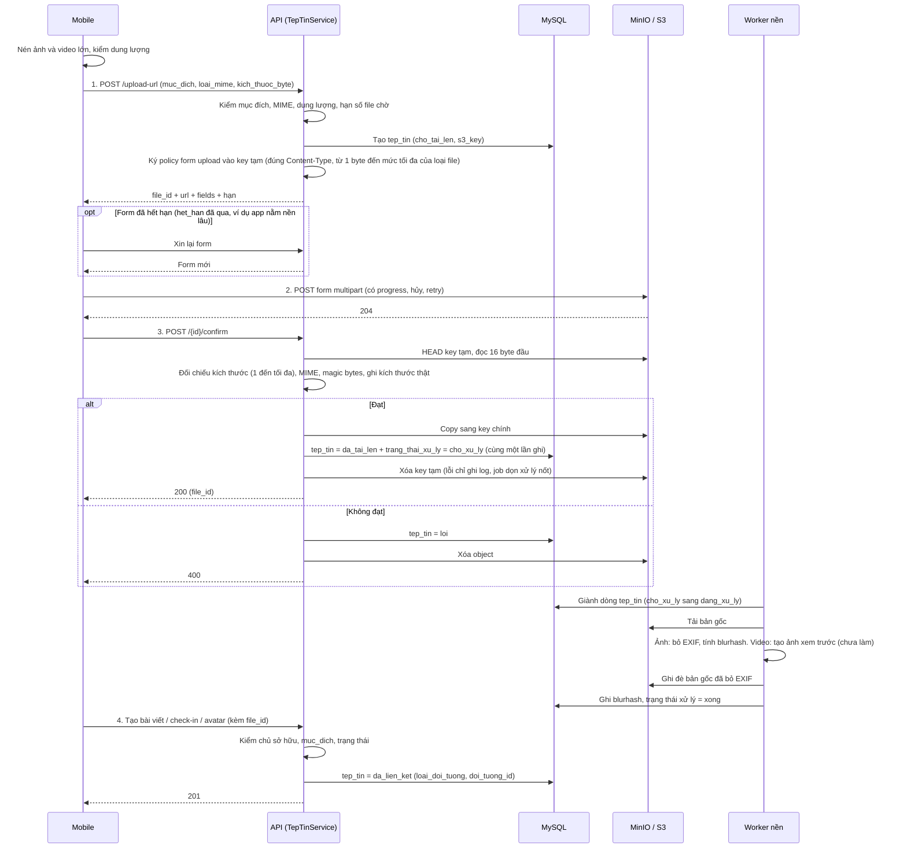
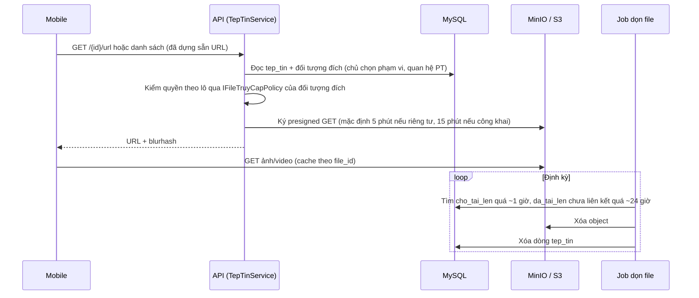
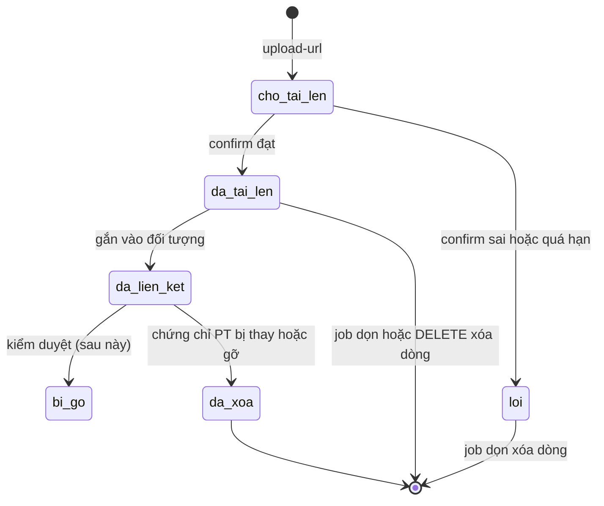

# Upload file: thiết kế chi tiết

> **Ngày viết:** 24/11/2026 · **Trạng thái:** đã triển khai (upload hai bước, bài viết gắn `file_ids`, URL đọc ký sẵn, job dọn file, xử lý ảnh nền); chưa làm: ảnh xem trước của video, kiểm duyệt Rekognition, policy xem cho check-in và ảnh cơ thể, nối upload cho màn hình lộ trình, rate limit riêng cho file, lifecycle `tmp/` và SSE ở bucket, xin lại URL xem khi hết hạn · **Đối chiếu code:** fd9ffa9 · **Cập nhật:** 24/11/2026 (mobile kiểm dung lượng, thu ảnh theo cạnh dài 1600px, nén video, blurhash và cache theo `file_id` cho ảnh bài viết, xóa cache khi đăng xuất; rà soát lại toàn bộ với code)

Quyết định và lý do: [ADR-0003](../adr/0003-upload-file-presigned-minio-s3.md). Tài liệu này mô tả cách làm. Bảng `tep_tin`
và vòng đời file: [database/diagrams/02-tep-tin.md](../../database/diagrams/02-tep-tin.md).

## 1. Thành phần

```text
Mobile ──(1) upload-url / (3) confirm / url──▶ API ──▶ MySQL (tep_tin)
   │                                            │
   └──────────(2) POST form───────────▶ MinIO / S3 ◀── worker nền (BackgroundService)
```

| Thành phần | Việc |
| --- | --- |
| `FilesController` (mob) | Các endpoint bên dưới (xin upload, confirm, lấy URL, lấy nhiều URL, xóa); chỉ gọi BL |
| `TepTinService` (`ITepTinService`, `GymBase.BLFile`) | Luật nghiệp vụ: whitelist mục đích, giới hạn, quyền, chuyển trạng thái |
| `IFileStorage` / `S3FileStorage` | Presigned POST (upload) và GET, copy, đọc đầu object, xóa |
| `IFileUrlProvider` (`ModuleContracts`) | Biến `file_id` thành URL đọc đã kiểm quyền, theo lô (bài viết, hồ sơ gọi vào); sau này thêm CDN ở đây. Ảnh xem trước của video chưa làm |
| `IImageProcessor` | Bỏ EXIF, xoay đúng chiều, kiểm kích thước điểm ảnh, tính blurhash |
| Worker xử lý file | Quét cột `trang_thai_xu_ly` của `tep_tin`, xử lý ảnh/video, (sau này) kiểm duyệt |
| Job dọn file (`TepTinDonDepWorker`) | Xóa file mồ côi và `loi` |

### Sơ đồ tuần tự

Upload, xử lý nền và gắn vào đối tượng:



Đọc file và dọn file mồ côi:



## 2. Trạng thái `tep_tin`



Job dọn file và `DELETE /files/{id}` xóa hẳn dòng (không đặt `da_xoa`); `da_xoa` hiện chỉ do thay hoặc gỡ chứng chỉ PT. Cần thêm giá trị `bi_go` vào `TrangThaiTepTin` khi làm kiểm duyệt. Xử lý nền (bỏ EXIF, blurhash) không đổi trạng thái chính: theo dõi bằng cột
`trang_thai_xu_ly` (`khong_can`, `cho_xu_ly`, `dang_xu_ly`, `xong`, `loi`) trên `tep_tin`, kèm `ngay_bat_dau_xu_ly` và `blurhash`.

## 3. API

Tất cả dưới `/api/v1/mob/files`, yêu cầu đăng nhập (trừ khi ghi khác). Route theo quy ước kebab-case; hàm BL đặt tên tiếng
Việt theo việc (`BLXinUploadAsync`, `BLXacNhanUploadAsync`, `BLLayUrlAsync`).

### 3.1 Xin upload: `POST /upload-url`

Request:

```json
{ "muc_dich": "progress", "loai_mime": "image/jpeg", "kich_thuoc_byte": 2480112, "ten_tep": "anh.jpg" }
```

BL kiểm, theo thứ tự:

1. `muc_dich` có trong whitelist (`avatar`, `gym_photo`, `progress`, `post`, `chung_chi_pt`, ...).
2. `loai_mime` được phép cho mục đích đó (bảng mục 4).
3. `kich_thuoc_byte` > 0 và không quá giới hạn của loại file.
4. Tạo `tep_tin`: `cho_tai_len`, `nguoi_tai_len_id` lấy từ token, `s3_key` duy nhất, `che_do_truy_cap` suy từ mục đích.

Response:

```json
{
  "file_id": "…",
  "upload": {
    "url": "http://…/gymbase-files", "method": "POST", "file_field": "file", "het_han": "…",
    "fields": { "key": "tmp/…", "Content-Type": "image/jpeg", "x-amz-algorithm": "…", "x-amz-credential": "…", "x-amz-date": "…", "policy": "…", "x-amz-signature": "…" }
  }
}
```

Form upload (presigned POST) có policy ràng buộc đúng `key`, đúng `Content-Type` và `content-length-range` từ 1 byte đến mức tối đa của loại file (10MB ảnh và PDF, 100MB video), hạn 15 phút, trỏ vào **key tạm**
`tmp/{file_id}`. Hạn mức chống lạm dụng, kiểm ở bước này:

- Tối đa 20 dòng `cho_tai_len` đồng thời mỗi tài khoản.
- Mỗi tài khoản mỗi ngày (tính theo giờ UTC+7, đếm cả file `loi` vì chúng đã tốn lượt xin): tối đa 50 ảnh, 10 video, 5 PDF
  và tổng 500MB. Con số đặt trong `StorageOptions` để chỉnh không cần sửa code.
- **Chưa làm:** rate limit riêng cho file (dự kiến `upload-url` 30 lần mỗi phút mỗi tài khoản, `confirm` và `url` 120 lần). Hiện chỉ đăng nhập có rate limit;
  hạn mức số lượng và dung lượng ở trên đã chặn phần lớn lạm dụng.

Cơ sở: một ngày tập điển hình có vài ảnh bữa ăn, vài ảnh cơ thể và một hai video; ngưỡng trên gấp nhiều lần mức đó nên người dùng
thật không chạm tới, còn tài khoản bị lạm dụng thì bị chặn trước khi tốn nhiều storage.

### 3.2 Báo xong: `POST /{id}/confirm`

BL kiểm:

1. `tep_tin` thuộc người gọi và đang `cho_tai_len`.
2. `HEAD` object: tồn tại, kích thước từ 1 đến mức tối đa của loại file, `Content-Type` khớp với lúc xin. Kích thước thật ghi vào `kich_thuoc_byte` (số khai lúc xin chỉ là ước lượng để kiểm sớm và tính hạn mức; app khó biết chính xác dung lượng sau khi nén).
3. Đọc 16 byte đầu, kiểm magic bytes khớp loại khai báo (JPEG, PNG, WebP, HEIC, MP4/MOV, PDF).
4. Đạt: **copy** object từ `tmp/{file_id}` sang key chính, ghi `da_tai_len`, `ngay_xac_nhan`, `trang_thai_xu_ly` (xem mục 6) và kích thước thật trong một lần ghi, rồi mới xóa
   key tạm (xóa lỗi chỉ ghi log để job dọn xử lý nốt, nên lỗi giữa chừng thì gọi lại confirm được). Copy phía server để form upload còn hạn không đè được file đã kiểm: sau confirm, ai POST lại vào
   key tạm cũng không ảnh hưởng key chính. Không đạt: `loi`, xóa key tạm.

Confirm gọi lại với file đã `da_tai_len` thì trả kết quả hiện tại (idempotent), không lỗi.

### 3.3 Lấy URL đọc: `GET /{id}/url` và `POST /urls`

Quyền xem do **đối tượng đích** quyết định, không suy từ loại file. Ba nhóm (bảng ở mục 4):

- **Công khai** (mạng xã hội: `avatar`, `post`, ...): mọi tài khoản đã đăng nhập đều xem được; URL hạn khoảng 15 phút.
- **Chỉ chủ và PT** (`check_in`, `chung_chi_pt` theo vai trò riêng): chủ file và PT đang kèm học viên đó; URL hạn tối đa 5 phút (`GetPrivateExpiryMinutes`, mặc định 5).
- **Chủ chọn** (`progress`, ảnh cơ thể): mỗi ảnh có phạm vi `chi_minh_toi` hoặc `chia_se_pt`, do chủ chọn và đổi được. `chi_minh_toi` thì chỉ chủ; `chia_se_pt` thì thêm PT đang kèm. Phạm vi lưu trên bản ghi ảnh cơ thể (đối tượng đích), không lưu trên `tep_tin`.

"PT đang kèm" tính tại thời điểm cấp URL: hết quan hệ kèm thì không cấp nữa (URL đã cấp còn sống tối đa vài phút).

Hợp đồng kiểm quyền (đặt trong `ModuleContracts/TepTin`, mỗi loại đối tượng đích tự cài):

```csharp
public interface IFileTruyCapPolicy
{
    string LoaiDoiTuong { get; }
    // Kiểm theo lô để danh sách/feed không gọi N lần; trả về tập file_id được phép xem.
    Task<IReadOnlySet<Guid>> BLKiemTruyCapAsync(Guid nguoiXemId, IReadOnlyCollection<TepTinTruyCap> cacTep, CancellationToken ct = default);
}

// Thông tin tối thiểu của file đã gắn vào đối tượng.
public sealed record TepTinTruyCap(Guid Id, Guid NguoiTaiLenId, Guid? DoiTuongId, string? MucDich);
```

`TepTinService` gom file theo `loai_doi_tuong`, gọi policy tương ứng một lần cho mỗi nhóm, rồi ký URL cho các file được phép. Đối tượng chưa có policy
(check-in, ảnh cơ thể: `TODO(FILE)`) thì file công khai xem được, file riêng tư chỉ chủ xem được.

- Chủ file xem được file của mình khi đã `da_tai_len`, kể cả chưa liên kết. Người khác không xem được file chưa liên kết. File `cho_tai_len` hoặc `loi` không cấp URL cho ai, kể cả chủ.
- Chỉ file `da_tai_len` và `da_lien_ket` được cấp URL (`bi_go` chưa có trong `TrangThaiTepTin`; `da_xoa` không cấp).
- `POST /urls` nhận danh sách `file_id`, trả `{ "data": [...] }` (danh sách `FileUrlDto`: `file_id`, `url`, hạn, `loai_mime`, `blurhash`); file không được phép thì vắng mặt trong `data` (không báo lý do để khỏi lộ sự tồn tại). Danh sách (bài viết, check-in) dựng sẵn URL trong response để client khỏi gọi thêm. Bài viết kèm `hinh_anh_meta` (cùng thứ tự với `hinh_anh_urls`): mỗi phần tử có `file_id` và `blurhash` của tệp; nội dung ngoài (URL http/https của dữ liệu mẫu) thì cả hai để trống. Tạo presigned URL chỉ tính chữ ký cục bộ nên rẻ; phần tốn là kiểm quyền, nên kiểm theo lô.
- Mỗi file chỉ có một bản để đọc. Video sẽ có thêm URL ảnh xem trước (`thumbnail_url`) khi worker tạo xong; **chưa làm**, `FileUrlDto` chưa có trường này.
- Không ghi URL presigned vào log (API, nginx, công cụ theo dõi lỗi).

### 3.4 Liên kết

Không có endpoint riêng. API tạo đối tượng nhận `file_id`; BL của đối tượng gọi `IFileLienKet` (hợp đồng trong
`ModuleContracts/TepTin`, đã có `IChungChiPtLienKet` làm mẫu) để kiểm: file của đúng người gọi, trạng thái `da_tai_len`,
`muc_dich` khớp, chưa gắn nơi khác; rồi đặt `loai_doi_tuong`, `doi_tuong_id`, `da_lien_ket`. Gắn trong cùng transaction với
việc tạo đối tượng.

### 3.5 Xóa file chưa gắn: `DELETE /{id}`

Chủ file xóa file chưa gắn vào đâu (ví dụ người dùng bỏ ảnh đã chọn, hoặc đăng bài lỗi): xóa cả key tạm lẫn key chính rồi xóa dòng, trả 204. File
`da_lien_ket` không xóa được; file của người khác báo không tìm thấy.

## 4. Quy tắc theo mục đích

| `muc_dich` | Loại | MIME cho phép | Tối đa | Ai xem |
| --- | --- | --- | --- | --- |
| `avatar` | ảnh | jpeg, png, webp, heic, heif | 10MB | công khai |
| `post` (mạng xã hội) | ảnh, video | ảnh như trên; mp4, quicktime | 10MB ảnh, 100MB video | công khai |
| `progress` (ảnh cơ thể) | ảnh | ảnh | 10MB | chủ chọn: `chi_minh_toi` hoặc `chia_se_pt` |
| `check_in` (bữa ăn, buổi tập) | ảnh, video | ảnh; mp4, quicktime | 10MB / 100MB | chủ và PT đang kèm |
| `chung_chi_pt` | PDF | application/pdf | 10MB | chủ hồ sơ và vai trò được phép (xem [ho-so.md](../api/ho-so.md)) |
| `gym_photo` | ảnh | ảnh | 10MB | chưa rõ, xác nhận khi làm |

Bảng này nằm ở **một nơi duy nhất** trong BL: `FilePolicy`. `che_do_truy_cap`
trong `tep_tin` chỉ còn là gợi ý (công khai hay không); quyền thật do `IFileTruyCapPolicy` của đối tượng đích quyết định.
`check_in` là mục đích mới, tách khỏi `progress`; cần đối chiếu với các màn hình `lo-trinh` đang dùng upload và sửa chúng cùng lúc.

## 5. Storage

- `S3FileStorage` dùng AWSSDK.S3. Cấu hình trong `StorageOptions` (đã có `ServiceUrl`, `ForcePathStyle`, `AccessKey`,
  `SecretKey`, `BucketName`, `PresignExpiryMinutes`); đã thêm hạn riêng cho upload (`PutExpiryMinutes`), GET riêng tư, GET công khai.
- MinIO dev: chạy trong `deploy/development/compose.yml` (S3 ở cổng 9100, giao diện 9101) hoặc riêng bằng `infrastructure/docker/docker-compose.minio.yml` (cổng 9000, 9001); bucket `gymbase-files` tự tạo ở lần tải lên đầu. **URL presigned phải dùng host mà
  điện thoại với tới được** (IP máy dev, không phải `localhost` hay tên service trong Docker), nên cần `PublicServiceUrl`
  tách khỏi `ServiceUrl` nội bộ nếu hai cái khác nhau. Xem [chay-mobile.md](../onboarding/chay-mobile.md).
- Key tạm: `tmp/{file_id}` (chỉ để upload). Key chính: `{muc_dich}/{yyyy}/{MM}/{file_id}{đuôi theo MIME}`, ví dụ `post/2026/11/{file_id}.jpg` (đuôi để app đoán ảnh hay video theo URL); ảnh xem trước của video (chưa làm) dự kiến là `{file_id}.thumb.jpg`.
  Không đưa tên file người dùng vào key. **Chưa làm:** lifecycle rule xóa `tmp/` sau 1 ngày làm lớp phòng thủ thứ hai
  bên cạnh job dọn file (hiện chỉ có job dọn).
- Bucket private; không bật public read. File "công khai" vẫn đọc qua presigned.
- **Chưa làm (cấu hình ở bucket khi triển khai production):** mã hóa phía server (SSE), code không đặt; khóa truy cập tối thiểu, chỉ `Get/Put/Head/Copy/DeleteObject` trên bucket.
- `LocalFileStorage` không hỗ trợ presigned, chỉ giữ cho test đơn vị.

## 6. Xử lý nền

Hàng đợi là chính cột `trang_thai_xu_ly` của `tep_tin` (không có bảng outbox riêng): ghi trạng thái cùng lúc với `da_tai_len` nên không thể lệch nhau.

1. Confirm đặt `trang_thai_xu_ly`: `cho_xu_ly` cho ảnh JPEG, PNG, WebP; `khong_can` cho video, PDF và ảnh HEIC (Skia chưa giải mã được; app đã
   đổi ảnh sang JPEG khi nén nên HEIC hầu như không tới).
2. `TepTinXuLyWorker` (`BackgroundService` trong API) quét mỗi 10 giây, mỗi lượt tối đa 10 tệp, còn việc thì làm tiếp ngay. Worker **nhận việc**
   bằng cập nhật có điều kiện (`cho_xu_ly` sang `dang_xu_ly`, kèm mốc `ngay_bat_dau_xu_ly`), nên nhiều instance không xử lý trùng; việc
   `dang_xu_ly` quá 10 phút coi như worker đã chết và được nhận lại.
3. Ảnh: từ chối nếu quá 8192px mỗi cạnh hoặc 36MP (kiểm từ header trước khi cấp bộ nhớ, chống ảnh nén bom); xoay đúng chiều theo EXIF
   (cả 8 hướng), mã hóa lại không kèm metadata (EXIF, GPS), ghi đè cùng key chính, lưu `blurhash` và dung lượng mới. Không tạo bản thu nhỏ: app
   đã nén xuống cạnh dài 1600px trước khi gửi, và mỗi file chỉ có một bản.
4. Ảnh quá lớn hoặc hỏng: xóa object, `trang_thai = loi`, `trang_thai_xu_ly = loi`; job dọn file xóa dòng sau 60 phút. Lỗi bất ngờ (kho, bộ nhớ):
   `trang_thai_xu_ly = loi`, tệp vẫn xem được nhưng chưa bỏ EXIF (ghi log mức lỗi).
5. **Chưa làm:** ảnh xem trước của video (cần ffmpeg trong image Docker của API, `infrastructure/docker/Dockerfile.api`), kiểm duyệt: gọi
   Rekognition như một tác vụ tiếp theo, vi phạm thì `bi_go` và gỡ khỏi đối tượng gắn; ảnh riêng tư có thể bỏ qua để tiết kiệm phí.

**Job dọn file** (`TepTinDonDepWorker`, mỗi 10 phút, tối đa 200 tệp mỗi lượt): xóa object (key tạm và key chính) rồi dòng của tệp `cho_tai_len` hoặc
`loi` quá 60 phút và `da_tai_len` chưa gắn quá 24 giờ. Tệp `da_lien_ket` không bao giờ bị dọn. Object nào xóa lỗi thì giữ dòng để lượt sau thử lại.

Nếu CPU xử lý ảnh chen vào API thì tách worker thành tiến trình riêng cùng codebase; cơ chế nhận việc giữ nguyên.

## 7. Mobile

Giữ `useFileUpload` và `uploadMultipartFile` làm điểm vào (đổi tên `uploadFile` khi sửa các nơi gọi), đổi bên trong:

1. **Chuẩn bị tệp** (`prepareFile` trong `file-uploader.ts`):
   - Ảnh: nén bằng `expo-image-manipulator`, thu nhỏ theo **cạnh dài tối đa 1600px** (chỉ thu nhỏ, ảnh nhỏ hơn không bị phóng to), JPEG 0.9, bỏ EXIF.
     Điện thoại hiển thị ảnh rộng chừng 1080 đến 1440px nên 1600px đủ nét (`CANH_DAI_ANH_TOI_DA_PX`).
   - Video: trên bản dev build, video lớn hơn 20MB hoặc chưa biết dung lượng được nén bằng `react-native-compressor` (`video-compressor.ts`, cạnh dài
     1280px tức 720p, bỏ metadata GPS). Không có thư viện (Expo Go) hoặc nén lỗi hoặc bản nén không nhỏ hơn thì gửi bản gốc.
   - Kiểm dung lượng sau bước trên, trước khi xin URL: ảnh và PDF tối đa 10MB, video 100MB (`DUNG_LUONG_TOI_DA_BYTE`); quá thì ném `UploadError`
     mã `FILE_TOO_LARGE` (status 413), không gọi API. Ảnh được kiểm theo dung lượng sau khi nén.
   - Composer loại video quá lớn **ngay lúc chọn** (`kiemTraVideoKhiChon`) và báo qua toast: máy nén được video thì cho tới 500MB (sẽ nén xuống trước
     khi gửi), không thì áp thẳng 100MB. Dung lượng lấy từ `fileSize` của bộ chọn; bộ chọn không báo thì chưa loại được lúc chọn, nhưng uploader và
     policy của storage vẫn chặn. Chỉ kiểm dung lượng, không kiểm thời lượng video.
   - **Chưa làm:** kiểm lúc chọn ở các màn hình khác ngoài composer (chưa nối upload).
2. Gọi `upload-url`.
3. POST form `multipart/form-data` bằng `axios.post` (các `fields` đặt trước, trường file dạng `{ uri, type, name }` đặt cuối để phần native của React Native tự đọc tệp,
   không nạp cả video vào bộ nhớ JS); `onProgress` theo `onUploadProgress` (byte thật); hủy bằng `AbortSignal`; chờ tối đa 5 phút. Không dùng
   `FileSystem.createUploadTask`: axios đã đủ progress, hủy, thử lại và chạy cả trên web.
4. Lỗi mạng hoặc 5xx thì thử lại có backoff (`maxRetries`, `initialRetryDelayMs` đã có trong `UploadOptions`). Form hết hạn (`het_han` đã qua, ví dụ app nằm nền lâu) thì xin form mới trước khi gửi;
   storage trả 403 thì báo `STORAGE_REJECTED`, không thử lại.
5. Gọi `confirm`, trả `FileUploadResult` gồm `file_id` (và URL xem nếu cần ngay).

`UploadState` có `idle`, `compressing`, `uploading`, `confirming`, `done`, `error`, nhưng `useFileUpload` hiện chỉ đặt `idle`, `uploading`, `done`,
`error` (`compressing` và `confirming` chưa dùng, nên giao diện chưa phân biệt được bước nén và bước xác nhận). `UploadError` giữ `status` và `code`
để màn hình báo đúng nguyên nhân.

Hiển thị ảnh: `RemoteImage` dùng `expo-image` cho ảnh có `file_id` hoặc blurhash, với `cacheKey = file_id` và `placeholder` là blurhash; ảnh khác giữ
`Image` của React Native. API bài viết trả `hinh_anh_meta` (mục 3.3); `mapBaiVietDtoToFeedPost` nhớ thông tin theo đúng URL ký (`ghiNhoThongTinAnh`,
tối đa 1000 URL, bỏ mục cũ nhất) để `RemoteImage` tự tra, các màn hình không phải truyền xuống từng ảnh. URL lấy từ response danh sách; việc
xin lại URL khi hết hạn rồi thử một lần **chưa làm** (hiện ảnh lỗi thì hiện nền xám). Không lưu URL presigned vào store lâu dài; lưu `file_id`. Đăng xuất gọi `xoaCacheAnh`: xóa cache ảnh của
expo-image (bộ nhớ và đĩa) cùng thông tin đã nhớ, để máy dùng chung không còn ảnh riêng tư của người trước. Hiện mới áp dụng cho ảnh bài viết; ảnh
check-in và ảnh cơ thể dùng cách này khi có API trả `hinh_anh_meta` tương ứng.

## 8. Kế hoạch làm

Đã làm (24/11/2026):

1. `S3FileStorage` (presigned POST và GET, copy, đọc đầu object), `FilePolicy`, API xin/confirm, hạn mức, test với MinIO thật.
2. Mobile: POST form, progress, hủy, thử lại, xin lại form khi hết hạn.
3. Bài viết nhận `file_ids` (`IFileLienKet`), URL đọc ký theo lô (`IFileUrlProvider`), `BaiVietFileTruyCapPolicy`, `DELETE /files/{id}`.
4. Xóa code cũ: `FileService`, `FileMigrationService`, `GetContent`, endpoint đọc legacy, controller web cũ.
5. Worker xử lý ảnh (EXIF, blurhash).
6. Job dọn file mồ côi.
7. Mobile: kiểm dung lượng ảnh, PDF, video trước khi xin URL; thu ảnh theo cạnh dài 1600px; nén video bằng `react-native-compressor`; composer loại video quá lớn
   ngay lúc chọn và hiện câu báo lỗi `FILE_TOO_LARGE`.
8. Bài viết trả `hinh_anh_meta` (`file_id`, `blurhash`); mobile dùng blurhash làm placeholder, cache ảnh theo `file_id` và xóa cache khi đăng xuất (cho ảnh bài viết).

Còn lại:

9. Ảnh xem trước của video (ffmpeg).
10. Kiểm duyệt Rekognition (đợt sau), kèm `TODO(FILE)` ở chỗ chừa.
11. `IFileTruyCapPolicy` cho `check_in` và `progress` (ảnh cơ thể: `chi_minh_toi` hoặc `chia_se_pt`) cùng nối upload cho các màn hình lộ trình khi có API check-in
   (hiện kho check-in của mobile còn lưu URI cục bộ, `TODO(ROUTE)`).
12. Mobile: dùng blurhash và `cacheKey` theo `file_id` cho ảnh check-in và ảnh cơ thể khi có API trả `hinh_anh_meta` tương ứng; kiểm dung lượng lúc chọn ở các màn hình lộ trình khi nối upload.
13. Rate limit riêng cho `upload-url`, `confirm` và `url` (hiện chỉ đăng nhập có rate limit).
14. Lifecycle rule xóa `tmp/` sau 1 ngày và mã hóa phía server (SSE) ở bucket production.
15. Mobile: xin lại URL xem khi hết hạn rồi thử một lần.

Code tạm đặt `// TODO(FILE): …`; thêm chủ đề `FILE` vào [quy-uoc-todo.md](quy-uoc-todo.md) nếu chưa có.

## 9. Còn mở

Xem mục "Còn mở" của ADR-0003. Thêm: xác nhận quyền xem của `gym_photo`, theo dõi thực tế rồi chỉnh hạn mức mỗi ngày.

**Nén video cần dev build:** `react-native-compressor` là module native (Nitro), không chạy trong Expo Go. Sau `pnpm install`, build lại dev build
(`pnpm mobile:android:dev`). Chạy bằng Expo Go vẫn được nhưng video gửi bản gốc và bị giới hạn 100MB ngay lúc chọn.

**Chạy dev với điện thoại:** URL ký mang địa chỉ của `Storage:ServiceUrl` (`http://localhost:9000`), điện thoại không với tới được. Đặt
`Storage:PublicServiceUrl` là địa chỉ máy dev mà điện thoại gọi được, ví dụ `http://192.168.1.10:9000` (biến môi trường
`Storage__PublicServiceUrl`); máy ảo Android dùng `http://10.0.2.2:9000`. API vẫn nói chuyện với MinIO bằng `ServiceUrl`.

## 10. Kiểm thử

- Đơn vị: `FilePolicy` (mục đích, MIME, dung lượng), chuyển trạng thái, liên kết sai chủ sở hữu hoặc sai mục đích.
- Tích hợp với MinIO thật: xin form, POST, confirm đạt; POST sai `Content-Type`, sai key, quá dung lượng tối đa, file rỗng, hết hạn đều bị từ chối; confirm khi
  chưa POST; file đổi nhãn MIME nhưng magic bytes sai; confirm gọi hai lần.
- Quyền đọc: người ngoài không lấy được URL file riêng tư; URL hết hạn thì 403 từ storage; ảnh cơ thể `chi_minh_toi` thì PT không xem,
  đổi sang `chia_se_pt` thì xem được, hết quan hệ kèm thì không xem nữa; kiểm theo lô cho danh sách nhiều file.
- Đè file: POST lại vào key tạm sau khi confirm không đổi nội dung file chính.
- Hạn mức: vượt số dòng chờ, dung lượng ngày, rate limit đều bị từ chối.
- Worker: xử lý ảnh, nhiều worker không giành trùng một dòng, dòng kẹt `dang_xu_ly` được giành lại.
- Job dọn: không xóa nhầm file đang `da_lien_ket`; chạy lại an toàn.
- Mobile: progress, hủy, retry và xin lại URL khi hết hạn (đã có `file-uploader.test.ts` làm nền); thu ảnh theo cạnh dài, nén video (thư viện nén giả), kiểm dung lượng
  ảnh, PDF, video, loại video lúc chọn (`composer-chon-media.test.tsx`), blurhash và `cacheKey` của `RemoteImage`, xóa cache khi đăng xuất (`image-cache.test.tsx`).
