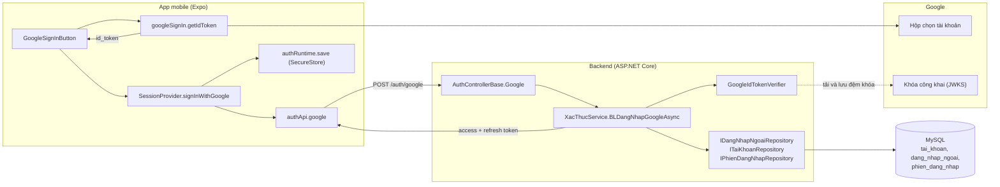
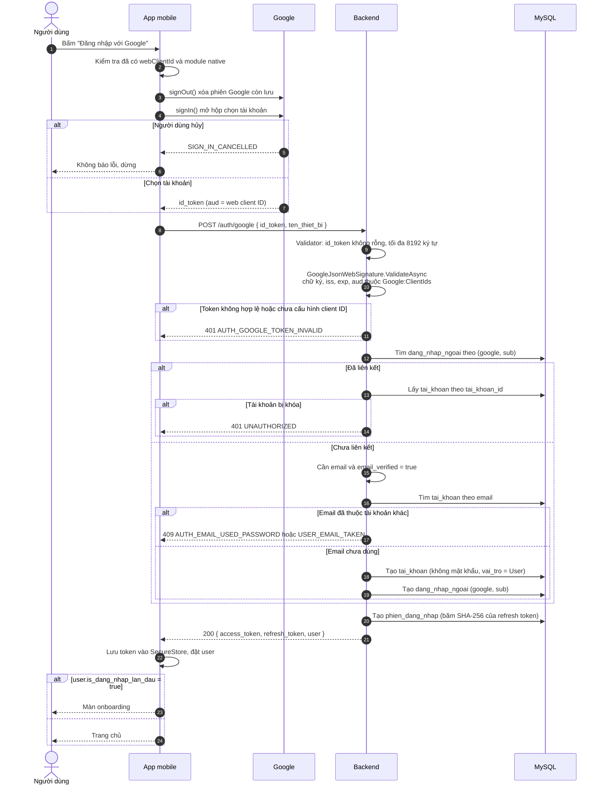
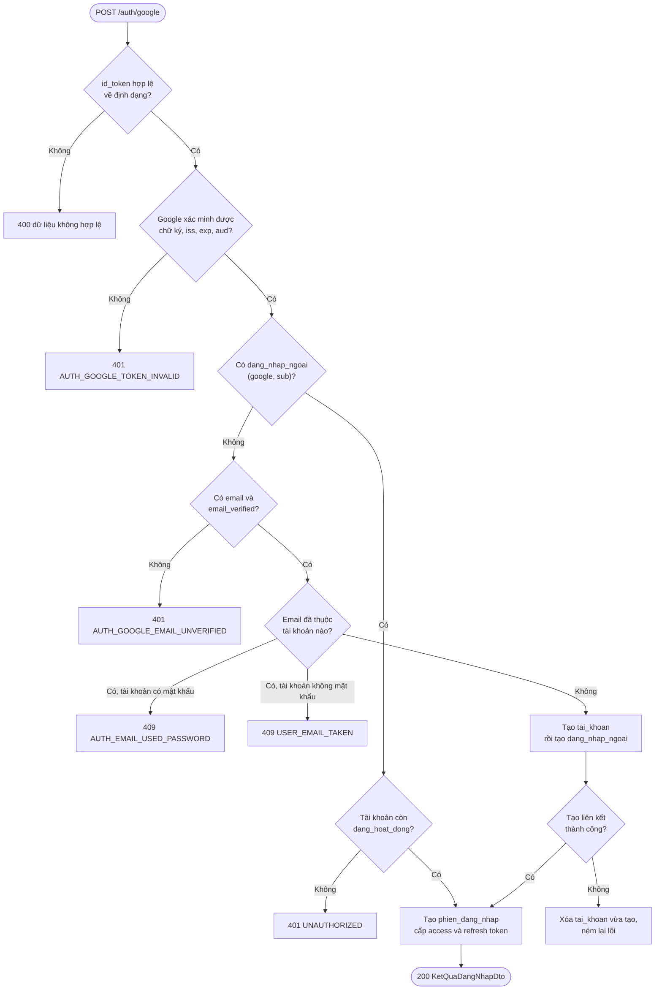
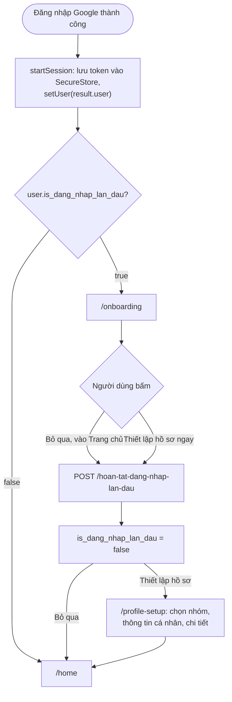
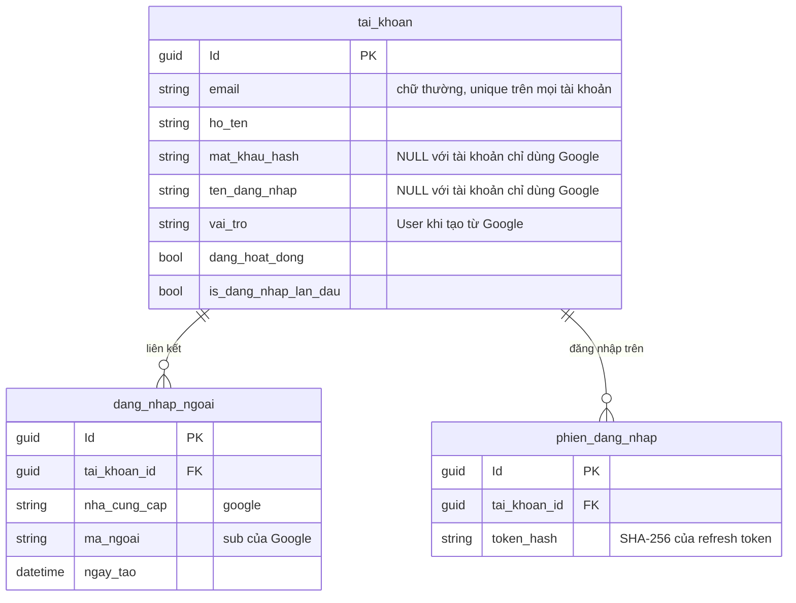

# Đăng nhập bằng Google

> **Ngày viết:** 17/11/2026 · **Trạng thái:** đã triển khai (backend và Android dev build); chưa làm iOS, Sign in with Apple, liên kết Google từ màn Cá nhân · **Đối chiếu code:** 71cef01

Tài liệu này mô tả cách GymBase đã triển khai đăng nhập và đăng ký bằng Google: ai làm việc gì, dữ liệu đi qua đâu,
lỗi nào trả về khi nào, và cấu hình ở từng môi trường. Quyết định thiết kế và các quy tắc chung của xác thực nằm ở
[docs/api/xac-thuc.md](../api/xac-thuc.md) (mục 8); lý do không tự liên kết theo email nằm ở
[ADR-0001](../adr/0001-dang-nhap-bang-email.md).

Phần chưa làm nằm ở mục 10.

## 1. Ý tưởng chính

App **không** dùng luồng OAuth chuyển hướng qua backend. App tự lấy **ID token** từ Google bằng thư viện native, gửi
cho API, API xác minh rồi cấp **JWT và refresh token của GymBase**. Từ lúc đó mọi thứ còn lại (phân quyền, refresh,
đăng xuất) giống hệt đăng nhập bằng mật khẩu; backend không giữ token nào của Google.

| Quyết định | Chọn | Lý do |
| --- | --- | --- |
| Ai lấy token từ Google | App mobile (thư viện `@react-native-google-signin/google-signin`) | Không cần màn hình chuyển hướng, không cần client secret ở backend |
| Backend nhận gì | Chỉ `id_token` (+ `ten_thiet_bi` tùy chọn) | ID token là chứng cứ danh tính đã được Google ký |
| Định danh tài khoản | `sub` của Google, lưu ở `dang_nhap_ngoai.ma_ngoai` | Email Google có thể đổi, `sub` thì không |
| Email trùng tài khoản đã có | **Từ chối** (409), không tự liên kết | Tự liên kết theo email là đường chiếm tài khoản (ADR-0001) |
| Token sau đăng nhập | Của GymBase (JWT 15 phút + refresh 30/90 ngày) | Phần còn lại của hệ thống không phân biệt cách đăng nhập |

## 2. Các thành phần

| Lớp | File | Việc |
| --- | --- | --- |
| Mobile, giao diện | [google-sign-in-button.tsx](../../apps/mobile/src/features/auth/components/google-sign-in-button.tsx) | Nút ở màn chào mừng và màn đăng nhập; hiện lỗi; chuyển màn sau khi đăng nhập |
| Mobile, thư viện Google | [google-sign-in.ts](../../apps/mobile/src/core/auth/google-sign-in.ts) | Bọc thư viện native, trả ID token hoặc `null` khi người dùng hủy |
| Mobile, phiên | [session.tsx](../../apps/mobile/src/core/auth/session.tsx) | `signInWithGoogle`: gọi API, lưu token, đặt `user` |
| Mobile, API | [auth-api.ts](../../apps/mobile/src/core/api/auth-api.ts) | `POST /auth/google`, gửi kèm `ten_thiet_bi = Platform.OS` |
| Mobile, cấu hình | [env.ts](../../apps/mobile/src/core/config/env.ts) | `EXPO_PUBLIC_GOOGLE_WEB_CLIENT_ID` |
| Backend, controller | [AuthControllerBase.cs](../../apps/api/src/Host/GymBase.API/Controllers/AuthControllerBase.cs) | `POST google`, `[AllowAnonymous]`, chung giới hạn 20 lần/phút/IP với `/login` |
| Backend, nghiệp vụ | [XacThucService.cs](../../apps/api/src/Auth/GymBase.BLAuth/BLXacThuc/XacThucService.cs) | `BLDangNhapGoogleAsync`, `CreateGoogleAccountAsync` |
| Backend, xác minh | [GoogleIdTokenVerifier.cs](../../apps/api/src/Base/GymBase.Base.Hosting/Auth/GoogleIdTokenVerifier.cs) | Xác minh ID token bằng `Google.Apis.Auth` |
| Backend, dữ liệu | [dang_nhap_ngoai.cs](../../apps/api/src/Data/GymBase.Entities/Auth/dang_nhap_ngoai.cs) | Bảng liên kết tài khoản với Google |

Endpoint có ở cả `/api/v1/web/auth/google` và `/api/v1/mob/auth/google`, dùng chung `XacThucService`.

## 3. Luồng đầy đủ

## 4. Backend quyết định thế nào

`BLDangNhapGoogleAsync` đi theo các nhánh sau. Mọi lỗi ở nhánh nào cũng không ghi nội dung token vào log.

Điểm cần nhớ:

- **Tìm theo `sub`, không theo email.** Người dùng đổi email Google vẫn vào đúng tài khoản cũ; không sinh tài khoản mới.
- **Chỉ kiểm tra email khi tạo tài khoản mới.** Tài khoản đã liên kết đăng nhập được kể cả khi Google không còn báo
  email đã xác minh.
- **Không có giao dịch DB bao hai lần ghi.** `tai_khoan` được ghi trước, `dang_nhap_ngoai` sau; nếu lần sau lỗi thì
  xóa tài khoản vừa tạo để không để lại tài khoản mồ côi (nếu để lại, lần sau email này báo trùng mà không đăng nhập được).
- **Tài khoản mới:** `vai_tro = User`, `mat_khau_hash` và `ten_dang_nhap` là NULL, `ho_ten` lấy từ Google (không có thì
  lấy phần trước `@`, cắt còn 100 ký tự), `is_dang_nhap_lan_dau = true`. Màn Google có dòng "bằng việc tiếp tục, bạn đồng ý…"
  nhưng không lưu mốc thời gian. Chưa có `ho_so_nguoi_dung`.
- **Tài khoản chỉ dùng Google không đăng nhập được bằng mật khẩu** (không có hash để so khớp).

## 5. Xác minh ID token

`GoogleIdTokenVerifier` dùng `GoogleJsonWebSignature.ValidateAsync` của thư viện chính thức, không tự viết:

| Kiểm tra | Cách |
| --- | --- |
| Chữ ký | Khóa công khai của Google, thư viện tự tải và lưu đệm |
| `iss` | `accounts.google.com` hoặc `https://accounts.google.com` |
| `exp` | Chưa hết hạn |
| `aud` | Phải nằm trong `Google:ClientIds` (mảng cấu hình) |

Kết quả `GoogleIdentity(Subject, Email, EmailVerified, Name)` trả về cho `XacThucService`.

| Tình huống | Hành vi |
| --- | --- |
| Token sai chữ ký, sai `aud`/`iss`, hết hạn, không phải JWT | Trả `null` → 401 `AUTH_GOOGLE_TOKEN_INVALID`; log cảnh báo, không ghi token |
| `Google:ClientIds` trống | Trả `null` (mọi token bị từ chối) và log **lỗi** |
| Lỗi mạng khi tải khóa của Google | **Không bắt**, thành 500, để không báo nhầm là "token sai" |

## 6. Sau khi đăng nhập: app đi đâu

Response có `user.is_dang_nhap_lan_dau`. Cờ này `true` cho tới khi người dùng bấm một trong hai nút của màn onboarding
(lúc đó app gọi `POST /hoan-tat-dang-nhap-lan-dau`). Vì cờ nằm ở server nên thoát app giữa chừng thì lần sau vẫn hiện onboarding.

Mở lại app: `SessionProvider` khôi phục token từ SecureStore, đọc `user` đã lưu để hiện ngay, rồi gọi `GET /me`. Nếu `/me`
trả 401 thì xóa phiên; lỗi mạng thì giữ phiên cũ. Màn `index` điều hướng theo cùng cờ `is_dang_nhap_lan_dau`.

Đăng xuất: `POST /logout` thu hồi phiên trên server (mất mạng vẫn đăng xuất cục bộ), xóa token và `user` đã lưu, rồi gọi
`googleSignIn.signOut()`.

## 7. Dữ liệu

`dang_nhap_ngoai` có hai unique: `(nha_cung_cap, ma_ngoai)` để một tài khoản Google không gắn vào hai tài khoản GymBase,
và `(tai_khoan_id, nha_cung_cap)` để mỗi tài khoản chỉ liên kết một Google. Sơ đồ đầy đủ: [database/diagrams/01-tai-khoan-ho-so.md](../../database/diagrams/01-tai-khoan-ho-so.md).

## 8. Mã lỗi và thông báo trên app

| HTTP | Mã | Khi nào | App hiện |
| --- | --- | --- | --- |
| 400 | (validation) | `id_token` rỗng hoặc dài quá 8192 ký tự; `ten_thiet_bi` quá 100 ký tự | Thông báo từ server |
| 401 | `AUTH_GOOGLE_TOKEN_INVALID` | Token không hợp lệ, hoặc backend chưa cấu hình `Google:ClientIds` | Thông báo từ server ("Không xác minh được tài khoản Google…") |
| 401 | `AUTH_GOOGLE_EMAIL_UNVERIFIED` | Tài khoản Google mới không có email đã xác minh | Thông báo từ server |
| 401 | `UNAUTHORIZED` | Tài khoản đã liên kết bị khóa | "Không thể đăng nhập bằng Google với tài khoản này." |
| 409 | `AUTH_EMAIL_USED_PASSWORD` | Email Google trùng tài khoản có mật khẩu | "Email này đã đăng ký bằng mật khẩu. Hãy đăng nhập bằng email và mật khẩu." |
| 409 | `USER_EMAIL_TAKEN` | Email Google trùng tài khoản khác không có mật khẩu | Thông báo từ server |
| 429 | | Quá 20 lần gọi/phút theo IP (chung với `/login`) | Thông báo từ server |
| 500 | | Lỗi mạng khi backend tải khóa của Google, hoặc lỗi DB | Thông báo chung |

Lỗi phát sinh ngay trên máy, trước khi gọi API (`GoogleSignInUnavailableError`):

| `reason` | Nguyên nhân | App hiện |
| --- | --- | --- |
| `NOT_CONFIGURED` | Thiếu `EXPO_PUBLIC_GOOGLE_WEB_CLIENT_ID` | "Đăng nhập Google chưa được cấu hình trên bản này." |
| `NATIVE_MODULE_MISSING` | Chạy trong Expo Go, không có module native | "Đăng nhập Google cần bản dev build, không chạy trong Expo Go." |
| `PLAY_SERVICES_UNAVAILABLE` | Thiết bị thiếu Google Play Services | "Thiết bị này chưa có Google Play Services." |
| `NO_ID_TOKEN` | Google đăng nhập xong nhưng không trả ID token | "Không lấy được thông tin từ Google. Vui lòng thử lại." |

Người dùng hủy hộp chọn tài khoản thì **không** báo lỗi.

## 9. Cấu hình

**Nguyên tắc quan trọng:** dùng **một Web client ID** cho cả hai phía. App xin ID token với `webClientId` nên `aud` của
token chính là Web client ID đó, và backend kiểm tra `aud` với cùng giá trị.

### 9.1. Google Cloud Console (làm một lần)

1. Tạo project, cấu hình màn hình đồng ý OAuth (OAuth consent screen).
2. Tạo OAuth client ID loại **Web application**: đây là giá trị đặt cho backend và app.
3. Tạo OAuth client ID loại **Android** với package name `vn.gymbase.app` (khớp `apps/mobile/app.json`) và SHA-1 của keystore.
   Không đưa client ID Android vào code, nhưng phải tồn tại để Google chấp nhận app.

Google báo `DEVELOPER_ERROR` thường do package name hoặc SHA-1 của client ID Android không khớp bản build.
Cách tạo dev build và lấy SHA-1: [chay-mobile.md](../onboarding/chay-mobile.md) mục 6.

### 9.2. Từng môi trường

| Nơi | Cấu hình | Ghi chú |
| --- | --- | --- |
| Backend, dev | `dotnet user-secrets set "Google:ClientIds:0" "<web-client-id>.apps.googleusercontent.com" --project src/Host/GymBase.API` | `appsettings.json` để `Google:ClientIds: []` |
| Backend, production | Biến `GOOGLE_WEB_CLIENT_ID` trong `deploy/production/.env`, compose ánh xạ thành `Google__ClientIds__0` | Để trống thì `/auth/google` luôn trả 401 |
| Mobile | `EXPO_PUBLIC_GOOGLE_WEB_CLIENT_ID` trong `apps/mobile/.env` | Sửa xong phải build lại hoặc chạy Metro với `-c`. Để trống thì nút báo chưa cấu hình |

Muốn nhận token cấp cho client ID khác (ví dụ khi sau này app lấy token bằng client ID Android), thêm vào mảng:
`Google:ClientIds:1`, `Google:ClientIds:2`…

## 10. Đã quyết và chưa làm

**Đã quyết (ở các mục trên đều có lý do):**

- Người lạ tự đăng ký bằng Google ngay V1 (chốt 11/11).
- Không tự liên kết theo email trùng; email unique trên mọi tài khoản (ADR-0001, 13/11).
- Định danh bằng `sub`, không bằng email.
- Mỗi lần bấm nút đều gọi `GoogleSignin.signOut()` trước `signIn()` để hộp chọn tài khoản luôn hiện. Nếu không, sau khi API
  từ chối một tài khoản (ví dụ email đã đăng ký bằng mật khẩu), thư viện dùng lại đúng tài khoản đó và người dùng không đổi được.
  App chỉ cần ID token, không dùng phiên Google về sau nên bỏ phiên này không mất gì.

**Chưa làm:**

| Việc | Ghi chú |
| --- | --- |
| Liên kết Google vào tài khoản mật khẩu từ màn Cá nhân | `TODO(LINK-GOOGLE)`: hiện email trùng chỉ bảo người dùng đăng nhập bằng mật khẩu |
| iOS | `TODO(IOS)`: cần client ID iOS, plugin `iosUrlScheme` trong `app.json` |
| Sign in with Apple | App Store thường yêu cầu khi có đăng nhập bên thứ ba |
| Xác minh email, số điện thoại | `TODO(VERIFY)`. Email Google đã được Google xác minh, nhưng tài khoản mật khẩu thì chưa |

## 11. Kiểm thử

| Test | Phạm vi |
| --- | --- |
| [GoogleLoginTests.cs](../../apps/api/tests/Integration/GymBase.IntegrationTests/GoogleLoginTests.cs) | Tích hợp: tạo mới, đăng nhập lại, email trùng, token sai, tài khoản khóa. Dùng `FakeGoogleIdTokenVerifier` thay cho Google thật |
| [GoogleIdTokenVerifierTests.cs](../../apps/api/tests/Integration/GymBase.IntegrationTests/GoogleIdTokenVerifierTests.cs) | Xác minh token, cấu hình `Google:ClientIds` |
| [XacThucServiceTests.cs](../../apps/api/tests/Unit/GymBase.UnitTests/Auth/XacThucServiceTests.cs) | Unit test nghiệp vụ đăng nhập |
| [google-sign-in.test.ts](../../apps/mobile/__tests__/google-sign-in.test.ts), [google-flow.test.tsx](../../apps/mobile/__tests__/google-flow.test.tsx) | Mobile: bọc thư viện Google và luồng nút |

Tay: trường hợp token sai thử bằng curl hoặc Postman, gửi `POST /api/v1/mob/auth/google` với `id_token` bất kỳ, kỳ vọng 401 `AUTH_GOOGLE_TOKEN_INVALID`. Trường hợp
thành công cần ID token thật nên chỉ thử được qua app dev build.
