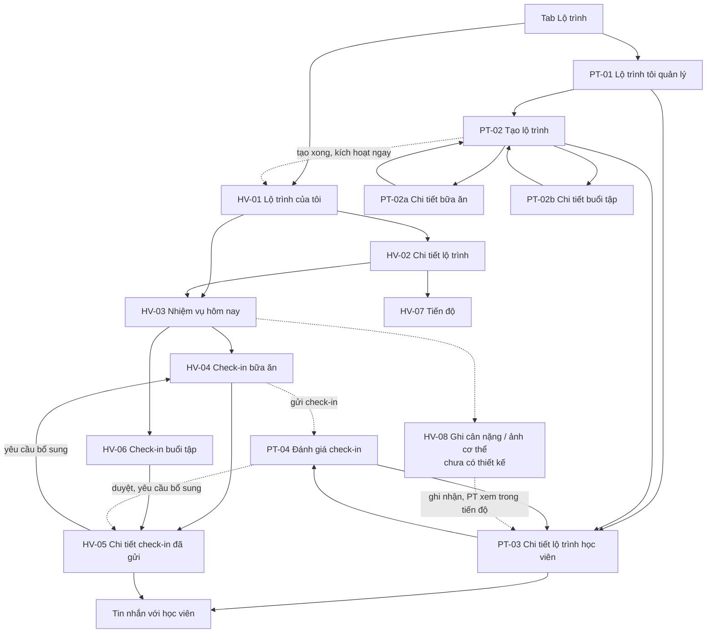

# Lộ trình: luồng màn hình (học viên và PT)

> **Ngày viết:** 21/11/2026 · **Cập nhật:** 22/11/2026 · **Trạng thái:** thiết kế đã chốt (luồng theo [adr.md](adr.md) N1 đến N22; còn các màn chưa có thiết kế ở mục 8, chưa có code)

Nguồn: `Tài liệu dự án/GymBase_V1_Workflow_Thiet_Ke.docx`, phần 05 đến 14, đã áp các quyết định trong [adr.md](adr.md). Phần chữ
của docx rất ngắn, nội dung nằm trong ảnh storyboard nên tài liệu này đọc từ ảnh. Chỉ mô tả **đi từ đâu tới đâu**. Quy tắc nghiệp
vụ (vòng đời lộ trình, ai được làm gì, hạn check-in, giới hạn) viết ở tài liệu riêng và chỉ được trỏ tới từ đây. Mã `Nx` là quyết định
nghiệp vụ trong `adr.md`.

> **Phạm vi V1 (N1):** làm đủ vòng PT và học viên. [phan-quyen.md](../../api/phan-quyen.md) mục 7 còn ghi "bốn bảng lộ trình không làm ở V1",
> cần sửa theo K1 trong `adr.md`.

## 1. Thuật ngữ và quy ước

| Từ | Nghĩa trong tài liệu này |
| --- | --- |
| Học viên, PT | Hai nhóm người dùng, theo [GLOSSARY.md](../../../GLOSSARY.md). Một tài khoản có thể là cả hai nên cùng một người thấy cả hai sub-tab của tab Lộ trình. |
| Lộ trình | Chương trình **một PT** lập cho **một học viên** (N2, N14): mục tiêu, thời gian, lịch bữa ăn và buổi tập, chu kỳ cân nặng và ảnh cơ thể, ghi chú. Thuộc một kết nối PT có đủ hai phạm vi (N15). Chia sẻ về sau là sao chép. |
| Nhiệm vụ | Một mốc trong ngày của lộ trình: bữa ăn, buổi tập, cân nặng, ảnh cơ thể. |
| Check-in | Học viên báo cáo **bữa ăn hoặc buổi tập** (trạng thái, ảnh, ghi chú) để PT duyệt. Cân nặng và ảnh cơ thể chỉ được **ghi nhận**, không qua duyệt (N16). |
| Mã màn hình | `HV-xx` cho học viên, `PT-xx` cho PT. |

Điều hướng chung:

- Tab Lộ trình có hai sub-tab: **Lộ trình của tôi** và **Lộ trình tôi quản lý** (N8). Không có tab "Lộ trình mẫu" ở V1.
- Đầu màn Lộ trình chỉ có tiêu đề và hai sub-tab. Hàng chip "Dành cho bạn, Xu hướng, Lộ trình, ..." chỉ ở Trang chủ (N9).
- Thanh dưới 5 mục (Trang chủ, **Lộ trình**, nút `+`, Tin nhắn, Cá nhân) chỉ hiện ở màn tab gốc (HV-01, PT-01); **ẩn ở mọi màn con**, màn con có nút quay lại (N10).
- Nút `+` giữ nguyên là soạn bài (N11), không có hành động nào của Lộ trình.
- Thanh đầu của màn tab gốc: logo, tìm kiếm, chuông thông báo, ảnh đại diện.

## 2. Bản đồ tổng

Nét liền là điều hướng trong app. Nét chấm là tác động chéo giữa hai vai trò (kèm thông báo, xem mục 6).

## 3. Luồng học viên

### HV-01 Lộ trình của tôi (danh sách)

Điểm vào: tab Lộ trình, sub-tab "Lộ trình của tôi" (mặc định); thông báo về lộ trình mới hoặc đánh giá của PT.

Bản thiết kế dùng là **danh sách nhóm theo trạng thái** (phần 06, N7): nhóm "Đang thực hiện (n)" gồm thẻ gọn (ảnh, tên lộ trình, thời gian, tuần x/12, %), bên dưới khối "Nhiệm vụ hôm nay" có đếm "2/4 hoàn thành". Học viên có thể có nhiều lộ trình từ nhiều PT. Bốn lối tắt của bản tổng quan (phần 05) không dùng ở đây, chuyển vào HV-02.

| Thao tác | Đích |
| --- | --- |
| Bấm thẻ lộ trình | HV-02 |
| Bấm tiêu đề khối "Nhiệm vụ hôm nay" | HV-03 |
| Bấm một nhiệm vụ trong khối Hôm nay | Như HV-03 (check-in tương ứng) |
| Menu `...` trên thẻ | Chưa có thiết kế |
| Chuyển sub-tab "Lộ trình tôi quản lý" | PT-01 |

Trạng thái cần có: chưa có lộ trình (trống), đang tải, lỗi tải, nhiều lộ trình cùng lúc.

### HV-02 Chi tiết lộ trình

Điểm vào: HV-01. Nội dung: ảnh bìa, tên, tuần x/12, thời gian, % hoàn thành; ba số cân nặng (hiện tại, mục tiêu, còn lại). Bốn lối tắt (chuyển từ bản tổng quan của HV-01): Kế hoạch ăn, Lịch tập, Tiến độ, Ảnh cơ thể. Bốn tab:

| Tab | Nội dung | Thao tác |
| --- | --- | --- |
| Hôm nay | Danh sách nhiệm vụ hôm nay, mỗi dòng có ảnh nhỏ, tên, giờ, kcal | Dòng bữa ăn sang HV-04, buổi tập sang HV-06, cân nặng và ảnh sang HV-08 |
| Kế hoạch | Kế hoạch ăn và lịch tập của lộ trình | Chưa có thiết kế. Lối tắt "Kế hoạch ăn" và "Lịch tập" mở tab này |
| Tiến độ | Rút gọn của HV-07 | Chưa có thiết kế. Lối tắt "Tiến độ" mở HV-07 |
| Ảnh | Ảnh cơ thể theo mốc | Chưa có thiết kế. Lối tắt "Ảnh cơ thể" mở HV-07, tab Ảnh cơ thể |

Nút `...` ở góc phải mở menu (chưa có thiết kế).

### HV-03 Nhiệm vụ hôm nay (dòng thời gian)

Điểm vào: HV-01 (tiêu đề khối Nhiệm vụ), HV-02 tab Hôm nay, thông báo nhắc nhiệm vụ. Bỏ hàng chip ở đầu màn (N9). Nội dung:

- Vòng tiến độ "2/4 nhiệm vụ hôm nay" và tên lộ trình.
- Dòng thời gian dọc theo giờ: bữa sáng, bữa trưa, buổi tập, cân nặng và ảnh cơ thể (hai mục sau chỉ xuất hiện đúng ngày theo chu kỳ của lộ trình, N4, N17).
- Khối "Nhắc nhở từ PT" (tên, nội dung lời nhắn, menu `...`).
- Nút cố định "Check-in nhanh".

| Thao tác | Đích |
| --- | --- |
| Bấm nhiệm vụ bữa ăn chưa check-in (nhãn "Đến giờ check-in" hoặc "Check-in ngay") | HV-04 |
| Bấm nhiệm vụ bữa ăn hoặc buổi tập đã gửi | HV-05 |
| Bấm buổi tập chưa check-in | HV-06 |
| Bấm cân nặng hoặc ảnh cơ thể | HV-08 (chưa có thiết kế); sau khi ghi thì nhãn "Đã ghi" |
| Nút "Check-in nhanh" | Chưa rõ: mở nhiệm vụ đến giờ gần nhất, hay một bảng chọn nhiệm vụ |

Nhãn trạng thái mỗi nhiệm vụ xem mục 5.

### HV-04 Check-in bữa ăn

Điểm vào: HV-03, HV-02, hoặc HV-05 khi PT yêu cầu bổ sung. Trình tự trên một màn cuộn:

1. Đầu màn: tên bữa, giờ, trạng thái "Đang chờ check-in", tên lộ trình.
2. Kế hoạch bữa: ảnh món, mô tả, kcal, P, C, F.
3. Trạng thái bữa ăn (bắt buộc): **Đã ăn** hoặc **Bỏ bữa** (N3). Không có "Ăn một phần"; ăn thiếu hoặc khác kế hoạch thì ghi trong ghi chú.
4. Ảnh bữa ăn: tối đa 3, nút "Chụp ảnh" và "Chọn từ thư viện", ảnh đã thêm có nút xóa.
5. Ghi chú gửi PT (không bắt buộc), tối đa **300 ký tự** (N6), có bộ đếm.
6. Nút "Gửi PT đánh giá" và dòng giải thích "PT sẽ xem và phản hồi".

| Thao tác | Đích |
| --- | --- |
| Gửi | Quay về HV-03 hoặc HV-02: nhiệm vụ chuyển "Đã gửi", hiện toast "Đã gửi check-in bữa trưa, PT sẽ xem và phản hồi sớm" |
| Chụp ảnh, chọn thư viện | Camera hoặc thư viện, rồi quay lại HV-04 |
| Quay lại khi đã nhập dở | Cần hỏi bỏ thay đổi (chưa có thiết kế) |

### HV-05 Chi tiết check-in đã gửi

Điểm vào: HV-03 (bấm nhiệm vụ đã gửi), thông báo "PT đã đánh giá". Nội dung: nhãn trạng thái, thông tin bữa hoặc buổi tập, ảnh, kế hoạch, ghi chú của học viên, khối "Đánh giá từ PT" (tên, giờ, nội dung).

Ba trạng thái (N13):

| Trạng thái | Nội dung màn | "Chỉnh sửa check-in" |
| --- | --- | --- |
| Chờ PT duyệt | Chưa có khối đánh giá | Hiện |
| PT yêu cầu bổ sung | Có nhận xét của PT, nêu rõ cần bổ sung gì (chưa có thiết kế) | Hiện; sửa xong gửi lại, về "Chờ PT duyệt" |
| Đã duyệt | Có khối "Đánh giá từ PT" | **Ẩn**. Muốn đổi thì nhắn PT, PT dùng "Yêu cầu bổ sung" để mở lại |

| Thao tác | Đích |
| --- | --- |
| "Chỉnh sửa check-in" | HV-04 với dữ liệu đã nhập |
| Nhắn PT | Cuộc trò chuyện với PT |
| Quay lại | Màn trước đó |

### HV-06 Check-in buổi tập

Điểm vào: HV-03, HV-02, hoặc HV-05 khi PT yêu cầu bổ sung. Nội dung: thông tin buổi (tên, giờ, nhóm cơ, thời lượng), "Bài tập hôm nay" (tên, số hiệp x số lần, ô tick từng bài), trạng thái buổi tập (Đã tập, Tập một phần, Nghỉ tập), ghi chú cho PT, một ảnh buổi tập (tùy chọn), nút "Hoàn thành buổi tập".

| Thao tác | Đích |
| --- | --- |
| "Hoàn thành buổi tập" | Quay về HV-03: buổi tập chuyển "Đã gửi", toast xác nhận (chưa có thiết kế, suy ra từ HV-04) |
| Tick bài tập | Đánh dấu tại chỗ, không đổi màn |

Quy tắc sửa và duyệt như HV-05. Chưa có thiết kế cho trạng thái PT đã đánh giá buổi tập (thiết kế chỉ vẽ cho bữa ăn).

### HV-07 Tiến độ

Điểm vào: lối tắt "Tiến độ" hoặc "Ảnh cơ thể" ở HV-02, tab Tiến độ của HV-02. Bốn tab trên cùng: Tổng quan, Cân nặng, Ảnh cơ thể, Check-in.

Tab Tổng quan gồm: tiến độ mục tiêu (từ x kg đến y kg, %, ngày còn lại), biểu đồ cân nặng 8 tuần, ba chỉ số (buổi tập hoàn thành, bữa ăn đã check, tuân thủ kế hoạch), ảnh cơ thể theo mốc (nhãn "Tuần n" tính từ ngày bắt đầu lộ trình), "Đánh giá từ PT" (nhận xét mới nhất của PT trên một check-in, kèm tên PT và thời điểm, N19).

| Thao tác | Đích |
| --- | --- |
| "Chi tiết" cạnh biểu đồ | Tab Cân nặng (HV-07a) |
| "Xem tất cả" cạnh ảnh theo mốc | Tab Ảnh cơ thể (HV-07b) |
| Bấm ô "Buổi tập hoàn thành" hoặc "Bữa ăn đã check" | Tab Check-in, lọc theo loại (chưa có thiết kế) |
| Bấm ô "Tuân thủ kế hoạch" | Chưa có thiết kế |
| Bấm một ảnh | Xem ảnh lớn, so sánh mốc (chưa có thiết kế) |

Tab Check-in chỉ liệt kê bữa ăn và buổi tập; cân nặng và ảnh nằm ở tab riêng của chúng.

#### HV-07a Theo dõi cân nặng (tab Cân nặng, tự thiết kế)

Chưa có thiết kế gốc nên dựng theo khuôn các màn tiến độ; trên app là một màn riêng có nút quay lại, mở từ "Chi tiết" cạnh biểu đồ. Từ trên xuống:

| Khối | Nội dung |
| --- | --- |
| Cân nặng hiện tại | Số lớn (lần cân mới nhất), mức đổi so với lúc bắt đầu (xanh nếu đi về phía mục tiêu, cam nếu đi ngược), rồi ba ô Bắt đầu, Mục tiêu, Còn lại |
| Biểu đồ cân nặng | Cùng biểu đồ ở HV-07 tab Tổng quan: trục dọc co giãn theo dữ liệu, tối đa 8 điểm một màn, nhiều hơn thì cuộn ngang và mở sẵn ở đoạn mới nhất, bấm điểm để xem số kg |
| Thống kê | Cao nhất, Thấp nhất, mức đổi trung bình mỗi tuần |
| Lịch sử cân nặng | Từng lần cân, mới nhất ở trên: "Tuần n • Lần m", mức đổi so với lần trước (lần đầu ghi "Mốc đầu") và số kg |

Mỗi tuần cân 2 lần (dữ liệu mẫu). Chưa có ngày thật của từng lần cân, chỉ có tuần và lần trong tuần.

#### HV-07b Ảnh cơ thể theo mốc (tab Ảnh cơ thể, tự thiết kế)

Cũng là một màn riêng, mở từ "Xem tất cả" cạnh ảnh theo mốc. Ảnh chụp cách nhau 2 tuần, bắt đầu từ Tuần 1, luôn có mốc của tuần hiện tại.

| Khối | Nội dung |
| --- | --- |
| So sánh mốc | Hai hàng chip chọn "Mốc trước" và "Mốc sau" (mặc định mốc đầu và mốc mới nhất). Hai ảnh cạnh nhau, nhãn "Tuần n" phía trên, cân nặng của tuần đó phía dưới, rồi dòng "Cách nhau n tuần • +x kg". Chọn cùng một mốc ở hai bên thì ghi "Cùng một mốc". Dưới 2 ảnh thì thay bằng lời nhắn cần ít nhất 2 ảnh mốc |
| Các mốc đã chụp | Danh sách mới nhất ở trên: ảnh nhỏ, "Tuần n", cân nặng tuần đó (hoặc "Chưa ghi cân nặng") và chế độ xem của ảnh ("Chỉ mình tôi" hoặc "Cho PT xem", N33) |

Chưa có: xem ảnh lớn toàn màn hình, đổi chế độ xem của ảnh đã lưu, trạng thái chưa có ảnh nào mới chỉ là một dòng chữ.

### HV-08 Ghi cân nặng và ảnh cơ thể (chưa có thiết kế)

HV-03 có hai nhiệm vụ này nhưng không có màn tương ứng. Theo N16, đây là **ghi nhận trực tiếp, không gửi PT duyệt**: nhập cân nặng (kg), chụp hoặc chọn ảnh cơ thể, lưu. Không có "Gửi PT đánh giá", không có "Yêu cầu bổ sung". PT xem kết quả trong tiến độ (PT-03). Chu kỳ do PT đặt ở PT-02, hệ thống tự chia ngày (N17).

## 4. Luồng PT

### PT-01 Lộ trình tôi quản lý

Điểm vào: tab Lộ trình, sub-tab "Lộ trình tôi quản lý"; thông báo có check-in mới. Bỏ hàng chip ở đầu màn (N9).

Nội dung: ba ô thống kê (số học viên, số check-in cần duyệt, số lịch tập hôm nay), nút "Tạo lộ trình", danh sách thẻ học viên. Mỗi thẻ: ảnh, tên, tên lộ trình, % tiến độ, nhiệm vụ tiếp theo (có thể ở dạng cảnh báo "Đã quá hạn"), nhãn "n check-in chờ duyệt", nút "Xem chi tiết", menu `...`. Số "check-in cần duyệt" và nhãn chờ duyệt chỉ đếm bữa ăn và buổi tập (N16).

| Thao tác | Đích |
| --- | --- |
| "Tạo lộ trình" | PT-02; nếu PT đang có bản nháp thì PT-02 nạp sẵn nháp (N22) |
| "Xem chi tiết" trên thẻ | PT-03 |
| Bấm ô "check-in cần duyệt" | Chưa có thiết kế (gợi ý: lọc danh sách theo chờ duyệt) |
| Bấm ô "lịch tập hôm nay" | Chưa có thiết kế |
| Menu `...` trên thẻ | Chưa có thiết kế |
| Chuyển sub-tab "Lộ trình của tôi" | HV-01 |

Trạng thái cần có: chưa có học viên, PT chưa được xác minh (không có kết nối nên không thấy học viên nào, xem [phan-quyen.md](../../api/phan-quyen.md)).

### PT-02 Tạo lộ trình

Điểm vào: PT-01 nút "Tạo lộ trình" (nạp sẵn bản nháp nếu có, N22). Một form cuộn, năm khối:

| Khối | Trường | Ghi chú |
| --- | --- | --- |
| Thông tin cơ bản | Tên lộ trình, Mục tiêu, Thời gian, Học viên tham gia (đều bắt buộc) | Học viên chọn từ danh sách học viên có kết nối `dang_hoat_dong` **và đủ cả hai phạm vi** tập luyện, dinh dưỡng (N15). Chỉ chọn **một** học viên, hiển thị dạng chip có nút xóa (N18); lộ trình thuộc đúng một học viên (N2) |
| Kế hoạch hằng ngày | Hộp tick và giờ cho bữa sáng, bữa trưa, bữa tối; dưới tên bữa là tóm tắt "~550 kcal • món ăn" hoặc nhắc "Chưa đặt món" | Mũi tên `>` ở mỗi bữa mở PT-02a để đặt món (N21) |
| Lịch tập | Danh sách buổi tập của lộ trình, nút "Thêm buổi tập"; dưới mỗi buổi là tóm tắt "3 bài • 60 phút • nhóm cơ" hoặc nhắc "Chưa đặt bài tập" | Mỗi buổi mở PT-02b để đặt buổi tập (N20). Thay cho hàng "Buổi tập" cũ trong "Kế hoạch hằng ngày" (cách hiểu của Claude, chờ xác nhận) |
| Theo dõi định kỳ | Cân nặng (số lần mỗi tuần), ảnh cơ thể (chu kỳ) | Chọn từ danh sách thả xuống. Gợi ý mặc định: cân nặng 2 lần/tuần, ảnh cơ thể mỗi 2 tuần (N4). PT không chọn thứ, hệ thống tự chia (N17) |
| Ghi chú cho học viên | Văn bản, tối đa 300 ký tự | Học viên thấy ở lộ trình |

| Thao tác | Đích |
| --- | --- |
| "Tạo lộ trình" | Lộ trình **kích hoạt ngay**, học viên nhận thông báo (N12). Đích: PT-03 của lộ trình vừa tạo |
| "Lưu nháp" ở góc phải | Chỉ lưu, **ở lại PT-02**, không thoát. Nháp chỉ PT thấy, học viên không thấy (N12, N22) |
| Mũi tên `>` ở từng bữa | PT-02a |
| "Thêm buổi tập", hoặc chạm một buổi tập | PT-02b |
| Quay lại khi đã nhập dở | Thoát về PT-01. Bản nháp đã lưu vẫn còn, lần sau bấm "Tạo lộ trình" sẽ nạp lại; thay đổi chưa lưu thì cần hỏi (chưa có thiết kế) |

Trường hợp biên: không có học viên nào đủ điều kiện (chưa kết nối, hoặc kết nối thiếu phạm vi) thì danh sách trống kèm lời giải thích. Luồng mở rộng phạm vi kết nối thuộc module kết nối PT, chưa có thiết kế (M9).

### PT-02a Chi tiết bữa ăn (màn con của PT-02, tự thiết kế)

Điểm vào: dấu `>` của một bữa ở PT-02 (N21). Màn con: có nút quay lại, không có thanh dưới (N10). Chưa có thiết kế gốc; app dựng theo đề xuất ở N37. Bữa **lặp mỗi ngày**, không có thực đơn riêng theo ngày. Từ trên xuống:

| Khối | Nội dung |
| --- | --- |
| Thời gian ăn | Giờ của bữa, cùng một giá trị với giờ ở hàng bữa ăn của PT-02 (đổi một nơi thì cả hai cập nhật) |
| Món ăn | Một ô nhiều dòng, tối đa 300 ký tự (N6): món ăn kèm ghi chú món ưu tiên hoặc điều cần tránh (N30). Có bộ đếm ký tự |
| Năng lượng | Số kcal PT nhập tay, tối đa 4 chữ số, chỉ nhận chữ số (N30) |
| Ảnh món ăn | Một ảnh tùy chọn: "Chụp ảnh" hoặc "Chọn từ thư viện", có nút xóa |

| Thao tác | Đích |
| --- | --- |
| Sửa bất kỳ ô nào | Ghi ngay vào bản nháp của PT-02, không có nút lưu riêng |
| "Xong" hoặc quay lại | Về PT-02; dữ liệu bữa được giữ trong form (chưa thành lộ trình cho đến khi bấm "Tạo lộ trình") |

Dữ liệu này là "Kế hoạch bữa" học viên thấy ở HV-04: mô tả món, kcal (hiện dạng "~550 kcal" dưới tên món), ảnh. Không có P, C, F (N37).

### PT-02b Chi tiết buổi tập (màn con của PT-02, tự thiết kế)

Điểm vào: dấu `>` của một buổi ở khối Lịch tập của PT-02 (N20). Màn con: có nút quay lại, không có thanh dưới. Chưa có thiết kế gốc; app dựng theo đề xuất ở N37 và theo cái học viên thấy ở HV-06. Mở cho **một buổi trong một tuần** (tiêu đề phụ "Tuần n • Thứ x"). Từ trên xuống:

| Khối | Nội dung |
| --- | --- |
| Dải thông báo (từ Tuần 2 trở đi) | Tuần đang theo Tuần 1 ("sửa ở đây sẽ tách riêng tuần này") hoặc đã sửa riêng (N29) |
| Thông tin buổi tập | Tên buổi (ví dụ Upper A), nhóm cơ, giờ tập, thời lượng (phút). Tên và giờ là cùng giá trị với hàng buổi tập ở PT-02 |
| Bài tập | Danh sách đánh số. Mỗi bài: tên (PT tự gõ), số set, số lần (chữ tự do như "8–10 rep", "45 giây"), ảnh minh họa tùy chọn, nút đưa lên, đưa xuống (nút ở đầu, ở cuối bị tắt) và xóa. Nút "Thêm bài tập" (mặc định 3 set, 10 rep) |
| Xóa buổi tập | Nút ở cuối |

| Thao tác | Đích |
| --- | --- |
| Sửa bất kỳ ô nào | Ghi ngay vào bản nháp của PT-02. Ở Tuần 1 thì sửa bản chung, các tuần chưa sửa riêng đổi theo; ở tuần khác thì tách riêng tuần đó, tuần đã sửa riêng không bị ghi đè khi sửa Tuần 1 (N29, N37) |
| "Xong" hoặc quay lại | Về PT-02, buổi tập được giữ trong form |
| "Xóa buổi tập" | Về PT-02, bỏ buổi khỏi tuần đang sửa (tuần khác không đổi) |

Chưa có: video hướng dẫn (N29), danh sách bài tập có sẵn để chọn (M14), kéo thả đổi thứ tự (đang dùng nút lên, xuống).

### PT-03 Chi tiết lộ trình học viên

Điểm vào: PT-01 "Xem chi tiết", PT-02 sau khi tạo, thông báo check-in. Dùng chung cho **lộ trình đơn và nhóm** (M17). Nút `...` ở góc phải; bốn tab Hôm nay, Kế hoạch, Tiến độ, Check-in; thanh hành động dưới cùng.

**Đầu màn:** tên lộ trình; học viên và PT phụ trách (lộ trình đơn: ảnh, tên học viên | ảnh, tên PT); "Tuần n / tổng" kèm thanh và phần trăm tiến độ. Lộ trình nhóm thay phần học viên bằng "Nhóm n người" (ảnh đại diện xếp chồng, "m đang tham gia"); bấm vào mở danh sách thành viên, mỗi người có nhãn tham gia: Đã tham gia, Chờ chấp nhận, Đã từ chối, Đã rời (K9, N23). Lộ trình đã đóng thêm nhãn trạng thái và dải thông báo "chỉ xem" kèm lý do đóng (N28).

**Tab Hôm nay** (N38):

| Khối | Nội dung |
| --- | --- |
| Công việc hôm nay | Danh sách **chung** cho cả lộ trình. Mỗi dòng: biểu tượng (đã xong thì dấu tick), tên, dòng phụ, nhãn trạng thái **của cả nhóm**. Lộ trình nhóm có thêm ảnh đại diện nhỏ của những người đã check-in |
| Check-in chờ duyệt (n) | Chỉ bữa ăn và buổi tập (N16). Mỗi dòng: tên, thời điểm, nút "Xem"; lộ trình nhóm ghi thêm tên học viên. Ẩn khi không có bản nào |
| Hoạt động gần đây | Các việc vừa xảy ra (học viên check-in, PT phản hồi) |
| Check-in gần đây | Các bản đã xử lý: Đã duyệt, Cần bổ sung |

**Tab Kế hoạch:** chỉ xem. Kế hoạch dinh dưỡng (các bữa đang bật: giờ, kcal, món) và lịch tập của tuần hiện tại (thứ, tên buổi, giờ, nhóm cơ, thời lượng, các bài với set và số lần). Sửa ở nút "Chỉnh sửa kế hoạch".

**Tab Tiến độ:** cùng các khối với HV-07 tab Tổng quan (mục tiêu, biểu đồ cân nặng, ba chỉ số, ảnh cơ thể theo mốc) nhưng cho **một học viên**; lộ trình nhóm có hàng chip chọn thành viên (chỉ người đang tham gia). Chỉ ảnh học viên để "Cho PT xem" mới hiện; ảnh "Chỉ mình tôi" không hiện và có dòng ghi số ảnh bị ẩn (N33).

**Tab Check-in:** mọi check-in bữa ăn và buổi tập của lộ trình, lọc Tất cả, Chờ duyệt, Đã duyệt, Cần bổ sung (kèm số lượng); lộ trình nhóm ghi tên học viên. Cân nặng và ảnh cơ thể không có ở đây (N16).

**Nhãn trạng thái nhiệm vụ chung:** Đã hoàn thành (khi mọi thành viên đang tham gia đã check-in; người chưa chấp nhận, đã từ chối, đã rời không chặn), Chờ check-in (đến giờ mà chưa đủ người), Sắp tới HH:mm, Ngày mai, Quá hạn. Dòng phụ: mô tả khi chưa ai check-in, "n/m đã check-in" khi nhóm mới có một phần, "Cả nhóm đã check-in" hoặc "Đã check-in" khi xong.

| Thao tác | Đích |
| --- | --- |
| Bấm nút "Xem" của một check-in chờ duyệt, hoặc một dòng ở tab Check-in | PT-04 (đánh giá, hoặc xem lại nếu đã xử lý) |
| Bấm vào dòng "Nhóm n người" | Mở, đóng danh sách thành viên |
| Chip thành viên ở tab Tiến độ | Đổi sang tiến độ của người đó |
| "Chỉnh sửa kế hoạch" | Form giống PT-02 với dữ liệu hiện có, thay đổi áp dụng từ hôm nay, check-in cũ giữ nguyên (N5); chưa có thiết kế. Khóa khi lộ trình đã đóng |
| "Nhắn tin" | Cuộc trò chuyện với học viên, hoặc với nhóm (chưa có màn) |
| "Xem tiến độ" | Chuyển sang tab Tiến độ của chính màn này |
| Menu `...` | "Đóng lộ trình" (chỉ khi lộ trình đang chạy), mở hộp xác nhận |
| Hộp "Đóng lộ trình?" | PT chọn Hoàn thành hoặc Thất bại (đề xuất cho M19), **bắt buộc nhập lý do** tối đa 300 ký tự (N28). Xác nhận: lộ trình đóng, chỉ còn xem, học viên được thông báo; không có lý do thì không đóng được |

Chưa có thiết kế gốc cho tab Kế hoạch, Tiến độ, Check-in, danh sách thành viên và hộp đóng lộ trình; app dựng theo đề xuất ở N38. Thiết kế gốc (phần 14 của tài liệu thiết kế) còn vẽ khối "Cập nhật cân nặng" trong check-in chờ duyệt; trái với N16 nên không làm.

### PT-04 Đánh giá check-in

Điểm vào: PT-03 (nút "Xem" ở khối "Check-in chờ duyệt", hoặc một dòng ở tab Check-in). Chỉ cho check-in **bữa ăn và buổi tập** (N16). Từ trên xuống:

| Khối | Nội dung |
| --- | --- |
| Thẻ kế hoạch | Bữa hoặc buổi tập **theo kế hoạch lúc check-in**, không phải kế hoạch mới sau khi sửa (K5) |
| Kết quả học viên báo | Bữa ăn: Đã ăn hoặc Bỏ bữa. Buổi tập: Đã tập, Tập một phần hoặc Nghỉ tập |
| Bài tập (chỉ buổi tập) | Danh sách bài, bài nào học viên đã tick, "Đã hoàn thành x/y bài" |
| Học viên gửi | Tên, giờ gửi, ảnh (bữa ăn tối đa 3; buổi tập một ảnh), ghi chú của học viên. Lộ trình nhóm cho biết rõ của ai |
| Nhận xét của PT | Ô nhiều dòng tối đa 300 ký tự (N6), có bộ đếm |

Thiết kế gốc chỉ vẽ cho bữa ăn; buổi tập dựng theo màn chi tiết check-in buổi tập của học viên (HV-06) (N39).

| Nút | Hệ quả |
| --- | --- |
| "Duyệt" | Nhận xét **tùy chọn**. Quay về PT-03, banner "Đã gửi đánh giá cho học viên" (đóng được), check-in thành "Đã duyệt", số "chờ duyệt" giảm (cả ở thẻ PT-01), mục "Hoạt động gần đây" thêm dòng. Học viên thấy nhận xét ở HV-05, không sửa được nữa |
| "Yêu cầu bổ sung" | Nhận xét **bắt buộc** (không có thì báo "Nhập nội dung cần học viên bổ sung"). Check-in thành "Cần bổ sung"; học viên thấy ở HV-05 và sửa được (N13) |
| "Nhắn tin học viên" | Mở cuộc trò chuyện với học viên (phần 15 của tài liệu thiết kế; chưa có màn) |

**Xem lại (không có nút đánh giá):**
- Check-in **đã duyệt**: hiện nhận xét đã gửi và ghi học viên không sửa được nữa.
- Check-in **cần bổ sung**: hiện nhận xét đã gửi và ghi "Đang chờ học viên bổ sung"; PT đánh giá tiếp khi học viên gửi lại.
- **Lộ trình đã đóng** (N28): mọi check-in chỉ xem.

**Học viên sửa trong lúc PT đang xem (N13):** mỗi check-in có số phiên bản. Bấm Duyệt hoặc Yêu cầu bổ sung khi bản đã đổi thì **không ghi**, hiện "Học viên vừa sửa check-in này. Hãy xem lại nội dung mới rồi đánh giá."; sau khi PT xem lại, bấm lần nữa thì ghi. Một check-in chỉ nhận một đánh giá: gửi lần hai (ví dụ do mạng chậm) thì báo "Check-in này đã được đánh giá."

## 5. Nhãn trạng thái

Gom lại để thống nhất tên khi làm giao diện. Đây là chữ trên màn hình, chưa phải tên trạng thái trong dữ liệu.

| Đối tượng | Nhãn |
| --- | --- |
| Lộ trình | Đang thực hiện; Hoàn thành; Thất bại (có lý do đóng); Nháp (chỉ PT thấy). Tạm dừng chưa có thiết kế |
| Thành viên của lộ trình nhóm (PT) | Đã tham gia, Chờ chấp nhận, Đã từ chối, Đã rời |
| Nhiệm vụ chung của lộ trình (PT) | Đã hoàn thành (cả nhóm), Chờ check-in, Sắp tới HH:mm, Ngày mai, Quá hạn |
| Nhiệm vụ bữa ăn, buổi tập (học viên) | Sắp tới, Đến giờ check-in, Chờ check-in, Chưa tập, Đã gửi, Đã duyệt |
| Nhiệm vụ cân nặng, ảnh cơ thể (học viên) | Tối nay, Ngày mai (tùy thời điểm), Đã ghi |
| Check-in (học viên) | Chờ PT duyệt, Cần bổ sung, Đã duyệt |
| Check-in (PT) | Chờ duyệt, Đã duyệt, Quá hạn (kèm số ngày) |
| Trạng thái bữa ăn | Đã ăn, Bỏ bữa |
| Trạng thái buổi tập | Đã tập, Tập một phần, Nghỉ tập |

## 6. Điểm giao nhau giữa hai vai trò

| Sự kiện | Phía kia thấy gì | Thông báo |
| --- | --- | --- |
| PT tạo lộ trình (kích hoạt ngay) | Lộ trình mới ở HV-01 | Có (nội dung và đích bấm chưa thiết kế) |
| PT sửa kế hoạch | Kế hoạch ở HV-02 đổi từ hôm sửa; check-in cũ giữ nguyên | Có (SRS FR-PRG-04 yêu cầu thông báo học viên) |
| Học viên gửi check-in bữa ăn hoặc buổi tập | PT-01: số "check-in cần duyệt" tăng, thẻ học viên có nhãn chờ duyệt; PT-03: vào khối chờ duyệt | Có, đích bấm là PT-04 |
| Học viên sửa check-in đang chờ hoặc gửi lại sau yêu cầu bổ sung | PT-04: báo phiên bản cũ nếu đang xem | Cần quyết định |
| PT duyệt hoặc yêu cầu bổ sung | HV-05: có khối "Đánh giá từ PT" hoặc trạng thái "Cần bổ sung"; HV-07: "Đánh giá từ PT" mới nhất; HV-03: "Nhắc nhở từ PT" | Có, đích bấm là HV-05 |
| Học viên ghi cân nặng hoặc ảnh cơ thể | PT-03 và tiến độ: có số đo và ảnh mới; **không** vào hàng chờ duyệt (N16) | Cần quyết định (PT có cần biết?) |
| Quá hạn check-in | PT-01: cảnh báo "Đã quá hạn" ở thẻ học viên | Cần quyết định (nhắc học viên?) |

## 7. Mâu thuẫn trong thiết kế đã chốt

Các mâu thuẫn tìm thấy khi đọc thiết kế, và cách chốt (chi tiết trong [adr.md](adr.md)):

| # | Mâu thuẫn | Chốt |
| --- | --- | --- |
| 1 | Trạng thái bữa ăn: phần 08 có ba lựa chọn, phần 09 có hai | Hai: Đã ăn, Bỏ bữa (N3) |
| 2 | Giới hạn ghi chú check-in: 200 ký tự (phần 08), 300 ký tự (phần 09) | 300 (N6) |
| 3 | Chu kỳ cân nặng: hằng ngày (07), hằng tuần (05, 08), 2 lần/tuần (13); ảnh cơ thể: mỗi 2 tuần (13) nhưng hằng ngày ở (06, 07) | PT chọn khi tạo lộ trình, mặc định cân nặng 2 lần/tuần và ảnh mỗi 2 tuần; hệ thống chia thứ (N4, N17) |
| 4 | Bản HV-01: tổng quan một lộ trình (05) hay danh sách nhóm theo trạng thái (06) | Danh sách (N7) |
| 5 | Tên sub-tab: "Lộ trình của tôi", "Lộ trình tôi quản lý", "Tôi quản lý", "Lộ trình mẫu" | Hai tab theo phần 12, không tab mẫu (N8) |
| 6 | Hàng chip có ở HV-03 và PT-01, không có ở HV-01 | Chỉ ở Trang chủ (N9) |
| 7 | Thanh dưới ở màn check-in lúc có lúc không | Ẩn ở mọi màn con (N10) |
| 8 | Nút `+` ở giữa thanh dưới không nói mở gì | Giữ nguyên là soạn bài (N11) |
| 9 | Học viên tham gia ở PT-02 chọn một hay nhiều, một lộ trình hay mỗi người một lộ trình | Chọn đúng một học viên, mỗi lộ trình một học viên (N2, N18) |
| 10 | Số liệu mẫu không khớp giữa các ảnh (tuần 4 hay 5 trên 12, tên PT, giờ bữa tối 19:00 hay 20:00) | Không cần chốt; tránh chép nguyên sang dữ liệu mẫu |

## 8. Màn hình chưa có thiết kế (tổng hợp)

- HV-08 Ghi cân nặng và ảnh cơ thể (ghi nhận, không duyệt).
- Tab Kế hoạch, tab Ảnh của HV-02; lọc theo Check-in của HV-07.
- PT-03: tab Kế hoạch, Tiến độ, Check-in, danh sách thành viên nhóm và hộp "Đóng lộ trình" đã tự dựng ngày 22/11/2026 theo N38, chờ thiết kế chính thức.
- PT-04: phần buổi tập, trạng thái xem lại (đã duyệt, cần bổ sung), báo học viên vừa sửa đã tự dựng ngày 22/11/2026 theo N39, chờ thiết kế chính thức. Duyệt xong thì màn học viên (HV-05) chưa tự đổi vì dữ liệu mẫu hai phía tách nhau.
- HV-07a (Cân nặng) và HV-07b (Ảnh cơ thể theo mốc) đã tự thiết kế ở mục 3 để có màn cho "Chi tiết" và "Xem tất cả", chờ thiết kế chính thức. Tab Check-in của HV-07 vẫn chưa có.
- Trạng thái "PT yêu cầu bổ sung" phía học viên, và check-in buổi tập đã được đánh giá (PT-04 cho buổi tập).
- PT-02a và PT-02b đã tự thiết kế ngày 22/11/2026 theo N37 (mục 3, PT-02a và PT-02b), chờ thiết kế chính thức; chưa có video bài tập. "Chỉnh sửa kế hoạch" dùng lại các màn này.
- Menu `...` ở thẻ lộ trình, HV-02, PT-03.
- Trạng thái trống, đang tải, lỗi, mất mạng cho mọi màn.
- Hộp thoại xác nhận khi thoát giữa chừng (check-in, và thay đổi chưa lưu ở tạo lộ trình). Việc mở lại bản nháp đã chốt ở N22 (bấm "Tạo lộ trình" ở PT-01).
- Luồng mở rộng phạm vi kết nối PT cho đủ hai phạm vi (module kết nối PT, M9).

## 9. Việc viết tiếp ngoài luồng màn hình

Các tài liệu sau đặt cạnh file này trong `docs/business/lo-trinh/`:

- Vòng đời lộ trình và check-in (trạng thái, ai chuyển, khi nào, hạn check-in, quá hạn; quy tắc chia thứ cho cân nặng và ảnh, N17).
- Quy tắc và phân quyền (ai tạo, sửa, duyệt; kiểm kết nối `dang_hoat_dong` và đủ hai phạm vi; đổi hoặc nghỉ PT giữa chừng).
- Nội dung và dữ liệu từng màn (trường, kiểm tra hợp lệ, giới hạn ảnh và ký tự).
- Thông báo (sự kiện, người nhận, nội dung, đích bấm).
- Trường hợp biên (check-in trễ, bỏ buổi, đổi lịch, sửa kế hoạch giữa chừng, học viên đã có lộ trình đang chạy với cùng PT).
