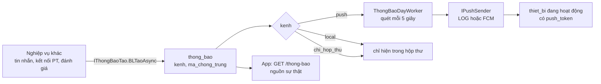

# Thông báo: hộp thư, đăng ký thiết bị và push FCM

> **Ngày viết:** 24/11/2026 · **Trạng thái:** đã triển khai (hộp thư, đăng ký thiết bị, worker đẩy push với bản log, màn thông báo và chuông trên mobile); chưa làm FCM thật, nhắc giờ local, cài đặt kênh, push dự phòng, iOS · **Đối chiếu code:** 064d133 (+ thay đổi chưa commit ở `apps/mobile/app.json`)

Tài liệu này mô tả phần thông báo đã có trong code và cách thiết lập Firebase Cloud Messaging (FCM) để push tới máy thật.
Lý do thiết kế nằm ở [ADR-2](../adr/0002-thong-bao-day-bang-fcm-truc-tiep-outbox.md); tài liệu này không lặp lại, chỉ nói "đang chạy thế nào" và "làm gì tiếp".

## 1. Hiện trạng

| Phần | Trạng thái |
| --- | --- |
| Hộp thư `thong_bao`, đọc, đánh dấu đã đọc | Đã có (backend và mobile) |
| Đăng ký thiết bị, push token, múi giờ; gỡ khi đăng xuất | Đã có |
| Worker đẩy push: giành dòng có điều kiện, backoff, phân loại lỗi, gỡ token chết | Đã có, có test |
| Gửi qua FCM thật | **Chưa**: `ThongBao:PushProvider = LOG` chỉ ghi log (`LogPushSender`) |
| Nhắc ăn, nhắc tập bằng local notification (ADR-2, quyết định 12 đến 18) | Chưa |
| Cài đặt bật/tắt từng loại (có bảng `cai_dat_thong_bao`, chưa có API) | Chưa |
| Push dự phòng khi lịch local không phủ được (quyết định 20) | Chưa |
| iOS (cần Apple Developer và khóa APNs) | Chưa |

## 2. Luồng



- `thong_bao` là nguồn sự thật, push chỉ là cái chuông. App tải lại hộp thư mỗi lần mở app, quay lại foreground và khi nhận push.
- Kênh mặc định theo loại: `nhac_an`, `nhac_tap` là `local`; loại còn lại là `push`. Loại mà người dùng đã tắt thì `chi_hop_thu` (vẫn ghi dòng, không chuông).
- Kết quả một dòng sau khi gửi: có ít nhất một thiết bị nhận thì `da_gui`; lỗi tạm thì `cho_gui` lại với backoff (30 giây, gấp đôi mỗi lần, tối đa 10 phút, tối đa 5 lần) rồi `loi`; lỗi cấu hình thì `loi` ngay; không còn thiết bị nào (hoặc mọi token đều chết) thì `huy` nhưng dòng vẫn trong hộp thư.
- Payload push chỉ có `thong_bao.Id`, loại, đối tượng và tiêu đề ngắn. Nội dung chi tiết không đi qua push.

## 3. API (kênh mobile, cần đăng nhập)

| Việc | Gọi |
| --- | --- |
| Hộp thư, mới nhất trước | `GET /api/v1/mob/thong-bao?chi_chua_doc=&bo_qua=&so_luong=` (tối đa 50) → `{ data, con_nua }` |
| Số chưa đọc (cho chấm trên chuông) | `GET /api/v1/mob/thong-bao/so-chua-doc` → `{ so_chua_doc }` |
| Đánh dấu một dòng đã đọc | `POST /api/v1/mob/thong-bao/{id}/da-doc` (204; 404 nếu không phải của mình) |
| Đánh dấu tất cả đã đọc | `POST /api/v1/mob/thong-bao/da-doc-tat-ca` → `{ so_dong }` |
| Đăng ký hoặc cập nhật thiết bị | `PUT /api/v1/mob/thiet-bi` body `{ ma_thiet_bi, nen_tang, push_token, mui_gio }` |
| Gỡ thiết bị (trước khi đăng xuất) | `DELETE /api/v1/mob/thiet-bi/{maThietBi}` |
| Tạo thông báo thử cho chính mình | `POST /api/v1/mob/thong-bao/thu-nghiem`, **chỉ Development** |

## 4. Tạo thông báo từ module khác

Module khác không tham chiếu `BLThongBao`; gọi qua `IThongBaoTao` trong `GymBase.ModuleContracts`:

```csharp
await thongBaoTao.BLTaoAsync(new TaoThongBaoRequest(
    TaiKhoanId: nguoiNhan,
    LoaiThongBao: "tin_nhan",
    TieuDe: "Bạn có tin nhắn mới",      // trung tính: hiện cả trên màn hình khóa
    NoiDung: null,
    LoaiDoiTuong: "tin_nhan",
    DoiTuongId: tinNhanId,
    MaChongTrung: $"tin_nhan:{tinNhanId}"));
```

- `MaChongTrung` unique cùng tài khoản; gọi lại cùng mã thì trả Id dòng đã có, nên retry an toàn.
- Hiện hàm ghi dòng ngay, **chưa nằm cùng transaction** với nghiệp vụ gọi nó (ADR-2, quyết định 3). Cần thêm unit of work khi gắn vào tin nhắn thật.

## 5. Cấu hình `ThongBao` (appsettings)

| Khóa | Mặc định | Ý nghĩa |
| --- | --- | --- |
| `PushProvider` | `LOG` | `LOG` chỉ ghi log; `FCM` (chưa có code) |
| `IntervalSeconds` | 5 | Giây giữa hai lượt quét của worker |
| `BatchSize` | 50 | Số dòng mỗi lượt |
| `MaxAttempts` | 5 | Số lần gặp lỗi tạm tối đa |
| `BackoffSeconds`, `MaxBackoffSeconds` | 30, 600 | Thời gian chờ thử lại và mức trần |
| `ReclaimMinutes` | 5 | Dòng `dang_gui` quá số phút này coi như worker đã chết và giành lại |

Khi làm `FcmPushSender`, đề xuất thêm hai khóa **chưa có trong code**: `ThongBao:Fcm:ProjectId` và `ThongBao:Fcm:CredentialsPath` (đường dẫn tới file service account, để ngoài repo, nạp qua user-secrets hoặc biến môi trường).

## 6. Thiết lập Firebase cho Android

Không cần thẻ thanh toán: FCM miễn phí trên gói Spark. Bỏ qua mọi lời mời nâng cấp lên Blaze hoặc gắn billing account.

1. Vào console.firebase.google.com, tạo project `gymbase-dev` (project riêng cho prod làm sau).
2. Thêm app Android với package name đúng `vn.gymbase.app` (xem `apps/mobile/app.json`). Không cần SHA-1 cho FCM.
3. Tải `google-services.json` và đặt vào `apps/mobile/google-services.json`. `app.json` đã có `android.googleServicesFile`.
4. Dựng lại bản dev build, vì đây là thay đổi native:
   ```bash
   cd apps/mobile
   npx expo prebuild --platform android
   npx expo run:android
   ```
   Thư mục `android/` đã có sẵn nên `expo run:android` một mình không áp cấu hình mới. Kiểm `git status` trước, và không dùng `--clean` nếu từng sửa tay trong `android/`.
5. **Expo Go không nhận push** (từ SDK 53). Máy ảo phải là image có **Google Play**.
6. Service account cho backend: Project settings → Service accounts → Generate new private key. Tab Cloud Messaging phải thấy **Firebase Cloud Messaging API (V1)** ở trạng thái Enabled. Cất file JSON ngoài repo, không commit, không dán vào chat hay issue.

`google-services.json` chứa khóa API của app Android (không phải bí mật như service account, nhưng gắn với project). Cần quyết định có commit hay không; hiện nó chưa được theo dõi bởi git.

## 7. Chạy thử

**Chưa cần Firebase** (kiểm hộp thư và worker):
1. Áp migration `ThemThongBaoOutbox`, chạy API ở Development.
2. Đăng nhập app, mở chuông, bấm **Gửi thông báo thử**. Dòng mới hiện trong hộp thư và chấm chưa đọc xuất hiện.
3. Log API có dòng "Giả lập push".

**Kiểm đường Google → máy** (chưa cần backend gửi):
1. Đăng nhập trên dev build, cho phép thông báo. Bảng `thiet_bi` phải có `push_token` dài khoảng 150 đến 200 ký tự.
2. Firebase console → Messaging → Send test message, dán token. Đưa app xuống nền hoặc khóa màn hình trước khi gửi.

## 8. Xử lý sự cố

| Triệu chứng | Nguyên nhân thường gặp |
| --- | --- |
| `push_token` NULL | Đang chạy Expo Go; thiếu `google-services.json` hoặc chưa prebuild lại; chưa cấp quyền thông báo (Android 13+); máy ảo không có Google Play; package name trong Firebase khác `vn.gymbase.app` |
| Có token nhưng không nhận push | Chưa có `FcmPushSender` (đang dùng `LOG`); thiết bị đã bị tắt `dang_hoat_dong` sau khi token chết |
| Thông báo vào hộp thư nhưng không có chuông | Dòng có `kenh` là `local` hoặc `chi_hop_thu` (nhắc ăn, nhắc tập, hoặc loại đã tắt) |
| Chấm chưa đọc không cập nhật | App chỉ tải lại khi mở, quay lại foreground, nhận push hoặc đánh dấu đã đọc |

## 9. Còn lại

- **`FcmPushSender`** (FCM HTTP v1 bằng service account; `channel_id` bằng đúng `loai_thong_bao`; ưu tiên và TTL theo loại; quy kết quả về bốn nhóm lỗi của worker). Cần Firebase của bạn.
- **iOS:** `getDevicePushTokenAsync` trên iOS thường trả token APNs, không phải token FCM mà ADR-2 giả định. Muốn đi qua FCM cần thêm `@react-native-firebase/messaging` hoặc tương đương, rồi sửa ADR-2. Không ảnh hưởng Android.
- Nhắc giờ local, cài đặt kênh, push dự phòng (ADR-2, quyết định 12 đến 20); phụ thuộc module lộ trình.
- Bấm push khi app đã tắt hẳn chưa mở màn tương ứng; điều hướng sau khi bấm thông báo đang tạm mở màn lộ trình. Tìm `TODO(THONGBAO)` trong repo.
- Cập nhật `database/diagrams/08-thong-bao.md` cho khớp cột mới (`kenh`, `so_lan_thu`, `thoi_diem_thu_lai`, `thoi_diem_nhan`, `mui_gio`, bảng `cai_dat_thong_bao`).
