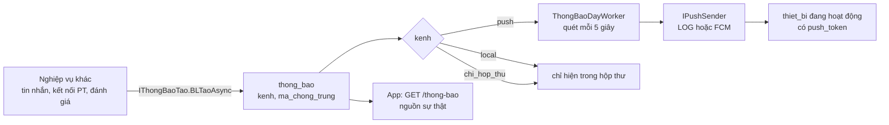

# Thông báo: hộp thư, đăng ký thiết bị và push FCM

> **Ngày viết:** 24/11/2026 · **Cập nhật:** 25/11/2026 · **Trạng thái:** đã triển khai (hộp thư, đăng ký thiết bị, worker đẩy push, FcmPushSender, nhắc ăn và nhắc tập local, màn thông báo và chuông trên mobile); chưa làm cài đặt kênh, push dự phòng, iOS; nhắc local đang chạy trên dữ liệu lộ trình mẫu · **Đối chiếu code:** de49c59

Tài liệu này mô tả phần thông báo đã có trong code và cách thiết lập Firebase Cloud Messaging (FCM) để push tới máy thật.
Lý do thiết kế nằm ở [ADR-2](../adr/0002-thong-bao-day-bang-fcm-truc-tiep-outbox.md); tài liệu này không lặp lại, chỉ nói "đang chạy thế nào" và "làm gì tiếp".

## 1. Hiện trạng

| Phần | Trạng thái |
| --- | --- |
| Hộp thư `thong_bao`, đọc, đánh dấu đã đọc | Đã có (backend và mobile) |
| Đăng ký thiết bị, push token, múi giờ; gỡ khi đăng xuất | Đã có |
| Worker đẩy push: giành dòng có điều kiện, backoff, phân loại lỗi, gỡ token chết | Đã có, có test |
| Gửi qua FCM (`FcmPushSender`) | Đã có code và test bằng HTTP giả; **chưa thử với Firebase thật**. Mặc định `PushProvider = LOG` chỉ ghi log |
| Nhắc ăn, nhắc tập bằng local notification (ADR-2, quyết định 12 đến 16) | Đã có (mobile); đang đọc **kế hoạch mẫu** vì lộ trình chưa có API. Server chưa tạo dòng hộp thư cho hai loại này (quyết định 17, 18) |
| Cài đặt bật/tắt từng loại (có bảng `cai_dat_thong_bao`, chưa có API) | Chưa |
| Push dự phòng khi lịch local không phủ được (quyết định 20) | Chưa |
| iOS (cần Apple Developer và khóa APNs) | Chưa |

## 2. Luồng



- `thong_bao` là nguồn sự thật, push chỉ là cái chuông. App tải lại hộp thư mỗi lần mở app, quay lại foreground và khi nhận push.
- Kênh mặc định theo loại: `nhac_an`, `nhac_tap` là `local`; loại còn lại là `push`. Loại mà người dùng đã tắt thì `chi_hop_thu` (vẫn ghi dòng, không chuông).
- Kết quả một dòng sau khi gửi: có ít nhất một thiết bị nhận thì `da_gui`; lỗi tạm thì `cho_gui` lại với backoff (30 giây, gấp đôi mỗi lần, tối đa 10 phút, tối đa 5 lần) rồi `loi`; lỗi cấu hình thì `loi` ngay; không còn thiết bị nào (hoặc mọi token đều chết) thì `huy` nhưng dòng vẫn trong hộp thư.
- Payload push chỉ có `thong_bao.Id`, loại, đối tượng và tiêu đề ngắn. Nội dung chi tiết không đi qua push.

## 3. Nhắc ăn và nhắc tập trên máy

Hai loại này không đi qua server: app tự đặt lịch trên máy nên chạy không cần mạng, không phụ thuộc FCM hay APNs.

- **Hai mốc cố định** cho mỗi sự kiện: 15 phút trước và đúng lúc. Mốc đã qua thì bỏ (sự kiện bắt đầu trong 15 phút tới chỉ có mốc đúng lúc). Người dùng không chỉnh được giờ nhắc.
- **Cửa sổ ngắn:** chỉ đặt các nhắc trong 14 ngày tới và tối đa 50 nhắc gần nhất (iOS giới hạn khoảng 64 lịch đang chờ). Mỗi lần đồng bộ nạp lại cửa sổ.
- **Đồng bộ idempotent** (`dongBoNhacGioAsync`): tính lại toàn bộ nhắc cần có, rồi thêm, đặt lại (đổi giờ) và hủy cho khớp lịch trên máy. Identifier cố định `{loai}:{maSuKien}:{yyyy-MM-dd}:{truoc15|dung_luc}` nên đặt lại là thay thế, không nhân đôi. Chỉ chạm vào nhắc có tiền tố `nhac_an:` hoặc `nhac_tap:`.
- **Khi nào đồng bộ:** vào app, khi kế hoạch hoặc check-in đổi (nhiệm vụ hôm nay đã check thì bỏ nhắc), và mỗi lần quay lại foreground (cũng là lúc quyền thông báo vừa đổi trong cài đặt, hoặc sang ngày mới). Đăng xuất hủy hết nhắc, để máy dùng chung không nhắc theo lịch của người trước.
- **Nội dung trung tính** ("Sắp đến giờ tập", "Đến giờ ăn", "Mở GymBase để xem chi tiết."): nhắc hiện trên màn hình khóa nên không ghi giờ, bài tập hay món ăn. Mỗi nhắc đi qua kênh Android cùng tên loại (`nhac_tap`, `nhac_an`).
- **Múi giờ** là múi giờ của máy: giờ trong kế hoạch được hiểu theo giờ địa phương.

Mã nguồn: phần tính và đồng bộ ở `apps/mobile/src/shared/notifications/nhac-gio.ts` (không phụ thuộc lộ trình); phần đổi kế hoạch thành sự kiện ở `features/lo-trinh/utils/nhac-gio.ts`; `NhacGioSync` gắn trong nhóm đã đăng nhập.

**Đang dùng dữ liệu mẫu:** lộ trình chưa có API nên `NhacGioSync` đọc kế hoạch mẫu (`taoKeHoachMau`, có `TODO(ROUTE)`). Khi có API lộ trình chỉ cần đổi nguồn kế hoạch; phần tính và đồng bộ giữ nguyên. Quyết định 14 muốn có số phiên bản của lộ trình để chỉ tính lại khi đổi; hiện đồng bộ luôn tính lại (rẻ, vì idempotent).

## 4. API (kênh mobile, cần đăng nhập)

| Việc | Gọi |
| --- | --- |
| Hộp thư, mới nhất trước | `GET /api/v1/mob/thong-bao?chi_chua_doc=&bo_qua=&so_luong=` (tối đa 50) → `{ data, con_nua }` |
| Số chưa đọc (cho chấm trên chuông) | `GET /api/v1/mob/thong-bao/so-chua-doc` → `{ so_chua_doc }` |
| Đánh dấu một dòng đã đọc | `POST /api/v1/mob/thong-bao/{id}/da-doc` (204; 404 nếu không phải của mình) |
| Đánh dấu tất cả đã đọc | `POST /api/v1/mob/thong-bao/da-doc-tat-ca` → `{ so_dong }` |
| Đăng ký hoặc cập nhật thiết bị | `PUT /api/v1/mob/thiet-bi` body `{ ma_thiet_bi, nen_tang, push_token, mui_gio }` |
| Gỡ thiết bị (trước khi đăng xuất) | `DELETE /api/v1/mob/thiet-bi/{maThietBi}` |
| Tạo thông báo thử cho chính mình | `POST /api/v1/mob/thong-bao/thu-nghiem`, **chỉ Development** |

## 5. Tạo thông báo từ module khác

Module khác không tham chiếu `BLThongBao`; gọi qua `IThongBaoTao` trong `GymBase.ModuleContracts`:

```csharp
await thongBaoTao.BLTaoAsync(new TaoThongBaoRequest(
    TaiKhoanId: nguoiNhan,
    LoaiThongBao: "tin_nhan",
    TieuDe: "Bạn có tin nhắn mới",      // trung tính: hiện cả trên màn hình khóa
    NoiDung: null,
    LoaiDoiTuong: "tin_nhan",
    DoiTuongId: tinNhanId,
    MaChongTrung: $"tin_nhan:{tinNhanId}"));
```

- `MaChongTrung` unique cùng tài khoản; gọi lại cùng mã thì trả Id dòng đã có, nên retry an toàn.
- Hiện hàm ghi dòng ngay, **chưa nằm cùng transaction** với nghiệp vụ gọi nó (ADR-2, quyết định 3). Cần thêm unit of work khi gắn vào tin nhắn thật.

## 6. Cấu hình `ThongBao` (appsettings)

| Khóa | Mặc định | Ý nghĩa |
| --- | --- | --- |
| `PushProvider` | `LOG` | `LOG` chỉ ghi log; `FCM` gửi thật. Giá trị khác, hoặc `FCM` mà cấu hình sai, làm API dừng ngay lúc khởi động |
| `Fcm:CredentialsPath` | rỗng | Đường dẫn tới file JSON service account (bắt buộc khi `FCM`; file phải tồn tại) |
| `Fcm:ProjectId` | rỗng | Id project Firebase; bỏ trống thì đọc `project_id` trong file service account |
| `IntervalSeconds` | 5 | Giây giữa hai lượt quét của worker |
| `BatchSize` | 50 | Số dòng mỗi lượt |
| `MaxAttempts` | 5 | Số lần gặp lỗi tạm tối đa |
| `BackoffSeconds`, `MaxBackoffSeconds` | 30, 600 | Thời gian chờ thử lại và mức trần |
| `ReclaimMinutes` | 5 | Dòng `dang_gui` quá số phút này coi như worker đã chết và giành lại |

Khóa service account là bí mật: để file ngoài repo, nạp đường dẫn qua user-secrets (`dotnet user-secrets set "ThongBao:Fcm:CredentialsPath" "C:\...\gymbase-fcm.json"`) hoặc biến môi trường `ThongBao__Fcm__CredentialsPath`.

## 7. Thiết lập Firebase cho Android

Không cần thẻ thanh toán: FCM miễn phí trên gói Spark. Bỏ qua mọi lời mời nâng cấp lên Blaze hoặc gắn billing account.

1. Vào console.firebase.google.com, tạo project `gymbase-dev` (project riêng cho prod làm sau).
2. Thêm app Android với package name đúng `vn.gymbase.app` (xem `apps/mobile/app.json`). Không cần SHA-1 cho FCM.
3. Tải `google-services.json` và đặt vào `apps/mobile/google-services.json`. `app.json` đã có `android.googleServicesFile`.
4. Dựng lại bản dev build, vì đây là thay đổi native:
   ```bash
   cd apps/mobile
   npx expo prebuild --platform android
   npx expo run:android
   ```
   Thư mục `android/` đã có sẵn nên `expo run:android` một mình không áp cấu hình mới. Kiểm `git status` trước, và không dùng `--clean` nếu từng sửa tay trong `android/`.
5. **Expo Go không nhận push** (từ SDK 53). Máy ảo phải là image có **Google Play**.
6. Service account cho backend: Project settings → Service accounts → Generate new private key. Tab Cloud Messaging phải thấy **Firebase Cloud Messaging API (V1)** ở trạng thái Enabled. Cất file JSON ngoài repo, không commit, không dán vào chat hay issue.

`google-services.json` chứa khóa API của app Android (không phải bí mật như service account, nhưng gắn với project). Repo công khai nên file này **không commit** (đã có trong `.gitignore`): ai build Android thì tự tải từ Firebase console và đặt vào đúng chỗ, thiếu file thì prebuild báo lỗi.

## 8. Chạy thử

**Với FCM thật** (sau khi xong mục 7): đặt `ThongBao:PushProvider = FCM` và `ThongBao:Fcm:CredentialsPath` bằng user-secrets, chạy API ở Development, đăng nhập trên dev build, rồi bấm **Gửi thông báo thử** ở màn thông báo (đưa app xuống nền trước khi bấm). Log API ghi số dòng, số tin thành công, token chết. Push gửi tới đúng `channel_id` bằng loại thông báo.

**Chưa cần Firebase** (kiểm hộp thư và worker):
1. Áp migration `ThemThongBaoOutbox`, chạy API ở Development.
2. Đăng nhập app, mở chuông, bấm **Gửi thông báo thử**. Dòng mới hiện trong hộp thư và chấm chưa đọc xuất hiện.
3. Log API có dòng "Giả lập push".

**Thử nhắc local khi đã tắt app** (bản dev): ở màn thông báo bấm **Nhắc thử trên máy sau 30 giây** rồi tắt app. Nhắc đặt thẳng trên máy nên hiện kể cả khi mất mạng hoặc API tắt. Nhắc theo kế hoạch mẫu (bữa ăn 07:00, 12:00, 19:00, buổi tập theo thứ) hiện vào 15 phút trước và đúng giờ đó.

**Kiểm đường Google → máy** (chưa cần backend gửi):
1. Đăng nhập trên dev build, cho phép thông báo. Bảng `thiet_bi` phải có `push_token` dài khoảng 150 đến 200 ký tự.
2. Firebase console → Messaging → Send test message, dán token. Đưa app xuống nền hoặc khóa màn hình trước khi gửi.

## 9. Xử lý sự cố

| Triệu chứng | Nguyên nhân thường gặp |
| --- | --- |
| `push_token` NULL | Đang chạy Expo Go; thiếu `google-services.json` hoặc chưa prebuild lại; chưa cấp quyền thông báo (Android 13+); máy ảo không có Google Play; package name trong Firebase khác `vn.gymbase.app` |
| Có token nhưng không nhận push | `PushProvider` vẫn là `LOG`; thiết bị đã bị tắt `dang_hoat_dong` sau khi token chết; dòng `thong_bao` ở trạng thái `loi` (xem log: `LoiCauHinh` thường là sai service account hoặc project) |
| API không khởi động, báo `ThongBao:Fcm:CredentialsPath` | `PushProvider = FCM` nhưng đường dẫn rỗng hoặc file không tồn tại |
| Thông báo vào hộp thư nhưng không có chuông | Dòng có `kenh` là `local` hoặc `chi_hop_thu` (nhắc ăn, nhắc tập, hoặc loại đã tắt) |
| Chấm chưa đọc không cập nhật | App chỉ tải lại khi mở, quay lại foreground, nhận push hoặc đánh dấu đã đọc |

## 10. Còn lại

- **iOS:** `getDevicePushTokenAsync` trên iOS thường trả token APNs, không phải token FCM mà ADR-2 giả định. Muốn đi qua FCM cần thêm `@react-native-firebase/messaging` hoặc tương đương, rồi sửa ADR-2. Không ảnh hưởng Android.
- Cài đặt bật/tắt từng loại (có bảng, chưa có API), push dự phòng khi lịch local không phủ được (quyết định 19, 20); server tạo dòng hộp thư kênh `local` cho nhắc ăn, nhắc tập (quyết định 17, 18). Các việc này cần lộ trình có API.
- Nhắc local: quyền báo thức chính xác trên Android 12 trở lên (`SCHEDULE_EXACT_ALARM`, mặc định bị từ chối từ Android 14) có thể làm nhắc lệch vài phút; cần thử trên máy thật, kể cả việc lịch có còn sau khi khởi động lại máy. Chưa có cách phát hiện lịch local bị mất (ADR-2, điểm còn mở).
- Bấm push khi app đã tắt hẳn chưa mở màn tương ứng; điều hướng sau khi bấm thông báo đang tạm mở màn lộ trình. Tìm `TODO(THONGBAO)` trong repo.
- Cập nhật `database/diagrams/08-thong-bao.md` cho khớp cột mới (`kenh`, `so_lan_thu`, `thoi_diem_thu_lai`, `thoi_diem_nhan`, `mui_gio`, bảng `cai_dat_thong_bao`).
