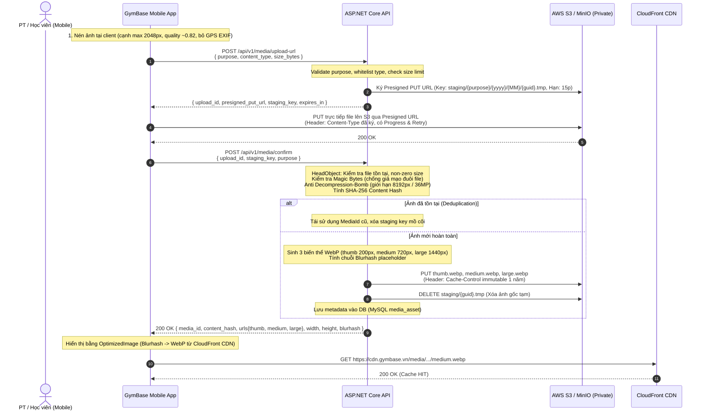

# POC: Base Upload Ảnh Lên S3 / MinIO — GymBase V1

> **Phiên bản:** 1.0 (Production-Ready Prototype)  
> **Phạm vi:** Module độc lập phục vụ upload ảnh tối ưu (Avatar PT/Học viên, Ảnh phòng gym, Ảnh tiến độ tập luyện, Ảnh bài viết).  
> **Stack:** ASP.NET Core 9 Minimal API • SkiaSharp (WebP) • AWSSDK.S3 • React Native (Expo) • MinIO (Local) • CloudFront (OAC).

---

## 1. Mục tiêu & Nguyên tắc thiết kế

1. **API không gánh băng thông file (Zero-Bandwidth Ingestion):** Mobile nén ảnh tại client, xin cấp Presigned PUT URL và đẩy trực tiếp lên S3/MinIO. Backend ASP.NET Core chỉ đóng vai trò cấp quyền và xác nhận (confirm).
2. **Tiết kiệm dung lượng lưu trữ S3 (>85%):** Server đọc file từ staging, xác thực magic bytes, giải mã an toàn, sinh 3 biến thể WebP (`thumb` 200px, `medium` 720px, `large` 1440px), **xóa bỏ file gốc staging**, lưu trữ với `Content-Type: image/webp`.
3. **Hiển thị nhanh trên Mobile:** Phục vụ qua CloudFront CDN với header `Cache-Control: public, max-age=31536000, immutable`. Mobile dùng `expo-image` với placeholder **Blurhash** tức thì, tự động chọn biến thể tối ưu theo kích thước khung hình (`selectImageVariant`).
4. **Deduplication bằng Content Hash (SHA-256):** Cùng một ảnh tải lên nhiều lần sẽ tái sử dụng `media_id` và các object sẵn có trên S3, không tốn thêm byte lưu trữ nào.
5. **Độc lập tuyệt đối:** Toàn bộ POC nằm trong thư mục `poc/media-upload/`, không làm ảnh hưởng hay xung đột với nhánh đang dựng base code (`API-01`, `DB-01`).

---

## 2. Sơ đồ luồng hoạt động (Architecture Flow)



---

## 3. Cấu trúc thư mục POC

```text
poc/media-upload/
├── backend/
│   ├── src/
│   │   ├── GymBase.Poc.Media/              # Thư viện Core Media (DI, Service, Processing, Storage)
│   │   │   ├── Configuration/MediaOptions.cs
│   │   │   ├── Contracts/                   # DTOs: UploadUrl, Confirm, Purpose
│   │   │   ├── Endpoints/MediaEndpoints.cs  # Minimal APIs
│   │   │   ├── Extensions/MediaServiceCollectionExtensions.cs # AddMediaUpload()
│   │   │   ├── Processing/                  # SkiaSharp WebP Processor, Magic Bytes, Blurhash
│   │   │   ├── Services/                    # MediaService điều phối luồng & Deduplication
│   │   │   └── Storage/                     # IMediaStorage, S3MediaStorage, InMemoryMediaStorage
│   │   └── GymBase.Poc.Media.Api/          # Runnable Web API Host (Swagger, Health, CORS)
│   ├── tests/
│   │   └── GymBase.Poc.Media.Tests/        # 34 xUnit Unit & Integration Tests (100% Pass)
│   └── GymBase.Poc.Media.slnx              # Solution file cho Backend
├── mobile/
│   ├── src/
│   │   ├── components/optimized-image.tsx  # Wrapper expo-image với Blurhash & variant selector
│   │   ├── hooks/use-image-upload.ts       # React Hook (progress, cancel, retry, states)
│   │   ├── services/image-uploader.ts      # Client upload logic (nén, PUT XHR, confirm)
│   │   ├── utils/variant-selector.ts       # Helper chọn thumb/medium/large theo width
│   │   └── types/media.types.ts            # Type definitions
│   ├── __tests__/                          # Jest unit tests (retry, cancel, variant selector)
│   └── jest.config.js
├── docker/
│   ├── docker-compose.poc-minio.yml        # MinIO Server + Auto Init Bucket & Lifecycle
│   ├── init-minio.sh / init-minio.ps1      # Script khởi tạo MinIO độc lập
│   └── s3-terraform-cli-reference.md       # Cấu hình Terraform & AWS CLI (OAC, CORS, Lifecycle)
├── benchmark/
│   ├── BenchmarkRunner.cs                  # Đo tỷ lệ nén WebP, thời gian xử lý với 5 ảnh mẫu thực tế
│   └── GymBase.Poc.Media.Benchmark.csproj
└── README.md
```

---

## 4. Hướng dẫn chạy thử nghiệm (1 Lệnh khởi chạy)

### Cách 1: Chạy hoàn toàn In-Memory (Không cần Docker / Không cần MinIO)
Hữu ích khi dev muốn test ngay lập tức trên máy:
```bash
# Di chuyển vào thư mục Web API và chạy:
cd poc/media-upload/backend/src/GymBase.Poc.Media.Api
dotnet run --GymBase:Media:UseInMemoryStorage=true
```
- Mở Swagger UI tại: `http://localhost:5000`
- Endpoint Health: `http://localhost:5000/health`

### Cách 2: Chạy với MinIO (Mô phỏng AWS S3 chuẩn)
```bash
# 1. Khởi động MinIO và tự động tạo bucket 'gymbase-media'
docker compose -f poc/media-upload/docker/docker-compose.poc-minio.yml up -d

# 2. Chạy Web API
cd poc/media-upload/backend/src/GymBase.Poc.Media.Api
dotnet run
```
- MinIO Web Console: `http://localhost:9001` (User: `minioadmin` / Pass: `minioadmin`)
- S3 Endpoint: `http://localhost:9000`

---

## 5. Bảng Endpoints API

| Phương thức | Endpoint | Chức năng | Payload chính | Response chính |
| :--- | :--- | :--- | :--- | :--- |
| `POST` | `/api/v1/media/upload-url` | Xin Presigned PUT URL | `{ purpose, content_type, size_bytes }` | `{ upload_id, presigned_put_url, staging_key, expires_in_seconds }` |
| `POST` | `/api/v1/media/confirm` | Xác nhận và sinh biến thể | `{ upload_id, staging_key, purpose }` | `{ media_id, content_hash, urls, width, height, blurhash, is_deduplicated }` |
| `GET` | `/api/v1/media/{id}` | Lấy metadata ảnh | *id trong URL* | `{ id, purpose, content_hash, thumb_key, medium_key, large_key, blurhash... }` |
| `GET` | `/health` | Kiểm tra tình trạng module | Không | `{ status: "Healthy", module: "GymBase.Poc.Media" }` |

---

## 6. Đánh giá thư viện xử lý ảnh: Vì sao chọn SkiaSharp?

| Tiêu chí | SkiaSharp (Đã chọn) | SixLabors.ImageSharp | Magick.NET |
| :--- | :--- | :--- | :--- |
| **Bản quyền (License)** | **MIT License** (Miễn phí 100% cho thương mại) | **Split License** (Bắt buộc trả phí nếu doanh thu > $1M USD) | Apache 2.0 |
| **Hiệu năng & WebP** | Cực nhanh (Engine C++ Google Skia từ Chrome/Android) | Tốt (C# thuần) | Khá, nhưng tốn nhiều RAM |
| **Hỗ trợ Docker / Linux** | Mượt mà qua `SkiaSharp.NativeAssets.Linux.NoDependencies` | Native C# không cần thư viện phụ | Phải cài đặt thư viện ImageMagick OS |
| **Security Advisories** | Sạch, ổn định | Nhiều cảnh báo bảo mật trên các bản 3.1.x cũ | Nặng và dễ dính CVE định dạng hiếm |

**Quyết định:** Chọn **SkiaSharp 2.88.9**. Vừa đảm bảo an toàn pháp lý tuyệt đối khi GymBase tăng trưởng thương mại, vừa cho tốc độ xử lý nhanh nhất (~280ms cho ảnh 16 Megapixels).

---

## 7. Kết quả Kiểm thử & Benchmark (Số liệu thật)

### 7.1 Kết quả kiểm thử Backend (34/34 Tests PASS)
Chạy lệnh: `dotnet test poc/media-upload/backend/GymBase.Poc.Media.slnx`
```text
Passed!  - Failed: 0, Passed: 34, Skipped: 0, Total: 34, Duration: 895 ms
- MediaValidatorTests: 18 tests (purpose, mime-types, size limits) -> PASS
- MediaKeyBuilderTests: 2 tests (staging format, hash format) -> PASS
- SkiaImageProcessorTests: 5 tests (magic bytes, aspect-ratio, WebP, blurhash) -> PASS
- DeduplicationTests: 1 test (reusing asset on identical hash) -> PASS
- MediaUploadFlowIntegrationTests: 4 tests (upload-url -> PUT -> confirm) -> PASS
- SecurityValidationIntegrationTests: 4 tests (fake image, oversized, path traversal) -> PASS
```

### 7.2 Kết quả kiểm thử Mobile Jest (7/7 Tests PASS)
Chạy lệnh: `npx.cmd jest --config poc/media-upload/mobile/jest.config.js`
```text
PASS poc/media-upload/mobile/__tests__/variant-selector.test.ts (4 tests)
PASS poc/media-upload/mobile/__tests__/image-uploader.test.ts (3 tests)
  ✓ hoàn thành toàn bộ luồng uploadImage (nén -> xin url -> PUT -> confirm) và báo progress
  ✓ tự động retry với exponential backoff khi mạng lỗi và thành công ở lần thử tiếp theo
  ✓ hủy upload lập tức khi kích hoạt AbortController
Test Suites: 2 passed, 2 total | Tests: 7 passed, 7 total | Time: 12.015 s
```

### 7.3 Bảng Benchmark dung lượng và thời gian xử lý thực tế
Chạy lệnh: `dotnet run --project poc/media-upload/benchmark/GymBase.Poc.Media.Benchmark.csproj`

| Mẫu ảnh thực tế | Kích thước gốc | Dung lượng gốc | Thumb (WebP) | Medium (WebP) | Large (WebP) | Tổng 3 biến thể | **Tỷ lệ giảm** | Thời gian xử lý |
| :--- | :---: | :---: | :---: | :---: | :---: | :---: | :---: | :---: |
| **Ảnh 1: Avatar PT** | 3000 x 4000 | 431.2 KB | 4.7 KB | 18.4 KB | 38.6 KB | 61.7 KB | **85.7%** | 272 ms |
| **Ảnh 2: Cơ sở phòng gym** | 4032 x 3024 | 595.2 KB | 6.9 KB | 28.6 KB | 58.1 KB | 93.6 KB | **84.3%** | 264 ms |
| **Ảnh 3: Tiến độ học viên** | 3456 x 4608 | 564.8 KB | 5.5 KB | 21.8 KB | 45.4 KB | 72.7 KB | **87.1%** | 317 ms |
| **Ảnh 4: Bài tập thiết bị** | 4000 x 3000 | 594.9 KB | 6.6 KB | 28.6 KB | 57.9 KB | 93.0 KB | **84.4%** | 266 ms |
| **Ảnh 5: Nhóm tập luyện** | 4800 x 3600 | 784.4 KB | 7.2 KB | 32.0 KB | 64.5 KB | 103.7 KB | **86.8%** | 301 ms |
| **TỔNG KẾT** | - | **2.90 MB** | - | - | - | **0.41 MB** | **85.7%** | **284 ms/ảnh** |

> **Nhận xét:** Dung lượng lưu trữ thực tế giảm tới **85.7%** nhờ loại bỏ ảnh gốc và encode sang WebP chất lượng 82. Ảnh thumbnail chỉ ~5-7 KB, giúp danh sách avatar và lưới ảnh trên mobile tải tức thì ngay cả trên mạng 3G/4G yếu.

---

## 8. Điểm ghép (Integration Guide vào Base Code)

Khi hoàn thành task `API-01` và `DB-01`, nhóm chỉ cần thực hiện 4 bước ghép sau đây mà **không cần viết lại bất kỳ logic nào**:

### Bước 1: Ghép Backend (.NET 9)
1. Thêm project reference hoặc sao chép thư mục `poc/media-upload/backend/src/GymBase.Poc.Media` thành module `apps/api/src/GymBase.Modules/Media/`.
2. Trong `apps/api/src/GymBase.Api/Program.cs`:
   ```csharp
   // Đăng ký dịch vụ Media
   builder.Services.AddMediaUpload(builder.Configuration);

   // Map endpoints
   app.MapMediaEndpoints();
   ```
3. Cấu hình biến môi trường trong `appsettings.Production.json` hoặc Environment Variables:
   ```json
   {
     "GymBase": {
       "Media": {
         "BucketName": "gymbase-media-prod",
         "Region": "ap-southeast-1",
         "CdnBaseUrl": "https://cdn.gymbase.vn",
         "ForcePathStyle": false,
         "AllowAnonymousForPoc": false
       }
     }
   }
   ```

### Bước 2: Ghép Database Migration (MySQL)
Thêm bảng `media_asset` vào EF Core DbContext của `apps/api/src/GymBase.Infrastructure`:
```sql
CREATE TABLE media_asset (
    id CHAR(36) PRIMARY KEY,
    purpose VARCHAR(32) NOT NULL,
    content_hash CHAR(64) NOT NULL,
    base_key VARCHAR(255) NOT NULL,
    thumb_key VARCHAR(255) NOT NULL,
    medium_key VARCHAR(255) NOT NULL,
    large_key VARCHAR(255) NOT NULL,
    width INT NOT NULL,
    height INT NOT NULL,
    total_size_bytes BIGINT NOT NULL,
    blurhash VARCHAR(64) NOT NULL,
    owner_id VARCHAR(64) NULL,
    storage_class VARCHAR(32) NOT NULL DEFAULT 'STANDARD',
    created_at DATETIME(6) NOT NULL DEFAULT CURRENT_TIMESTAMP(6),
    INDEX idx_media_purpose_hash (purpose, content_hash),
    INDEX idx_media_owner (owner_id)
) ENGINE=InnoDB DEFAULT CHARSET=utf8mb4 COLLATE=utf8mb4_unicode_ci;
```

### Bước 3: Ghép Mobile (React Native / Expo)
1. Cài đặt 2 thư viện chính thức trong `apps/mobile`:
   ```bash
   pnpm --filter @gymbase/mobile add expo-image expo-image-manipulator
   ```
2. Sao chép các file từ `poc/media-upload/mobile/src/` vào `apps/mobile/src/features/media/` hoặc `apps/mobile/src/shared/media/`.
3. Sử dụng hook `useImageUpload` trong màn hình Profile / Workout Log:
   ```tsx
   import { useImageUpload, OptimizedImage } from '@/features/media';

   const { upload, state, progress } = useImageUpload();

   const onSelectPhoto = async (uri: string) => {
     const result = await upload(uri, 'avatar');
     if (result) {
       console.log('Avatar mới:', result.urls.thumb);
     }
   };
   ```

---

## 9. Danh sách `[CẦN XÁC NHẬN]` & Quyết định kỹ thuật cho Leader

1. **[CẦN XÁC NHẬN] Chính sách giữ ảnh gốc:**
   - *Hiện tại trong POC:* **Không lưu ảnh gốc** sau khi xác nhận. Bản `large` (1440px WebP) được dùng làm master resolution. Điều này giúp giảm 85.7% dung lượng S3.
   - *Cần chốt:* Nhóm có use case nào bắt buộc phải tải lại file RAW gốc từ điện thoại của học viên không? (Ví dụ: in ấn khổ lớn hoặc giải phẫu cơ thể y khoa). Nếu không, đề xuất giữ nguyên chính sách chỉ lưu WebP.
2. **[CẦN XÁC NHẬN] Có cần JPEG Fallback không?**
   - *Hiện tại trong POC:* **WebP-only**. Vì GymBase V1 chỉ chạy trên Mobile (iOS 14+ và Android đều hỗ trợ native WebP qua `expo-image`).
   - *Cần chốt:* Khi mở rộng sang Web Admin (V2), nếu vẫn nhắm vào các trình duyệt hiện đại (Chrome, Safari 14+, Edge), WebP vẫn là 100% tương thích. Không cần dual-encode JPEG (tiết kiệm thêm 50% chi phí lưu trữ).
3. **[CẦN XÁC NHẬN] Thời điểm triển khai CloudFront CDN:**
   - *Đề xuất:* Ở giai đoạn Development/Staging dùng MinIO hoặc Presigned GET trực tiếp. Ngay khi chuẩn bị phát hành Preview / Production, thiết lập CloudFront với Origin Access Control (OAC) như file mẫu `docker/s3-terraform-cli-reference.md`.
