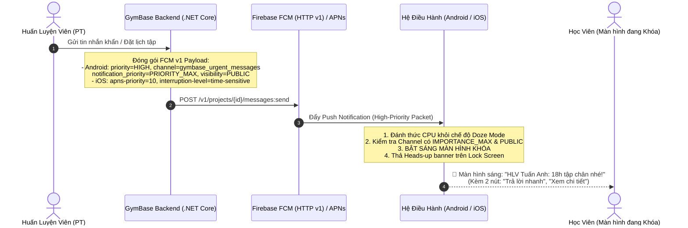

# POC: Bắn Tin Nhắn Lên Màn Hình Khóa & Báo Thức (GymBase Lock Screen Notifications & Alarms)

> **Dự án:** GymBase Monorepo (Nền tảng kết nối PT và Học viên)  
> **Mục tiêu:** Bắn thông báo / tin nhắn tức thì sáng màn hình người dùng kể cả khi điện thoại đang khóa (giống Messenger, Zalo, Facebook) và hỗ trợ chế độ Báo thức reo chuông nhắc giờ tập.  
> **Nền tảng:** ASP.NET Core 9 (Backend API) • React Native Expo SDK 58 (Mobile App) • Firebase Cloud Messaging (FCM HTTP v1) & Apple APNs.

---

## 1. Cơ Chế Hoạt Động (How It Works)

Để thông báo có thể **đánh thức CPU, bật sáng màn hình và hiển thị nổi bật trên màn hình khóa (Heads-up / Lock screen banner)**, hệ điều hành Android và iOS đòi hỏi cấu hình đồng bộ ở cả Backend và Mobile:



---

## 2. Các Mức Độ Hiển Thị Màn Hình Khóa Trong GymBase

| Mức độ | Use Case GymBase | Cơ chế kỹ thuật | Trải nghiệm người dùng |
|:---|:---|:---|:---|
| **Mức 1: Heads-up Banner (Giống Messenger, Zalo)** | PT nhắn tin cho học viên; PT duyệt bài tập; thay đổi lịch khẩn cấp. | FCM `priority: "HIGH"`, Android Channel `IMPORTANCE_MAX (5)`, `visibility: PUBLIC (1)`. iOS APNs `priority: 10`, `interruption-level: time-sensitive`. | Màn hình khóa sáng lên, chuông reo, thanh banner xuất hiện trên đầu màn hình khóa hiển thị avatar và tin nhắn rút gọn, bấm trả lời ngay. |
| **Mức 2: Báo thức (Alarm Reminder)** | Nhắc giờ tập trước 30 phút, nhắc uống nước, giờ dinh dưỡng sau tập. | Android AlarmManager + `WAKE_LOCK` + `SCHEDULE_EXACT_ALARM`. Expo `scheduleNotificationAsync` với sound lặp lại. | Chuông báo thức reo liên tục, rung mạnh, màn hình bật sáng với nút "Tắt báo thức" hoặc "Nhắc lại sau 5 phút". |
| **Mức 3: Cuộc gọi đến Full-Screen (Incoming Call)** | PT gọi video hướng dẫn bài tập trực tiếp cho học viên. | Android `USE_FULL_SCREEN_INTENT` + iOS `CallKit` (`react-native-callkeep`). | Màn hình khóa chuyển thành giao diện cuộc gọi toàn màn hình giống hệt cuộc gọi điện thoại thoại thoại thường. |

---

## 3. Cấu Trúc Backend (.NET Core 9)

Module nằm tại: `poc/notifications/backend/`
- `GymBase.Poc.Notification`:
  - `Contracts/PushNotificationModels.cs`: Định nghĩa `PushNotificationRequest`, `NotificationChannels`.
  - `Services/FcmV1PushNotificationService.cs`: Sinh JSON FCM v1 chuẩn với các flags:
    - Android: `priority: "HIGH"`, `notification_priority: "PRIORITY_MAX"`, `visibility: "PUBLIC"`.
    - iOS: `apns-priority: "10"`, `interruption-level: "time-sensitive"`.
  - `Endpoints/NotificationEndpoints.cs`:
    - `POST /api/v1/notifications/send`: Gửi thông báo đến thiết bị.
    - `POST /api/v1/notifications/preview-payload`: Kiểm tra payload FCM v1.

### Chạy Backend Notification POC:
```bash
# 1. Chạy Backend API
dotnet run --project poc/notifications/backend/src/GymBase.Poc.Notification.Api

# 2. Chạy Tests (100% Pass)
dotnet test poc/notifications/backend/GymBase.Poc.Notification.slnx
```

---

## 4. Cấu Trúc Mobile (React Native Expo SDK 58)

Module nằm tại: `poc/notifications/mobile/`

### 1. Cấu hình Quyền trong `app.json`:
```json
{
  "expo": {
    "plugins": [
      [
        "expo-notifications",
        {
          "icon": "./assets/notification-icon.png",
          "color": "#FF231F7C",
          "defaultChannel": "gymbase_urgent_messages"
        }
      ]
    ],
    "android": {
      "permissions": [
        "android.permission.POST_NOTIFICATIONS",
        "android.permission.WAKE_LOCK",
        "android.permission.SCHEDULE_EXACT_ALARM",
        "android.permission.USE_FULL_SCREEN_INTENT",
        "android.permission.VIBRATE"
      ]
    },
    "ios": {
      "infoPlist": {
        "UIBackgroundModes": ["remote-notification"]
      }
    }
  }
}
```

### 2. Đăng ký Channel khi ứng dụng khởi chạy (`_layout.tsx`):
```typescript
import { useEffect } from 'react';
import { setupNotificationChannelsAsync, requestNotificationPermissionsAsync } from './services/notification-service';

export default function RootLayout() {
  useEffect(() => {
    async function initNotifications() {
      await requestNotificationPermissionsAsync();
      await setupNotificationChannelsAsync();
    }
    initNotifications();
  }, []);

  return <Slot />;
}
```

### 3. Bắn tin nhắn khẩn cấp lên màn hình khóa:
```typescript
import { displayUrgentMessageAsync } from './services/notification-service';

await displayUrgentMessageAsync({
  title: 'HLV Tuấn Anh',
  body: 'Hôm nay tập ngực lúc 18h nhé, đừng quên mang bình nước!',
  data: {
    type: 'chat_message',
    conversation_id: 'conv-123',
    sender_id: 'pt-001',
  },
});
```

### 4. Lên lịch báo thức nhắc giờ tập (Alarm):
```typescript
import { scheduleWorkoutAlarmAsync } from './services/notification-service';

// Đặt báo thức lúc 17:30 (30 phút trước buổi tập)
const workoutAlarmTime = new Date('2026-11-10T17:30:00');

await scheduleWorkoutAlarmAsync({
  title: 'Báo thức: Chuẩn bị đến giờ tập Gym!',
  body: 'Buổi tập Lưng & Tay trước bắt đầu sau 30 phút.',
  triggerDate: workoutAlarmTime,
  workoutSessionId: 'sess-888',
});
```

### Chạy Mobile Tests:
```bash
npm.cmd test --prefix poc/notifications/mobile
```
**Kết quả:** 4/4 tests passed (100%).

---

## 5. Điểm Ghép Vào Solution Chính Của Dự Án GymBase

1. **Backend Integration:**
   - Đăng ký DI trong `apps/api/src/GymBase.Api/Program.cs`:
     ```csharp
     builder.Services.AddGymBaseNotifications(builder.Configuration);
     app.MapNotificationEndpoints();
     ```
   - Cấu hình Firebase Service Account JSON trong `appsettings.Production.json`.
2. **Mobile Integration:**
   - Cài đặt `expo-notifications` vào `apps/mobile`:
     ```bash
     pnpm --filter @gymbase/mobile add expo-notifications
     ```
   - Thêm quyền vào `apps/mobile/app.json`.
   - Copy service từ `poc/notifications/mobile/src/` vào `apps/mobile/src/shared/notifications/`.
